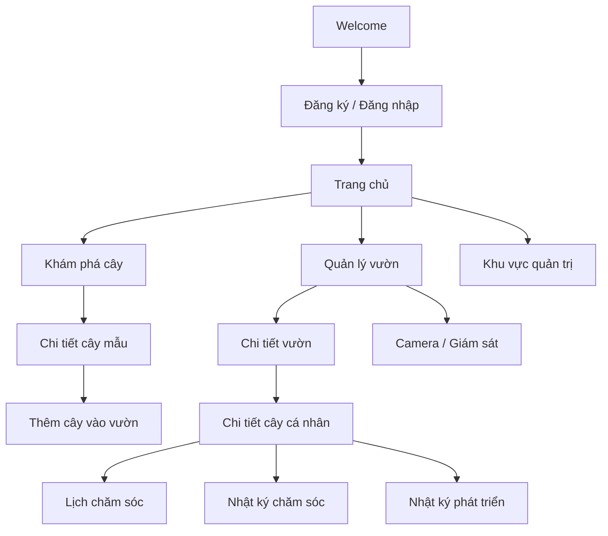
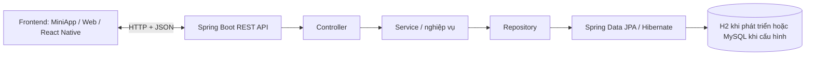

# 🌱 GoPlant — Hệ thống quản lý và chăm sóc cây trồng

GoPlant là dự án hướng đến việc hỗ trợ người dùng quản lý cây trồng và khu vườn trên một nền tảng tập trung. Hệ thống được định hướng theo mô hình **Frontend + Backend REST API + cơ sở dữ liệu**, với giao diện tham khảo được thiết kế trên Figma.

> **Trạng thái phát triển:** Dự án đang được xây dựng. README này phân biệt rõ phần khung source hiện có và phạm vi tính năng dự kiến. Ảnh cây trong bản thiết kế giao diện chỉ là **ảnh minh họa/placeholder**, không phải ảnh sản phẩm thực tế hoặc dữ liệu cây đã được xác thực. Camera trong phạm vi hiện tại phục vụ giám sát và lưu/hiển thị hình ảnh; không có chức năng AI tự nhận diện hoặc chẩn đoán bệnh cây.

## Mục lục

- [1. Mục tiêu dự án](#1-mục-tiêu-dự-án)
- [2. Người dùng và vai trò](#2-người-dùng-và-vai-trò)
- [3. Phạm vi chức năng](#3-phạm-vi-chức-năng)
- [4. Thiết kế giao diện và luồng sử dụng](#4-thiết-kế-giao-diện-và-luồng-sử-dụng)
- [5. Kiến trúc hệ thống](#5-kiến-trúc-hệ-thống)
- [6. Công nghệ và môi trường](#6-công-nghệ-và-môi-trường)
- [7. Cấu trúc repository](#7-cấu-trúc-repository)
- [8. Chạy Backend trên máy cá nhân](#8-chạy-backend-trên-máy-cá-nhân)
- [9. Cấu hình cơ sở dữ liệu](#9-cấu-hình-cơ-sở-dữ-liệu)
- [10. Frontend: cách chuẩn bị và chạy](#10-frontend-cách-chuẩn-bị-và-chạy)
- [11. API và hợp đồng tích hợp dự kiến](#11-api-và-hợp-đồng-tích-hợp-dự-kiến)
- [12. Kiểm thử](#12-kiểm-thử)
- [13. Quy trình đóng góp và Git](#13-quy-trình-đóng-góp-và-git)
- [14. Xử lý lỗi thường gặp](#14-xử-lý-lỗi-thường-gặp)
- [15. Lộ trình phát triển](#15-lộ-trình-phát-triển)
- [16. Nhóm phát triển](#16-nhóm-phát-triển)

---

## 1. Mục tiêu dự án

GoPlant hướng đến việc số hóa các công việc quản lý và chăm sóc cây trồng, hạn chế phụ thuộc vào ghi chép thủ công và giúp người dùng theo dõi dữ liệu theo thời gian.

Các mục tiêu chính:

- Quản lý danh mục cây tham khảo và hồ sơ cây mà người dùng đang sở hữu.
- Tạo và quản lý nhiều khu vườn/khu vực trồng.
- Lập lịch chăm sóc như tưới nước, bón phân, cắt tỉa và thay đất.
- Ghi nhận lịch sử chăm sóc cùng ghi chú và hình ảnh trước/sau khi chăm sóc.
- Theo dõi quá trình phát triển bằng nhật ký, trạng thái và hình ảnh theo từng thời điểm.
- Tìm kiếm, lọc và phân trang dữ liệu cây.
- Cung cấp nền tảng API để Frontend có thể trao đổi dữ liệu với Backend.
- Định hướng phân quyền giữa người dùng và quản trị viên.

## 2. Người dùng và vai trò

### Người dùng — `ROLE_USER`

Người trồng cây hoặc người yêu thích thực vật, có nhu cầu:

- Đăng ký, đăng nhập và quản lý hồ sơ cá nhân.
- Tạo vườn; thêm, xem, sửa và xóa cây thuộc quyền sở hữu.
- Khám phá, tìm kiếm và xem chi tiết thông tin các loại cây.
- Tạo lịch chăm sóc và theo dõi việc sắp đến hạn/quá hạn.
- Ghi nhận hoạt động chăm sóc và theo dõi nhật ký phát triển.
- Xem hình ảnh hoặc thông tin giám sát từ camera khi chức năng này được tích hợp.

### Quản trị viên — `ROLE_ADMIN`

Định hướng chức năng quản trị gồm:

- Quản lý tài khoản người dùng và trạng thái tài khoản.
- Quản lý danh mục cây chuẩn và các danh mục nghiệp vụ.
- Quản lý thông tin khu vực trồng và thiết bị camera.
- Theo dõi log/vận hành hệ thống.

> Các vai trò và nghiệp vụ trên mô tả phạm vi thiết kế. Chúng chỉ được xem là hoạt động thực tế sau khi phần API, bảo mật và giao diện tương ứng đã được triển khai và kiểm thử.

## 3. Phạm vi chức năng

| Phân hệ | Chức năng trong phạm vi thiết kế |
|---|---|
| Tài khoản | Đăng ký, đăng nhập, xem/cập nhật hồ sơ, đăng xuất; xác thực và phân quyền |
| Khám phá cây | Xem danh mục cây; tìm theo từ khóa; lọc theo loại cây, độ khó chăm sóc, nhu cầu ánh sáng/nước và môi trường sống; xem chi tiết |
| Quản lý vườn | Tạo, xem, cập nhật và xóa vườn; lưu tên, loại khu vực, vị trí, diện tích và mô tả |
| Quản lý cây cá nhân | Thêm cây vào vườn; sửa thông tin; theo dõi vị trí, sức khỏe và giai đoạn phát triển; xóa cây khi không còn sở hữu |
| Mã nhận diện cây | Định hướng tạo `plantCode`/QR để mở nhanh hồ sơ cây |
| Lịch chăm sóc | Tạo và chỉnh sửa lịch; thiết lập chu kỳ lặp; theo dõi trạng thái `PENDING`, `COMPLETED`, `OVERDUE`, `SKIPPED` |
| Nhật ký chăm sóc | Ghi nhận tưới nước, bón phân, cắt tỉa, thay đất; lưu thời điểm, ghi chú, người thực hiện và ảnh nếu có |
| Nhật ký phát triển | Ghi nhận tình trạng, chiều cao/số lá hoặc chỉ số phù hợp, giai đoạn phát triển và ảnh theo thời gian |
| Camera | Quản lý thông tin camera và hiển thị luồng/hình ảnh nếu được tích hợp; không thực hiện chẩn đoán bệnh bằng AI |
| Quản trị | Quản lý tài khoản, danh mục cây, loại hoạt động chăm sóc, thiết bị và log hệ thống |

### Phạm vi triển khai hiện tại trên repository

Repo đang có **bộ khung Spring Boot** với lớp khởi động ứng dụng, Maven Wrapper và cấu hình H2. Khi tạo README này, chưa thấy `frontend/package.json`/source Frontend được commit; Backend cũng chưa có các Controller/Service/Repository và endpoint nghiệp vụ hoàn chỉnh. Do đó, có thể chạy và kiểm tra khởi động Backend theo hướng dẫn bên dưới, nhưng **chưa thể xem toàn bộ tính năng trong bảng là đã triển khai hoặc kiểm thử xong**.

## 4. Thiết kế giao diện và luồng sử dụng

Thiết kế tham khảo hướng đến giao diện sáng, nhấn màu xanh lá, các thẻ nội dung và hình ảnh cây. Các màn hình/chức năng đã được mô tả trong tài liệu thiết kế gồm:

1. **Chào mừng (Welcome):** giới thiệu mục đích ứng dụng và điều hướng bắt đầu.
2. **Đăng ký/Đăng nhập:** tạo tài khoản hoặc truy cập tài khoản hiện có.
3. **Trang chủ:** điểm vào các khu vực chính, tóm tắt vườn/cây và các công việc cần chú ý.
4. **Khám phá cây:** tìm kiếm, lọc, xem danh sách và mở trang chi tiết cây.
5. **Quản lý vườn:** tạo vườn, xem danh sách và thông tin chi tiết.
6. **Quản lý cây:** xem cây trong vườn, mở chi tiết, thêm mới hoặc chỉnh sửa.
7. **Lịch chăm sóc:** xem công việc, tạo lịch và theo dõi trạng thái.
8. **Theo dõi/ghi nhận chăm sóc:** đánh dấu hoàn thành và thêm ghi chú hoặc hình ảnh.
9. **Nhật ký phát triển:** lưu và xem lại thay đổi của cây theo thời gian.
10. **Camera/giám sát:** khu vực dành cho ảnh hoặc luồng giám sát khi tính năng được tích hợp.
11. **Khu vực quản trị:** quản lý tài khoản và dữ liệu danh mục theo quyền được cấp.

### Luồng điều hướng khái quát



Đây là luồng tham chiếu để phát triển, không phải bằng chứng rằng toàn bộ màn hình/điều hướng đã có trong source code.

### Lưu ý về hình ảnh trong Figma

- Hình cây, ảnh minh họa hoặc ảnh nền trong mockup chỉ dùng để mô tả bố cục và trải nghiệm dự kiến.
- Khi phát triển dữ liệu thật, ảnh nên lấy từ dữ liệu/API hoặc kho tài nguyên được quản lý riêng; không coi ảnh mockup là dữ liệu cây chuẩn.
- File SVG xuất từ thiết kế có kích thước lớn. Nên lưu file gốc ngoài repository hoặc cung cấp đường dẫn Figma; nếu cần lưu trong repo, nên thêm bản preview đã tối ưu trong `docs/design/` thay vì mặc định commit file export lớn.

## 5. Kiến trúc hệ thống

Kiến trúc mục tiêu của hệ thống:



### Vai trò các lớp Backend

- **Controller:** tiếp nhận HTTP request, kiểm tra dữ liệu đầu vào và trả HTTP response.
- **Service:** chứa quy tắc nghiệp vụ, xử lý lịch chăm sóc và phối hợp các thao tác dữ liệu.
- **Repository:** truy vấn và cập nhật dữ liệu thông qua Spring Data JPA.
- **Entity:** biểu diễn các đối tượng miền nghiệp vụ và ánh xạ cơ sở dữ liệu.
- **DTO:** định nghĩa dữ liệu đầu vào/đầu ra, tách API khỏi cấu trúc entity khi cần.
- **Cấu hình bảo mật:** định hướng sử dụng Spring Security, BCrypt và JWT cho xác thực/phân quyền sau khi được triển khai.
- **Validation và xử lý lỗi:** kiểm tra dữ liệu và trả lỗi có cấu trúc.
- **Logging/AOP:** định hướng ghi nhận hoạt động và thời gian thực thi.

## 6. Công nghệ và môi trường

### Thành phần đã được tìm thấy trong source Backend trên GitHub

| Công nghệ | Vai trò |
|---|---|
| Java 21 | Phiên bản Java mục tiêu được cấu hình trong `backend/pom.xml` |
| Spring Boot 4.1.1 | Khung ứng dụng Backend trong `backend/pom.xml` hiện tại |
| Maven Wrapper | Build/chạy ứng dụng bằng `mvnw` hoặc `mvnw.cmd`, không bắt buộc cài Maven toàn hệ thống |
| Spring Web MVC | Nền tảng web/API |
| Spring Data JPA | Tích hợp truy cập dữ liệu |
| Spring Security | Thư viện bảo mật hiện có trong dependency; cấu hình nghiệp vụ riêng vẫn cần triển khai |
| Spring Validation | Thư viện kiểm tra dữ liệu đầu vào |
| H2 Database | CSDL phát triển dạng in-memory đang được cấu hình trong `application.properties` |
| MySQL Connector/J | Driver đã có trong dependency để chuẩn bị kết nối MySQL |

### Công nghệ định hướng cho toàn hệ thống

- **Frontend:** React Native/JavaScript/JSX theo định hướng trong tài liệu; cần xác nhận runtime và script theo `frontend/package.json` khi source Frontend được thêm.
- **Trao đổi dữ liệu:** REST API, HTTP và JSON.
- **CSDL mục tiêu:** MySQL cho dữ liệu bền vững; H2 hiện dùng để khởi động nhanh trong môi trường phát triển.
- **Kiểm thử API:** Postman hoặc công cụ HTTP tương đương.
- **Quản lý mã nguồn:** Git và GitHub.
- **Tự động kiểm tra:** có thể bổ sung GitHub Actions cho build/test khi workflow được cấu hình.

## 7. Cấu trúc repository

### Cấu trúc hiện đang có trên GitHub

```text
GoPlant/
├── .gitignore
└── backend/
    ├── .gitignore
    ├── .gitattributes
    ├── .mvn/
    │   └── wrapper/
    ├── mvnw
    ├── mvnw.cmd
    ├── pom.xml
    └── src/
        ├── main/
        │   ├── java/
        │   │   └── com/cmc/plant_care_backend/
        │   │       └── PlantCareBackendApplication.java
        │   └── resources/
        │       └── application.properties
        └── test/
            └── java/
```

### Cấu trúc mục tiêu khi Frontend và các phân hệ được bổ sung

```text
GoPlant/
├── README.md
├── .gitignore
├── frontend/                       # Source MiniApp/Web (đang cần bổ sung)
│   ├── package.json
│   ├── src/
│   │   ├── components/              # Thành phần giao diện tái sử dụng
│   │   ├── screens/                 # Welcome, Auth, Home, Garden, Plant...
│   │   ├── navigation/              # Stack/Tab và luồng màn hình
│   │   ├── services/                # Gọi REST API
│   │   └── storage/                 # Cấu hình lưu cục bộ nếu cần
│   └── assets/                      # Icon và tài nguyên đã chọn sử dụng
├── backend/
│   ├── pom.xml
│   ├── mvnw
│   ├── mvnw.cmd
│   └── src/
│       ├── main/java/com/cmc/plant_care_backend/
│       │   ├── controller/
│       │   ├── service/
│       │   ├── repository/
│       │   ├── entity/
│       │   ├── dto/
│       │   ├── config/
│       │   └── exception/
│       ├── main/resources/
│       │   └── application.properties
│       └── test/java/
└── docs/
    ├── design/                      # Preview/đường dẫn thiết kế Figma
    └── api/                         # Tài liệu API, ví dụ request/response
```

Cấu trúc mục tiêu là gợi ý tổ chức khi code phát triển; các package chưa tồn tại trong repo hiện tại không nên hiểu là đã được cài đặt.

## 8. Chạy Backend trên máy cá nhân

### 8.1. Yêu cầu

- Git.
- JDK 21 đã cài và cấu hình trong `PATH`/`JAVA_HOME`.
- Kết nối Internet lần đầu để Maven Wrapper tải Maven và các thư viện phụ thuộc.
- Windows PowerShell cho các lệnh Windows bên dưới. macOS/Linux dùng `./mvnw`.

Kiểm tra Java trước:

```powershell
java -version
javac -version
```

Cả hai nên hiển thị phiên bản 21.

### 8.2. Clone repository

Mở PowerShell/Terminal tại thư mục muốn lưu source:

```powershell
git clone https://github.com/vuduc6002/GoPlant.git
cd GoPlant\backend
```

### 8.3. Kiểm tra Maven Wrapper và build

```powershell
.\mvnw.cmd -v
.\mvnw.cmd clean verify
```

Nếu lệnh `clean verify` hoàn tất với `BUILD SUCCESS`, bước build đã thành công.

### 8.4. Khởi động Backend

```powershell
.\mvnw.cmd spring-boot:run
```

Khi log có dòng tương tự `Started PlantCareBackendApplication`, ứng dụng đã khởi động. Mặc định Spring Boot sử dụng cổng `8080`, vì vậy địa chỉ gốc là:

- `http://localhost:8080`

> **Giới hạn hiện tại:** source được kiểm tra mới có lớp khởi động, chưa có endpoint nghiệp vụ/health endpoint được xác nhận. Vì thế, truy cập địa chỉ gốc có thể trả về 404 hoặc màn hình đăng nhập mặc định do dependency Spring Security; điều đó không tự động có nghĩa là tiến trình Spring Boot không chạy. Không gọi các API trong phần thiết kế như thể chúng đã hoạt động nếu chưa có Controller tương ứng.

### 8.5. Dừng ứng dụng

Trong Terminal đang chạy ứng dụng, nhấn `Ctrl + C`.

### 8.6. Chạy trên macOS/Linux

Từ thư mục `GoPlant/backend`:

```bash
./mvnw -v
./mvnw clean verify
./mvnw spring-boot:run
```

Nếu quyền thực thi chưa được cấp, chạy `chmod +x mvnw` một lần rồi thử lại.

## 9. Cấu hình cơ sở dữ liệu

### 9.1. Cấu hình phát triển mặc định hiện tại: H2

File: `backend/src/main/resources/application.properties`

Cấu hình hiện tại sử dụng H2 in-memory:

```properties
spring.application.name=plant-care-backend
spring.datasource.url=jdbc:h2:mem:plantcaredb
spring.datasource.driver-class-name=org.h2.Driver
spring.datasource.username=sa
spring.datasource.password=
spring.jpa.hibernate.ddl-auto=update
spring.jpa.show-sql=true
spring.h2.console.enabled=true
spring.h2.console.path=/h2-console
```

- Database URL: `jdbc:h2:mem:plantcaredb`
- Username: `sa`
- Password: để trống.
- H2 in-memory chỉ giữ dữ liệu trong phiên chạy ứng dụng; dữ liệu thường mất khi ứng dụng dừng.
- H2 Console được bật theo cấu hình tại `http://localhost:8080/h2-console`. Tùy cấu hình Spring Security đang được áp dụng, console có thể cần cấu hình bảo mật phát triển riêng để truy cập được.

### 9.2. Chuyển sang MySQL

MySQL Connector/J đã có trong `pom.xml`, nhưng cấu hình được commit hiện tại vẫn dùng H2. Khi cần dùng MySQL:

1. Cài và khởi động MySQL Server.
2. Tạo database, ví dụ:

   ```sql
   CREATE DATABASE plant_care_db
     CHARACTER SET utf8mb4
     COLLATE utf8mb4_unicode_ci;
   ```

3. Thay cấu hình datasource trong `backend/src/main/resources/application.properties` bằng cấu hình MySQL, ví dụ:

   ```properties
   spring.datasource.url=jdbc:mysql://localhost:3306/plant_care_db?serverTimezone=Asia/Ho_Chi_Minh
   spring.datasource.username=${DB_USERNAME:root}
   spring.datasource.password=${DB_PASSWORD}
   spring.datasource.driver-class-name=com.mysql.cj.jdbc.Driver
   spring.jpa.hibernate.ddl-auto=update
   spring.jpa.show-sql=true
   ```

4. Đặt biến môi trường cho tài khoản MySQL trước khi khởi động ứng dụng, ví dụ PowerShell:

   ```powershell
   $env:DB_USERNAME = "root"
   $env:DB_PASSWORD = "mat_khau_mysql_cua_ban"
   .\mvnw.cmd spring-boot:run
   ```

Không commit mật khẩu thật lên GitHub. Trong dự án dùng chung, nên quản lý cấu hình cá nhân bằng biến môi trường hoặc file cấu hình local được `.gitignore` loại trừ. Khi chuyển datasource, kiểm tra xem các thư viện H2/MySQL và `application.properties` có khớp nhau hay không.

## 10. Frontend: cách chuẩn bị và chạy

Thiết kế giao diện đã định hướng các màn hình và luồng sử dụng trong [Mục 4](#4-thiết-kế-giao-diện-và-luồng-sử-dụng). Tuy nhiên, tại thời điểm README này được tạo, repository chưa có `frontend/package.json` và source Frontend nên chưa có lệnh chạy giao diện có thể xác nhận từ repo.

Khi source Frontend đã được commit:

1. Mở Terminal tại thư mục gốc `GoPlant`.
2. Chuyển vào `frontend`:

   ```powershell
   cd frontend
   ```

3. Cài dependencies theo lockfile của dự án:

   ```powershell
   npm ci
   ```

   Nếu repo chưa có `package-lock.json`, dùng `npm install` trong lần cài đầu để tạo lockfile rồi commit lockfile.

4. Xem các script thực tế trong `package.json`. Chạy script đã khai báo, ví dụ `npm run start`. Nếu ứng dụng được khởi tạo bằng Expo, có thể dùng `npx expo start`; chỉ dùng lệnh phù hợp với framework thực tế của source.
5. Với Android emulator/thiết bị thật, bảo đảm môi trường React Native tương ứng đã được thiết lập.

### Kết nối Frontend tới Backend

- Backend chạy trên máy phát triển: `http://localhost:8080`.
- Với Android emulator, `localhost` bên trong emulator không phải máy tính host; cần dùng địa chỉ host phù hợp emulator (thường là `10.0.2.2` cho Android Studio Emulator) hoặc IP LAN của máy.
- Với điện thoại thật, máy tính và điện thoại cần cùng mạng LAN và Backend phải lắng nghe trên địa chỉ có thể truy cập từ thiết bị.
- Nên cấu hình API base URL qua file cấu hình môi trường của Frontend thay vì rải URL trực tiếp trong các màn hình.
- Các request sẽ gửi/nhận JSON khi API tương ứng được triển khai; cần xử lý trạng thái loading, success, empty và error ở giao diện.

## 11. API và hợp đồng tích hợp dự kiến

Các đường dẫn dưới đây xuất phát từ luồng nghiệp vụ và thiết kế API trong tài liệu. **Đây là API contract dự kiến, không phải cam kết rằng endpoint đã có trong source hiện tại.** Endpoint chỉ dùng được sau khi Controller, Service và cơ chế bảo mật tương ứng được cài đặt.

| Phân hệ | Endpoint tham chiếu | Ý nghĩa |
|---|---|---|
| Auth | `POST /api/v1/auth/register` | Đăng ký tài khoản |
| Auth | `POST /api/v1/auth/login` | Đăng nhập và dự kiến cấp access token |
| Tài khoản | `GET /api/v1/users/me` | Lấy hồ sơ người dùng hiện tại sau xác thực |
| Danh mục cây | `GET /api/v1/species` | Danh sách cây, tìm kiếm/lọc/phân trang |
| Danh mục cây | `GET /api/v1/species/{id}` | Chi tiết một loại cây |
| Vườn | `/api/v1/gardens` | Nhóm API quản lý vườn |
| Cây cá nhân | Chưa chốt trong source | API quản lý cây thuộc vườn/người dùng |
| Lịch chăm sóc | Chưa chốt trong source | API tạo lịch, chu kỳ và trạng thái công việc |
| Nhật ký chăm sóc/phát triển | Chưa chốt trong source | API ghi nhận và truy xuất lịch sử |
| Camera | Chưa chốt trong source | API quản lý thiết bị và metadata ảnh/luồng giám sát |

### Quy ước API nên thống nhất khi triển khai

- Request/Response dùng JSON và mã HTTP có ý nghĩa.
- Dữ liệu đầu vào cần được validate; phản hồi lỗi nên có cấu trúc thống nhất.
- Các danh sách lớn nên hỗ trợ phân trang và sắp xếp.
- API yêu cầu xác thực cần gửi `Authorization: Bearer <token>` sau khi JWT được triển khai.
- Người dùng chỉ được đọc/thay đổi dữ liệu thuộc quyền sở hữu; endpoint quản trị yêu cầu vai trò tương ứng.
- Không lưu password dạng văn bản thuần; khi triển khai xác thực, dùng BCrypt hoặc cơ chế băm mật khẩu phù hợp của Spring Security.

## 12. Kiểm thử

### Build/test Backend

Từ thư mục `GoPlant/backend`:

```powershell
.\mvnw.cmd clean verify
```

Hoặc chỉ chạy unit test:

```powershell
.\mvnw.cmd test
```

Lệnh build kiểm tra biên dịch và chạy các test hiện có. Khi chưa có test nghiệp vụ, `BUILD SUCCESS` chỉ xác nhận build thành công, không chứng minh mọi chức năng quản lý cây đã hoạt động.

### Kiểm thử API khi endpoint đã được triển khai

Dùng Postman hoặc công cụ HTTP tương đương để kiểm tra:

- Đường đi thành công và các mã HTTP.
- Dữ liệu thiếu/sai định dạng.
- Dữ liệu không tồn tại.
- Tìm kiếm, lọc và phân trang.
- Xác thực token, vai trò và quyền sở hữu dữ liệu.
- Các trường hợp lịch chăm sóc đến hạn/quá hạn và cập nhật nhật ký.

### Kiểm thử giao diện khi Frontend đã được bổ sung

Kiểm tra các luồng chính: đăng nhập → trang chủ → khám phá cây → xem chi tiết → thêm vào vườn; và quản lý vườn → cây → lịch chăm sóc → ghi nhận chăm sóc → xem nhật ký phát triển. Cần kiểm tra cả trạng thái loading, empty, lỗi mạng và dữ liệu không hợp lệ.

## 13. Quy trình đóng góp và Git

Nên làm việc theo nhánh tính năng để tránh ghi đè code của thành viên khác:

```bash
git switch -c feature/ten-chuc-nang
# chỉnh sửa và kiểm thử code

git status
git add .
git commit -m "feat: mô tả thay đổi"
git push -u origin feature/ten-chuc-nang
```

Sau đó tạo Pull Request để nhóm rà soát trước khi gộp vào `main`.

Trước khi commit:

- Kiểm tra `git status` để không đưa `target/`, `node_modules/`, log hoặc file build lên GitHub.
- Không commit `.env`, mật khẩu database, JWT secret, token hoặc dữ liệu cá nhân thật.
- Giữ `backend/mvnw`, `backend/mvnw.cmd`, `backend/.mvn/` và `backend/pom.xml` để người khác có thể build bằng Maven Wrapper.
- Không sao chép thư mục `.git` của repo Frontend/Backend cũ vào repo GoPlant; repo này nên có một `.git` ở thư mục gốc.
- Thống nhất tên branch, format code, API contract và kiểu dữ liệu với cả nhóm.

## 14. Xử lý lỗi thường gặp

### `release version 25 not supported`

Project đang đặt Java target cao hơn JDK được Maven sử dụng. Kiểm tra:

```powershell
java -version
cd backend
.\mvnw.cmd -v
```

Nếu dự án dùng Java 21, đặt `<java.version>21</java.version>` trong `pom.xml` và bảo đảm Maven thực sự chạy bằng JDK 21. Kiểm tra cả cấu hình `maven.compiler.release` nếu có.

### `mvnw.cmd is not recognized`

Chạy lệnh trong đúng thư mục `GoPlant/backend`, nơi có `mvnw.cmd`:

```powershell
cd E:\GoPlant\backend
.\mvnw.cmd -v
```

### `Failed to configure a DataSource`

Kiểm tra `backend/src/main/resources/application.properties`, dependency driver và URL database. Cấu hình mặc định hiện tại phải có H2 dependency và `jdbc:h2:mem:plantcaredb`; nếu chuyển sang MySQL thì phải có URL MySQL, driver, server đang chạy và thông tin đăng nhập hợp lệ.

### Port `8080` đã được sử dụng

Đóng tiến trình đang chiếm cổng hoặc đổi cổng phát triển bằng cách thêm vào `application.properties`:

```properties
server.port=8081
```

Sau đó truy cập `http://localhost:8081`.

### Ứng dụng chạy nhưng endpoint trả về `404` hoặc trang đăng nhập

Source hiện tại chưa có các API nghiệp vụ được xác nhận và dependency Spring Security có thể áp dụng bảo vệ mặc định. Kiểm tra log khởi động trước; sau đó triển khai Controller và SecurityConfig phù hợp thay vì giả định endpoint đã tồn tại.

### Frontend không tìm thấy `package.json`

Frontend source chưa được commit vào repository hoặc đang mở sai thư mục. Kiểm tra `GoPlant/frontend/package.json`; nếu file chưa có, cần thêm project Frontend trước khi chạy lệnh npm.

## 15. Lộ trình phát triển

- [ ] Hoàn thiện source Frontend dựa trên các màn hình và luồng thiết kế.
- [ ] Chốt mô hình dữ liệu, quan hệ Entity và ERD.
- [ ] Triển khai CRUD cho vườn, cây cá nhân và danh mục cây.
- [ ] Triển khai tìm kiếm, lọc, sắp xếp và phân trang.
- [ ] Triển khai đăng ký/đăng nhập, BCrypt, JWT, phân quyền User/Admin và kiểm soát quyền sở hữu dữ liệu.
- [ ] Triển khai lịch chăm sóc lặp, trạng thái công việc, nhật ký chăm sóc và nhật ký phát triển.
- [ ] Chuẩn hóa response/error, Bean Validation và logging/AOP.
- [ ] Hoàn thiện API contract/OpenAPI và bộ test nghiệp vụ.
- [ ] Kết nối Frontend với Backend và kiểm tra các luồng đầu-cuối.
- [ ] Tích hợp camera ở phạm vi giám sát/hình ảnh nếu đáp ứng được môi trường thử nghiệm; không đưa AI chẩn đoán bệnh vào phạm vi mặc định.
- [ ] Thêm GitHub Actions cho build/test và hướng dẫn triển khai.

## 16. Nhóm phát triển

- Vũ Tuấn Đạt
- Vũ Minh Đức
- Hoàng Phúc Vinh
- Nguyễn Ngọc Tuấn Linh

---

**Repository:** https://github.com/vuduc6002/GoPlant

**Lưu ý về trạng thái:** README sẽ cần được cập nhật cùng source code. Khi một chức năng hoàn tất, hãy bổ sung endpoint thực tế, hướng dẫn cấu hình, test case và bằng chứng chạy thử; chỉ đánh dấu hoàn thành sau khi đã kiểm tra trên mã nguồn.
