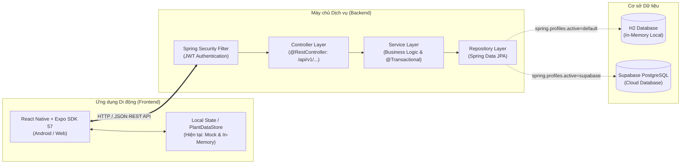

# 🌱 GoPlant — Hệ thống Quản lý và Chăm sóc Cây trồng

GoPlant là giải pháp ứng dụng di động hỗ trợ người dùng số hóa quy trình quản lý, theo dõi quá trình sinh trưởng và lập lịch chăm sóc cây trồng trên một nền tảng tập trung.

Kiến trúc mục tiêu của dự án là **Ứng dụng di động React Native + Expo (Android) kết nối qua RESTful API với Backend Spring Boot và cơ sở dữ liệu Supabase PostgreSQL**.

> **Trạng thái phát triển hiện tại (Giai đoạn 2):**
> - **Frontend:** Đã tích hợp hoàn chỉnh mã nguồn giao diện trong thư mục `frontend/` sử dụng **React Native (v0.86.3) + Expo SDK 57 (Managed Workflow) + Expo Router**. Toàn bộ 11 phân hệ màn hình và điều hướng đã sẵn sàng. Dữ liệu tài khoản hiện dùng mock (`mockAuth.ts`) và dữ liệu cây/vườn được quản lý in-memory (`PlantDataStore.tsx`).
> - **Backend:** Khung ứng dụng Java 21 + Spring Boot 4.1.1 nằm trong `backend/` đang chạy với cấu hình H2 in-memory cục bộ; đã chuẩn bị sẵn profile kết nối Supabase PostgreSQL qua biến môi trường. Các Entity, Repository, Service và Controller REST API nghiệp vụ sẽ được xây dựng ở các giai đoạn tiếp theo.
> - **Camera & AI:** Camera trong thiết kế phục vụ chụp ảnh nhật ký và giám sát; dự án **không** triển khai AI tự chẩn đoán bệnh cây.

---

## Mục lục

- [1. Mục tiêu dự án](#1-mục-tiêu-dự-án)
- [2. Chức năng chính và trạng thái phát triển](#2-chức-năng-chính-và-trạng-thái-phát-triển)
- [3. Công nghệ sử dụng](#3-công-nghệ-sử-dụng)
- [4. Kiến trúc tổng thể hệ thống](#4-kiến-trúc-tổng-thể-hệ-thống)
- [5. Cấu trúc repository hiện tại](#5-cấu-trúc-repository-hiện-tại)
- [6. Yêu cầu môi trường phát triển (Windows 10/11 & VS Code)](#6-yêu-cầu-môi-trường-phát-triển-windows-1011--vs-code)
- [7. Cài đặt và chạy Backend](#7-cài-đặt-và-chạy-backend)
- [8. Cấu hình cơ sở dữ liệu H2 local](#8-cấu-hình-cơ-sở-dữ-liệu-h2-local)
- [9. Cấu hình cơ sở dữ liệu Supabase PostgreSQL](#9-cấu-hình-cơ-sở-dữ-liệu-supabase-postgresql)
- [10. Cài đặt và chạy Frontend Expo](#10-cài-đặt-và-chạy-frontend-expo)
- [11. Thiết lập Android Studio, Android SDK và Android Emulator](#11-thiết-lập-android-studio-android-sdk-và-android-emulator)
- [12. Kiểm thử Frontend và Backend](#12-kiểm-thử-frontend-và-backend)
- [13. GitHub Actions và Continuous Integration (CI)](#13-github-actions-và-continuous-integration-ci)
- [14. Hướng dẫn xử lý lỗi thường gặp](#14-hướng-dẫn-xử-lý-lỗi-thường-gặp)
- [15. Lộ trình phát triển và các chức năng kế tiếp](#15-lộ-trình-phát-triển-và-các-chức-năng-kế-tiếp)
- [16. Nhóm phát triển](#16-nhóm-phát-triển)

---

## 1. Mục tiêu dự án

GoPlant hướng đến việc thay thế sổ tay và ghi nhớ thủ công bằng một ứng dụng di động trực quan, giúp người làm vườn đô thị, văn phòng hoặc người yêu cây:

- Quản lý danh mục cây trồng tham khảo và hồ sơ từng cây cá nhân đang sở hữu.
- Tạo và phân loại nhiều khu vườn/khu vực trồng (ban công, sân thượng, trong nhà).
- Thiết lập lịch chăm sóc định kỳ (tưới nước, bón phân, cắt tỉa, thay đất) với chu kỳ nhắc nhở.
- Ghi nhận nhật ký phát triển, theo dõi sức khỏe, hình thái lá/thân và hình ảnh theo thời gian.
- Cung cấp nền tảng REST API bảo mật, hỗ trợ phân quyền người dùng (`ROLE_USER`) và quản trị (`ROLE_ADMIN`).

---

## 2. Chức năng chính và trạng thái phát triển

Bảng ma trận đối soát hiện trạng triển khai giữa Frontend, Backend và Database:

| Phân hệ nghiệp vụ | Chức năng trong thiết kế | Trạng thái Frontend | Trạng thái Backend & Database |
|:---|:---|:---:|:---:|
| **Chào mừng (Welcome)** | Giới thiệu app, điều hướng bắt đầu | Đã hoàn thành UI (`WelcomeScreen.tsx`) | Không yêu cầu API |
| **Xác thực tài khoản** | Đăng ký, đăng nhập | Đã có UI (`AuthScreens.tsx`); dùng Mock Auth (`mockAuth.ts`) | Chưa có API; chưa triển khai JWT / BCrypt |
| **Trang chủ (Dashboard)** | Xem tổng quan vườn, việc cần làm, thời tiết | Đã có UI (`HomeScreen.tsx`); dữ liệu mô phỏng | Chưa có API tổng hợp |
| **Khám phá cây** | Danh mục loài cây, tìm kiếm, lọc đa tiêu chí | Đã có UI (`SearchScreens.tsx`); danh mục mẫu tĩnh | Chưa có API (`/api/v1/species`) |
| **Chi tiết loài cây** | Thông tin sinh học, đặc điểm, nhu cầu chăm sóc | Đã có UI (`PlantDetailScreen.tsx`) | Chưa có API |
| **Quản lý khu vườn** | Tạo mới, xem chi tiết, sửa, xóa khu vườn | Đã có UI (`GardenScreens.tsx`); lưu tạm trong state | Chưa có API (`/api/v1/gardens`) |
| **Quản lý cây sở hữu** | Thêm cây vào vườn, sửa vị trí, ghi chú, xóa | Đã có UI; lưu trong React Context (`PlantDataStore.tsx`) | Chưa có API (`/api/v1/plants`) |
| **Lập lịch chăm sóc** | Tạo lịch tưới/bón/tỉa, chu kỳ lặp, xem lịch | Đã có UI (`ScheduleScreens.tsx`); giao diện mẫu | Chưa có API (`/api/v1/schedules`) |
| **Nhật ký chăm sóc** | Đánh dấu hoàn thành việc, lưu lịch sử chăm sóc | Đã có UI (`JournalScreens.tsx`); giao diện mẫu | Chưa có API (`/api/v1/care-logs`) |
| **Nhật ký phát triển** | Ghi nhận tiến trình lớn lên, tình trạng sức khỏe | Đã có UI (`JournalDetailScreen.tsx`); giao diện mẫu | Chưa có API (`/api/v1/journals`) |
| **Chỉ số sinh trưởng** | Biểu đồ môi trường, độ ẩm đất, nhiệt độ | Đã có UI (`MonitoringDetailScreen.tsx`); chỉ số mô phỏng | Chưa có API |
| **Mã định danh (QR)** | Sinh mã `plantCode` mở nhanh hồ sơ cây | Đang trong kế hoạch mở rộng (Backlog) | Chưa có API |
| **Camera giám sát** | Xem ảnh chụp thực tế vị trí trồng cây | Nút bấm placeholder UI; chưa kích hoạt camera | Chưa có API |

---

## 3. Công nghệ sử dụng

### 3.1. Phía Frontend Di động (`frontend/`)

- **Nền tảng:** React Native `0.86.3` kết hợp **Expo SDK `57.0.31`** (Managed Workflow).
- **Điều hướng:** Expo Router `~57.0.29` (File-based Routing trong `src/app/`).
- **Ngôn ngữ:** TypeScript `~6.0.3`, React `19.2.3`.
- **Giao diện & Đồ họa:** Vector Icons qua `react-native-svg` (`15.15.4`) và `react-native-svg-transformer`, Animations qua `react-native-reanimated` (`4.5.1`).
- **Font chữ:** `@expo-google-fonts/plus-jakarta-sans`.
- **Quản lý gói:** npm (sử dụng `frontend/package-lock.json`).

### 3.2. Phía Backend Dịch vụ (`backend/`)

- **Ngôn ngữ & Nền tảng:** Java 21, Spring Boot `4.1.1`.
- **Công cụ build:** Maven Wrapper (`mvnw`, `mvnw.cmd`).
- **Mô đun Spring:** Spring Web MVC, Spring Data JPA, Spring Security, Spring Validation.
- **Cơ sở dữ liệu hỗ trợ:**
  - H2 Database Engine (chạy in-memory kiểm thử nhanh nội bộ).
  - PostgreSQL JDBC Driver (kết nối Supabase PostgreSQL).

---

## 4. Kiến trúc tổng thể hệ thống



**Quy tắc tích hợp bắt buộc:**
1. Ứng dụng di động **chỉ trao đổi với Backend qua giao thức REST API JSON**; tuyệt đối không kết nối trực tiếp hoặc chứa thông tin đăng nhập PostgreSQL/Supabase bên trong code di động.
2. Backend là nơi tập trung xác thực, phân quyền người dùng, thực thi quy tắc toàn vẹn dữ liệu và điều phối truy vấn cơ sở dữ liệu.

---

## 5. Cấu trúc repository hiện tại

```text
E:\GoPlant/
├── .github/
│   └── workflows/
│       ├── maven.yml               # CI build & test Backend Spring Boot (Java 21)
│       └── frontend.yml            # CI kiểm tra TypeScript, Expo config & dependencies (Node 22)
├── backend/                        # Nguồn Backend Spring Boot
│   ├── .mvn/wrapper/
│   ├── src/
│   │   ├── main/
│   │   │   ├── java/com/cmc/plant_care_backend/
│   │   │   │   └── PlantCareBackendApplication.java
│   │   │   └── resources/
│   │   │       ├── application.properties           # Cấu hình mặc định H2 in-memory
│   │   │       └── application-supabase.properties  # Cấu hình PostgreSQL Supabase qua biến môi trường
│   │   └── test/
│   │       └── java/com/cmc/plant_care_backend/
│   │           └── PlantCareBackendApplicationTests.java
│   ├── mvnw
│   ├── mvnw.cmd
│   └── pom.xml
├── frontend/                       # Ứng dụng Di động React Native + Expo SDK 57
│   ├── assets/                     # Icons, hình ảnh minh họa, logo, vector SVG
│   ├── design-reference/           # Ảnh chụp màn hình mẫu tham chiếu thiết kế
│   ├── scripts/                    # Scripts tiện ích
│   ├── src/
│   │   ├── app/                    # Định tuyến file-based của Expo Router
│   │   │   ├── _layout.tsx         # Root layout nạp fonts, theme và DataProvider
│   │   │   ├── index.tsx           # Điểm vào ứng dụng (dẫn đến WelcomeScreen)
│   │   │   ├── home.tsx            # Trang chủ Dashboard
│   │   │   ├── explore.tsx         # Khám phá loài cây
│   │   │   ├── filter.tsx          # Bộ lọc tìm kiếm
│   │   │   ├── gardens.tsx         # Quản lý vườn
│   │   │   ├── plants.tsx          # Danh sách cây cá nhân
│   │   │   ├── auth/               # Tuyến đường đăng nhập / đăng ký
│   │   │   ├── garden/             # Tuyến đường thêm vườn, thêm cây vào vườn
│   │   │   ├── journal/            # Tuyến đường ghi chép nhật ký
│   │   │   ├── monitoring/         # Tuyến đường theo dõi chỉ số
│   │   │   └── schedule/           # Tuyến đường lịch chăm sóc
│   │   ├── components/             # Components UI tái sử dụng
│   │   ├── constants/              # Bảng màu, typography, kích thước theme
│   │   ├── features/               # Code màn hình nghiệp vụ (Auth, Home, Garden, Plant...)
│   │   ├── hooks/                  # Custom hooks (color scheme, theme)
│   │   ├── services/               # Mock authentication service
│   │   └── types/                  # Ambient declarations (css.d.ts, svg.d.ts)
│   ├── app.json                    # Cấu hình Expo application
│   ├── metro.config.js             # Cấu hình Metro bundler (hỗ trợ SVG Transformer)
│   ├── package.json                # Dependencies Expo SDK 57 và npm scripts
│   ├── package-lock.json           # Khóa phiên bản dependencies
│   └── tsconfig.json               # Cấu hình TypeScript và path alias (@/*)
├── docs/
│   └── GEMINI_MASTER_PROMPT.md     # Chỉ thị gốc về quy chuẩn kiến trúc và lộ trình
├── .gitignore                      # Loại trừ node_modules, target, .expo, secrets
└── README.md                       # Tài liệu hướng dẫn dự án chuẩn hóa
```

---

## 6. Yêu cầu môi trường phát triển (Windows 10/11 & VS Code)

Để cài đặt và chạy dự án trơn tru trên Windows, hãy chuẩn bị các công cụ sau:

1. **Git:** Phiên bản `>= 2.40`.
2. **Java Development Kit (JDK):** **JDK 21** (khuyến nghị [Eclipse Temurin 21](https://adoptium.net/temurin/releases/?version=21)). Đảm bảo biến môi trường `JAVA_HOME` trỏ tới thư mục JDK 21.
3. **Node.js:** Phiên bản `>= 22.13.0` (phù hợp với baseline của Expo SDK 57; máy phát triển local có thể dùng Node 22.x - 26.x).
4. **Trình biên tập:** [Visual Studio Code](https://code.visualstudio.com/) với các Extension hữu ích:
   - *Extension Pack for Java* (Microsoft)
   - *Spring Boot Extension Pack* (VMware)
   - *Expo Tools* (by Expo)
   - *ESLint* / *Prettier*
5. **Android Studio:** Bản mới nhất để quản lý Android SDK và Android Emulator.

### Lệnh kiểm tra môi trường trên PowerShell

Mở PowerShell và kiểm tra các công cụ:

```powershell
java -version
node --version
npm.cmd --version
```

> **Lưu ý đặc biệt cho Windows PowerShell:**
> Trên Windows, PowerShell có thể chặn việc thực thi các file script `.ps1` chưa được ký số (`PSSecurityException`). Để đảm bảo an toàn tuyệt đối và **không cần hạ thấp Execution Policy hệ thống**, hãy luôn sử dụng lệnh với đuôi `.cmd`:
> - Sử dụng `npm.cmd` thay vì `npm`
> - Sử dụng `npx.cmd` thay vì `npx`
> - Sử dụng `.\mvnw.cmd` thay vì `mvnw`

---

## 7. Cài đặt và chạy Backend

Mã nguồn Backend nằm tại thư mục `backend/`. Dự án đã tích hợp sẵn Maven Wrapper nên không bắt buộc phải cài Maven toàn cục.

### 7.1. Di chuyển vào thư mục Backend

```powershell
cd E:\GoPlant\backend
```

### 7.2. Kiểm tra Maven Wrapper và biên dịch thử

```powershell
.\mvnw.cmd -v
.\mvnw.cmd test
```

Nếu lệnh báo `BUILD SUCCESS`, môi trường Java 21 đã sẵn sàng.

### 7.3. Khởi động Backend

```powershell
.\mvnw.cmd spring-boot:run
```

Khi Terminal xuất hiện dòng thông báo tương tự:
```text
Started PlantCareBackendApplication in ... seconds
```
Backend đã khởi động thành công trên cổng mặc định `8080` (`http://localhost:8080`).

> **Lưu ý về trạng thái Backend:**
> Hiện tại Backend đang ở giai đoạn bộ khung ứng dụng. Khi truy cập vào `http://localhost:8080` qua trình duyệt, bạn có thể nhận phản hồi `404 Not Found` hoặc màn hình đăng nhập mặc định do Spring Security tự sinh. Điều này là hoàn toàn bình thường vì các Controller nghiệp vụ chưa được cài đặt.

Để dừng Backend: Nhấn tổ hợp phím `Ctrl + C` trong cửa sổ Terminal.

---

## 8. Cấu hình cơ sở dữ liệu H2 local

Khi khởi động Backend bình thường (không kích hoạt profile), ứng dụng sẽ tự động sử dụng cấu hình H2 in-memory từ file [application.properties](file:///E:/GoPlant/backend/src/main/resources/application.properties):

- **JDBC URL:** `jdbc:h2:mem:plantcaredb`
- **Username:** `sa`
- **Password:** *(để trống)*
- **H2 Console:** Bật tại `http://localhost:8080/h2-console`

**Đặc điểm:** Thích hợp để lập trình viên kiểm tra nhanh logic mà không cần kết nối mạng. Toàn bộ dữ liệu trong bộ nhớ sẽ được reset lại trạng thái ban đầu khi dừng tiến trình Spring Boot.

---

## 9. Cấu hình cơ sở dữ liệu Supabase PostgreSQL

Để dữ liệu được đồng bộ dùng chung giữa các thành viên, Backend hỗ trợ profile `supabase` qua file [application-supabase.properties](file:///E:/GoPlant/backend/src/main/resources/application-supabase.properties).

### 9.1. Lấy thông tin kết nối từ Supabase

1. Đăng nhập vào [Supabase Dashboard](https://supabase.com/dashboard) và tạo project.
2. Vào mục **Project Settings → Database** hoặc nút **Connect** ở thanh công cụ trên cùng.
3. Chọn thẻ **Session pooler** (cổng `5432` hoặc `6543`, phù hợp với mạng IPv4).
4. Sao chép Host, Port, Database name, Username (thường có dạng `postgres.<project-ref>`) và Password.

### 9.2. Kích hoạt profile và khởi động bằng PowerShell

Truyền các thông số dưới dạng biến môi trường tạm thời trong phiên làm việc PowerShell (thay thế các placeholder `<...>` bằng giá trị thực tế):

```powershell
cd E:\GoPlant\backend

$env:SUPABASE_DB_URL = "jdbc:postgresql://<POOLER_HOST>:5432/postgres?sslmode=require"
$env:SUPABASE_DB_USERNAME = "postgres.<PROJECT_REF>"
$env:SUPABASE_DB_PASSWORD = "<DATABASE_PASSWORD>"
$env:SPRING_PROFILES_ACTIVE = "supabase"

.\mvnw.cmd spring-boot:run
```

**Nguyên tắc an toàn bảo mật:**
- Tuyệt đối **không** dán password database trực tiếp vào file cấu hình `application-supabase.properties` hoặc file README.
- Không commit các file chứa mật khẩu lên Git.
- Cấu hình JPA `ddl-auto=update` chỉ dùng trong giai đoạn phát triển ban đầu. Khi bước vào môi trường hoàn thiện, dự án sẽ áp dụng công cụ quản lý migration phiên bản (Flyway).

---

## 10. Cài đặt và chạy Frontend Expo

Ứng dụng di động nằm trong thư mục `frontend/`, chạy hoàn toàn trên quy trình **Expo Managed Workflow**.

### 10.1. Cài đặt dependencies theo lockfile chuẩn

Mở PowerShell tại thư mục `frontend`:

```powershell
cd E:\GoPlant\frontend
npm.cmd ci
```

Lệnh `npm.cmd ci` đảm bảo cài đặt chính xác 100% các phiên bản package được chỉ định trong `package-lock.json` mà không làm xáo trộn phiên bản.

### 10.2. Kiểm tra tính toàn vẹn kiểu dữ liệu (TypeScript)

```powershell
npm.cmd run typecheck
```
Lệnh thực thi `tsc --noEmit`. Kết quả không được có bất kỳ lỗi nào (`Exit Code: 0`).

### 10.3. Xác thực cấu hình Expo

```powershell
npx.cmd expo config
```
Lệnh đọc cấu hình `app.json` và in ra schema SDK 57 hợp lệ.

### 10.4. Khởi động ứng dụng

```powershell
npm.cmd start
```

Menu điều khiển của Expo CLI sẽ xuất hiện:
- Nhấn `a` để mở trên **Android Emulator**.
- Nhấn `w` để mở thử nghiệm trên **Trình duyệt Web** (`http://localhost:8081`).
- Quét mã QR hiển thị trên Terminal bằng camera điện thoại qua ứng dụng **Expo Go** (Android).
- Nhấn `r` để tải lại (reload) ứng dụng.

### 10.5. Giải thích các scripts có sẵn trong `package.json`

| Script | Lệnh thực thi | Ý nghĩa / Hành vi |
|:---|:---|:---|
| `start` | `expo start` | Khởi động Metro bundler và máy chủ phát triển Expo |
| `android` | `expo start --android` | Khởi động Expo và tự động kết nối mở ứng dụng trên Android Emulator |
| `ios` | `expo start --ios` | Khởi động Expo cho iOS Simulator (chỉ hỗ trợ trên macOS) |
| `web` | `expo start --web` | Chạy ứng dụng trên nền tảng Web |
| `typecheck` | `tsc --noEmit` | Kiểm tra tĩnh toàn bộ mã TypeScript theo cấu hình `tsconfig.json` |
| `lint` | `expo lint` | Chạy bộ kiểm tra quy chuẩn mã nguồn ESLint (khi đã cấu hình) |
| `reset-project` | `node ./scripts/reset-project.js` | Script dọn dẹp đưa template về trạng thái ban đầu (không dùng khi dev) |

---

## 11. Thiết lập Android Studio, Android SDK và Android Emulator

### 11.1. Cài đặt Android SDK qua Android Studio

1. Tải và cài đặt [Android Studio](https://developer.android.com/studio).
2. Mở Android Studio, vào **Settings (Preferences) → Languages & Frameworks → Android SDK**.
3. Tại tab **SDK Platforms**, cài đặt phiên bản Android SDK tương thích (khuyến nghị Android 14 / API Level 34 trở lên).
4. Tại tab **SDK Tools**, tích chọn cài đặt:
   - *Android SDK Build-Tools*
   - *Android SDK Platform-Tools*
   - *Android Emulator*
5. Thiết lập biến môi trường trên Windows:
   - Thêm biến hệ thống `ANDROID_HOME` trỏ tới đường dẫn SDK (thường là `C:\Users\<Tên_User>\AppData\Local\Android\Sdk`).
   - Thêm `%ANDROID_HOME%\platform-tools` vào biến môi trường `Path`.

Mở PowerShell kiểm tra:
```powershell
adb --version
```

### 11.2. Tạo và khởi chạy Android Emulator

1. Trong Android Studio, mở **Virtual Device Manager** (Device Manager).
2. Chọn **Create Virtual Device**, chọn thiết bị (ví dụ: *Pixel 7* hoặc *Pixel 8*).
3. Chọn System Image có hỗ trợ Google Play APIs, tải về và nhấn **Finish**.
4. Khởi chạy máy ảo bằng nút Play (Start). Kiểm tra máy ảo đã kết nối:
   ```powershell
   adb devices
   ```

### 11.3. Phân biệt các chế độ chạy ứng dụng với Expo

- **Expo Go (Khuyến nghị cho phát triển hiện tại):** Chạy lệnh `npm.cmd start`, sau đó nhấn phím `a` trên Terminal. Expo CLI sẽ tự động cài ứng dụng Expo Go lên máy ảo và nạp bundle mã JavaScript/TypeScript nhanh chóng mà không cần build mã nguồn native C++/Java.
- **Expo Prebuild & Run Native:** Khi dự án cần thêm các thư viện native ngoài danh mục Expo SDK, có thể sử dụng `npx.cmd expo run:android`. Lệnh này sẽ tự động sinh thư mục `android/` và build bằng Gradle. *Ở giai đoạn hiện tại, dự án tuân thủ Managed Workflow thuần túy, tuyệt đối không tự ý commit thư mục `android/` lên Git.*
- **Build APK/AAB phát hành:** Sẽ được thực hiện ở Giai đoạn hoàn thiện thông qua dịch vụ EAS Build (Expo Application Services) hoặc quy trình build tự động.

### 11.4. Lưu ý địa chỉ IP kết nối Backend từ Android

Khi chạy đồng thời Frontend và Backend trên máy tính cá nhân:
- **Địa chỉ gọi API từ Android Emulator:** Sử dụng `http://10.0.2.2:8080` (đây là địa chỉ alias mặc định để máy ảo Android truy cập vào `localhost` của máy host tính).
- **Địa chỉ gọi API từ điện thoại thật (cùng Wi-Fi):** Sử dụng địa chỉ IP mạng nội bộ của máy tính chạy Backend, ví dụ `http://192.168.1.x:8080`.
- Tuyệt đối **không** dùng `http://localhost:8080` bên trong ứng dụng Android vì `localhost` trong ngữ cảnh Android trỏ vào chính chiếc điện thoại.

---

## 12. Kiểm thử Frontend và Backend

### 12.1. Kiểm thử tĩnh Frontend

Từ thư mục `E:\GoPlant\frontend`, thực hiện các lệnh:

```powershell
# 1. Kiểm tra typecheck TypeScript
npm.cmd run typecheck

# 2. Kiểm tra cấu hình Expo
npx.cmd expo config --json

# 3. Kiểm tra tính tương thích của dependencies
npx.cmd expo install --check
```
Tất cả các lệnh trên đều phải vượt qua thành công với mã thoát `0`.

### 12.2. Kiểm thử Backend

Từ thư mục `E:\GoPlant\backend`, thực hiện:

```powershell
.\mvnw.cmd clean verify
```
Maven sẽ dọn dẹp, tải các dependency cần thiết, biên dịch Java 21, thực thi các test case trong `src/test/java/` và tạo gói JAR tại `target/`. Kết quả đạt `BUILD SUCCESS`.

---

## 13. GitHub Actions và Continuous Integration (CI)

Dự án thiết lập hệ thống tích hợp liên tục (CI) tự động với hai pipeline độc lập đặt trong `.github/workflows/`:

### 13.1. Backend Pipeline ([.github/workflows/maven.yml](file:///E:/GoPlant/.github/workflows/maven.yml))

- **Kích hoạt (Triggers):**
  - Push lên nhánh `main` và nhánh tính năng `feature/integrate-frontend-report`.
  - Tạo Pull Request hướng tới nhánh `main`.
- **Môi trường runner:** `ubuntu-latest`.
- **Nhiệm vụ:**
  - Cài đặt Java 21 (Temurin).
  - Tự động cache Maven dependencies theo file `backend/pom.xml`.
  - Cấp quyền thực thi và chạy `./mvnw --batch-mode clean verify` trong thư mục `backend/`.

### 13.2. Frontend Pipeline ([.github/workflows/frontend.yml](file:///E:/GoPlant/.github/workflows/frontend.yml))

- **Kích hoạt (Triggers):**
  - Push lên nhánh `main` và nhánh tính năng `feature/integrate-frontend-report`.
  - Tạo Pull Request hướng tới nhánh `main`.
- **Môi trường runner:** `ubuntu-latest`.
- **Nhiệm vụ:**
  - Cài đặt Node.js 22.x (phiên bản chuẩn baseline của Expo SDK 57).
  - Tự động cache npm dependencies theo file `frontend/package-lock.json`.
  - Cài đặt gói sạch bằng `npm ci`.
  - Chạy `npm run typecheck` (`tsc --noEmit`).
  - Kiểm tra tính hợp lệ của cấu hình ứng dụng bằng `npx expo config --json`.
  - Kiểm tra độ tương thích của các dependencies bằng `CI=1 npx expo install --check`.

*Cả hai pipeline CI đều không yêu cầu các thông tin bí mật (secrets) về cơ sở dữ liệu cloud, đảm bảo tính an toàn và khả năng chạy độc lập.*

---

## 14. Hướng dẫn xử lý lỗi thường gặp

### 1. PowerShell chặn chạy npm/npx (`PSSecurityException`)
- **Triệu chứng:** Khi gõ `npm` hoặc `npx`, PowerShell báo lỗi `File npm.ps1 cannot be loaded because running scripts is disabled on this system`.
- **Khắc phục:** Sử dụng cú pháp có đuôi `.cmd` trên PowerShell: `npm.cmd` và `npx.cmd`.

### 2. TypeScript báo lỗi `Cannot find module './animated-icon.module.css'` hoặc `'@/global.css'`
- **Triệu chứng:** Trình biên dịch TypeScript không nhận dạng được các file CSS.
- **Khắc phục:** Đảm bảo file [frontend/src/types/css.d.ts](file:///E:/GoPlant/frontend/src/types/css.d.ts) đã tồn tại trong dự án để khai báo ambient module cho `*.css` và `*.module.css`.

### 3. Backend báo lỗi `release version 25 not supported` hoặc lỗi phiên bản JDK
- **Triệu chứng:** Maven báo không hỗ trợ phiên bản Java đích.
- **Khắc phục:** Kiểm tra phiên bản Java máy tính đang trỏ tới bằng `java -version`. Đảm bảo `JAVA_HOME` đang cấu hình tới JDK 21.

### 4. Cổng mạng `8080` bị chiếm dụng
- **Triệu chứng:** `Web server failed to start. Port 8080 was already in use`.
- **Khắc phục:** Đóng ứng dụng đang dùng cổng 8080 hoặc bổ sung `server.port=8081` vào `backend/src/main/resources/application.properties`.

### 5. Android Emulator không kết nối được Backend
- **Triệu chứng:** Ứng dụng di động báo lỗi `Network request failed` hoặc không nạp được dữ liệu từ máy tính host.
- **Khắc phục:** Đảm bảo Backend đang chạy. Trong code gọi API từ Android Emulator, dùng địa chỉ `http://10.0.2.2:8080` thay vì `http://localhost:8080`.

---

## 15. Lộ trình phát triển và các chức năng kế tiếp

Lộ trình chuẩn hóa theo 10 giai đoạn của dự án GoPlant:

- [x] **Giai đoạn 0:** Audit chỉ đọc hiện trạng repository và đối chiếu 2 báo cáo kỹ thuật.
- [x] **Giai đoạn 1:** Tích hợp Frontend React Native + Expo SDK 57 vào nhánh `feature/integrate-frontend-report`; sửa lỗi TypeScript CSS declarations.
- [x] **Giai đoạn 2:** Chuẩn hóa README, tài liệu môi trường phát triển Windows/VS Code và thiết lập GitHub Actions CI cho cả Frontend lẫn Backend.
- [ ] **Giai đoạn 3:** Thiết kế mô hình dữ liệu (ERD 10 bảng), migration cơ sở dữ liệu PostgreSQL (Flyway) và đặc tả hợp đồng RESTful API / OpenAPI.
- [ ] **Giai đoạn 4:** Xây dựng tầng Backend (Entity, Repository, Service, Controller) cho các phân hệ: Loài cây, Khu vườn, Cây cá nhân, Lịch chăm sóc và Nhật ký.
- [ ] **Giai đoạn 5:** Cài đặt bảo mật Spring Security, mã hóa BCrypt, cơ chế JWT Token và kiểm soát quyền sở hữu dữ liệu cá nhân.
- [ ] **Giai đoạn 6:** Kết nối Frontend Expo với Backend REST API; thay thế toàn bộ Mock Data bằng dữ liệu thực tế.
- [ ] **Giai đoạn 7:** Kiểm thử tích hợp toàn diện trên Android Studio / Emulator và thiết bị thật.
- [ ] **Giai đoạn 8:** Triển khai các tính năng mở rộng theo mức ưu tiên: Giám sát Camera, Mã QR (`plantCode`), Lưu trữ ảnh đám mây.
- [ ] **Giai đoạn 9:** Hoàn thiện tổng kết, kiểm toán bảo mật, đóng gói bản phát hành và chuẩn bị báo cáo dự án.

---

## 16. Nhóm phát triển

Dự án được thực hiện bởi nhóm sinh viên Khoa Công nghệ Thông tin — Trường Đại học CMC:

1. **Vũ Minh Đức** (Nhóm trưởng) — Mã SV: BIT240066 — Lớp: 24IT-GM
2. **Vũ Tuấn Đạt** — Mã SV: BIT240055 — Lớp: 24IT-GM
3. **Hoàng Phúc Vinh** — Mã SV: BIT240255 — Lớp: 24IT-GM
4. **Nguyễn Ngọc Tuấn Linh** — Mã SV: BIT240140 — Lớp: 24IT-GM

**Giảng viên hướng dẫn:** ThS. Vũ Văn Tiệp
