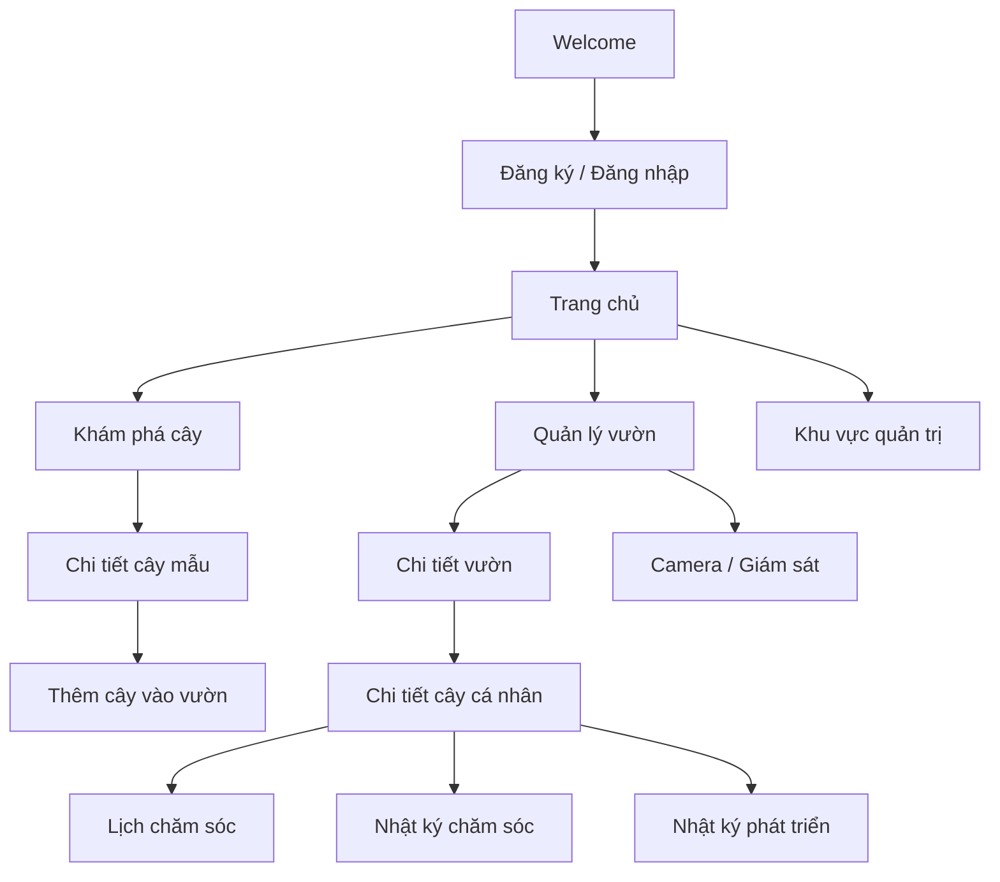
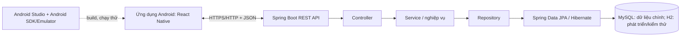

🌱 GoPlant — Hệ thống quản lý và chăm sóc cây trồng

GoPlant là dự án hỗ trợ người dùng quản lý cây trồng và khu vườn trên một nền tảng tập trung. Kiến trúc mục tiêu gồm **ứng dụng di động React Native (Android) + Backend REST API bằng Spring Boot + cơ sở dữ liệu MySQL**. Android Studio được dùng để thiết lập Android SDK, chạy trình giả lập, kiểm thử và build ứng dụng Android; mã giao diện di động vẫn được phát triển bằng React Native trong thư mục `frontend/`.

> **Trạng thái phát triển:** Dự án đang được xây dựng. README phân biệt phần source hiện có và kiến trúc dự kiến. Trong phiên bản repository được mô tả ở đây, Backend mới có bộ khung; `frontend/` và dự án Android do React Native tạo ra chưa được xác nhận có trong repo, vì vậy chưa thể build APK/AAB ngay. Ảnh cây trong bản thiết kế Figma chỉ là **ảnh minh họa/placeholder**, không phải dữ liệu cây đã được xác thực. Camera trong phạm vi hiện tại phục vụ giám sát và lưu/hiển thị hình ảnh; không có chức năng AI tự nhận diện hoặc chẩn đoán bệnh cây.

## Mục lục

- [1. Mục tiêu dự án](#1-mục-tiêu-dự-án)
- [2. Người dùng và vai trò](#2-người-dùng-và-vai-trò)
- [3. Phạm vi chức năng](#3-phạm-vi-chức-năng)
- [4. Thiết kế giao diện và luồng sử dụng](#4-thiết-kế-giao-diện-và-luồng-sử-dụng)
- [5. Kiến trúc hệ thống](#5-kiến-trúc-hệ-thống)
- [6. Công nghệ và môi trường](#6-công-nghệ-và-môi-trường)
- [7. Cấu trúc repository](#7-cấu-trúc-repository)
- [8. Chạy Backend trên máy cá nhân](#8-chạy-backend-trên-máy-cá-nhân)
- [9. Cấu hình cơ sở dữ liệu](#9-cấu-hình-cơ-sở-dữ-liệu)
- [10. Frontend React Native: chuẩn bị và chạy](#10-frontend-react-native-chuẩn-bị-và-chạy)
- [11. Android Studio: chạy thử và build ứng dụng Android](#11-android-studio-chạy-thử-và-build-ứng-dụng-android)
- [12. API và hợp đồng tích hợp dự kiến](#12-api-và-hợp-đồng-tích-hợp-dự-kiến)
- [13. Kiểm thử](#13-kiểm-thử)
- [14. Quy trình đóng góp và Git](#14-quy-trình-đóng-góp-và-git)
- [15. Xử lý lỗi thường gặp](#15-xử-lý-lỗi-thường-gặp)
- [16. Lộ trình phát triển](#16-lộ-trình-phát-triển)
- [17. Nhóm phát triển](#17-nhóm-phát-triển)

---

## 1. Mục tiêu dự án

GoPlant hướng đến việc số hóa các công việc quản lý và chăm sóc cây trồng, hạn chế phụ thuộc vào ghi chép thủ công và giúp người dùng theo dõi dữ liệu theo thời gian.

Các mục tiêu chính:

- Quản lý danh mục cây tham khảo và hồ sơ cây mà người dùng đang sở hữu.
- Tạo và quản lý nhiều khu vườn/khu vực trồng.
- Lập lịch chăm sóc như tưới nước, bón phân, cắt tỉa và thay đất.
- Ghi nhận lịch sử chăm sóc cùng ghi chú và hình ảnh trước/sau khi chăm sóc.
- Theo dõi quá trình phát triển bằng nhật ký, trạng thái và hình ảnh theo từng thời điểm.
- Tìm kiếm, lọc và phân trang dữ liệu cây.
- Cung cấp nền tảng API để Frontend có thể trao đổi dữ liệu với Backend.
- Định hướng phân quyền giữa người dùng và quản trị viên.

## 2. Người dùng và vai trò

### Người dùng — `ROLE_USER`

Người trồng cây hoặc người yêu thích thực vật, có nhu cầu:

- Đăng ký, đăng nhập và quản lý hồ sơ cá nhân.
- Tạo vườn; thêm, xem, sửa và xóa cây thuộc quyền sở hữu.
- Khám phá, tìm kiếm và xem chi tiết thông tin các loại cây.
- Tạo lịch chăm sóc và theo dõi việc sắp đến hạn/quá hạn.
- Ghi nhận hoạt động chăm sóc và theo dõi nhật ký phát triển.
- Xem hình ảnh hoặc thông tin giám sát từ camera khi chức năng này được tích hợp.

### Quản trị viên — `ROLE_ADMIN`

Định hướng chức năng quản trị gồm:

- Quản lý tài khoản người dùng và trạng thái tài khoản.
- Quản lý danh mục cây chuẩn và các danh mục nghiệp vụ.
- Quản lý thông tin khu vực trồng và thiết bị camera.
- Theo dõi log/vận hành hệ thống.

> Các vai trò và nghiệp vụ trên mô tả phạm vi thiết kế. Chúng chỉ được xem là hoạt động thực tế sau khi phần API, bảo mật và giao diện tương ứng đã được triển khai và kiểm thử.

## 3. Phạm vi chức năng

| Phân hệ | Chức năng trong phạm vi thiết kế |
|---|---|
| Tài khoản | Đăng ký, đăng nhập, xem/cập nhật hồ sơ, đăng xuất; xác thực và phân quyền |
| Khám phá cây | Xem danh mục cây; tìm theo từ khóa; lọc theo loại cây, độ khó chăm sóc, nhu cầu ánh sáng/nước và môi trường sống; xem chi tiết |
| Quản lý vườn | Tạo, xem, cập nhật và xóa vườn; lưu tên, loại khu vực, vị trí, diện tích và mô tả |
| Quản lý cây cá nhân | Thêm cây vào vườn; sửa thông tin; theo dõi vị trí, sức khỏe và giai đoạn phát triển; xóa cây khi không còn sở hữu |
| Mã nhận diện cây | Định hướng tạo `plantCode`/QR để mở nhanh hồ sơ cây |
| Lịch chăm sóc | Tạo và chỉnh sửa lịch; thiết lập chu kỳ lặp; theo dõi trạng thái `PENDING`, `COMPLETED`, `OVERDUE`, `SKIPPED` |
| Nhật ký chăm sóc | Ghi nhận tưới nước, bón phân, cắt tỉa, thay đất; lưu thời điểm, ghi chú, người thực hiện và ảnh nếu có |
| Nhật ký phát triển | Ghi nhận tình trạng, chiều cao/số lá hoặc chỉ số phù hợp, giai đoạn phát triển và ảnh theo thời gian |
| Camera | Quản lý thông tin camera và hiển thị luồng/hình ảnh nếu được tích hợp; không thực hiện chẩn đoán bệnh bằng AI |
| Quản trị | Quản lý tài khoản, danh mục cây, loại hoạt động chăm sóc, thiết bị và log hệ thống |

### Phạm vi triển khai hiện tại trên repository

Repo đang có **bộ khung Spring Boot** với lớp khởi động ứng dụng, Maven Wrapper và cấu hình H2. Khi cập nhật README này, chưa thấy `frontend/package.json`, source React Native hoặc thư mục `frontend/android/` được commit; Backend cũng chưa có các Controller/Service/Repository và endpoint nghiệp vụ hoàn chỉnh. Vì vậy, chưa thể build ứng dụng Android hoặc xem toàn bộ chức năng trong bảng là đã triển khai/kiểm thử xong. Cần bổ sung Frontend React Native, hoàn thiện Backend và database trước khi kiểm thử tích hợp toàn hệ thống.

## 4. Thiết kế giao diện và luồng sử dụng

Thiết kế tham khảo hướng đến giao diện sáng, nhấn màu xanh lá, các thẻ nội dung và hình ảnh cây. Các màn hình/chức năng đã được mô tả trong tài liệu thiết kế gồm:

1. **Chào mừng (Welcome):** giới thiệu mục đích ứng dụng và điều hướng bắt đầu.
2. **Đăng ký/Đăng nhập:** tạo tài khoản hoặc truy cập tài khoản hiện có.
3. **Trang chủ:** điểm vào các khu vực chính, tóm tắt vườn/cây và các công việc cần chú ý.
4. **Khám phá cây:** tìm kiếm, lọc, xem danh sách và mở trang chi tiết cây.
5. **Quản lý vườn:** tạo vườn, xem danh sách và thông tin chi tiết.
6. **Quản lý cây:** xem cây trong vườn, mở chi tiết, thêm mới hoặc chỉnh sửa.
7. **Lịch chăm sóc:** xem công việc, tạo lịch và theo dõi trạng thái.
8. **Theo dõi/ghi nhận chăm sóc:** đánh dấu hoàn thành và thêm ghi chú hoặc hình ảnh.
9. **Nhật ký phát triển:** lưu và xem lại thay đổi của cây theo thời gian.
10. **Camera/giám sát:** khu vực dành cho ảnh hoặc luồng giám sát khi tính năng được tích hợp.
11. **Khu vực quản trị:** quản lý tài khoản và dữ liệu danh mục theo quyền được cấp.

### Luồng điều hướng khái quát



Đây là luồng tham chiếu để phát triển, không phải bằng chứng rằng toàn bộ màn hình/điều hướng đã có trong source code.

### Lưu ý về hình ảnh trong Figma

- Hình cây, ảnh minh họa hoặc ảnh nền trong mockup chỉ dùng để mô tả bố cục và trải nghiệm dự kiến.
- Khi phát triển dữ liệu thật, ảnh nên lấy từ dữ liệu/API hoặc kho tài nguyên được quản lý riêng; không coi ảnh mockup là dữ liệu cây chuẩn.
- File SVG xuất từ thiết kế có kích thước lớn. Nên lưu file gốc ngoài repository hoặc cung cấp đường dẫn Figma; nếu cần lưu trong repo, nên thêm bản preview đã tối ưu trong `docs/design/` thay vì mặc định commit file export lớn.

## 5. Kiến trúc hệ thống

Kiến trúc mục tiêu được thống nhất theo hướng ứng dụng di động Android bằng React Native:



**Nguyên tắc tích hợp:** ứng dụng Android gọi Backend qua REST API; Backend mới là thành phần kết nối database. Không nhúng thông tin đăng nhập MySQL vào ứng dụng và không để ứng dụng Android truy cập thẳng vào database. Với React Native, mã giao diện trong `frontend/` chính là mã nguồn ứng dụng di động; Android Studio dùng để quản lý môi trường Android, mở phần native project và build/chạy ứng dụng.

### Vai trò các lớp Backend

- **Controller:** tiếp nhận HTTP request, kiểm tra dữ liệu đầu vào và trả HTTP response.
- **Service:** chứa quy tắc nghiệp vụ, xử lý lịch chăm sóc và phối hợp các thao tác dữ liệu.
- **Repository:** truy vấn và cập nhật dữ liệu thông qua Spring Data JPA.
- **Entity:** biểu diễn các đối tượng miền nghiệp vụ và ánh xạ cơ sở dữ liệu.
- **DTO:** định nghĩa dữ liệu đầu vào/đầu ra, tách API khỏi cấu trúc entity khi cần.
- **Cấu hình bảo mật:** định hướng sử dụng Spring Security, BCrypt và JWT cho xác thực/phân quyền sau khi được triển khai.
- **Validation và xử lý lỗi:** kiểm tra dữ liệu và trả lỗi có cấu trúc.
- **Logging/AOP:** định hướng ghi nhận hoạt động và thời gian thực thi.

## 6. Công nghệ và môi trường

### Thành phần đã được tìm thấy trong source Backend trên GitHub

| Công nghệ | Vai trò |
|---|---|
| Java 21 | Phiên bản Java mục tiêu được cấu hình trong `backend/pom.xml` |
| Spring Boot 4.1.1 | Khung ứng dụng Backend trong `backend/pom.xml` hiện tại |
| Maven Wrapper | Build/chạy ứng dụng bằng `mvnw` hoặc `mvnw.cmd`, không bắt buộc cài Maven toàn hệ thống |
| Spring Web MVC | Nền tảng web/API |
| Spring Data JPA | Tích hợp truy cập dữ liệu |
| Spring Security | Thư viện bảo mật hiện có trong dependency; cấu hình nghiệp vụ riêng vẫn cần triển khai |
| Spring Validation | Thư viện kiểm tra dữ liệu đầu vào |
| H2 Database | CSDL phát triển dạng in-memory đang được cấu hình trong `application.properties` |
| MySQL Connector/J | Driver đã có trong dependency để chuẩn bị kết nối MySQL |

### Công nghệ định hướng cho toàn hệ thống

| Công nghệ | Vai trò/trạng thái |
|---|---|
| React Native + JavaScript/JSX | Frontend di động, xây dựng màn hình, component, navigation, gọi API và lưu cục bộ khi cần; cần bổ sung vào `frontend/` |
| React Native Community CLI | Hướng triển khai được README này giả định để có dự án native Android trong `frontend/android/`; nếu nhóm chọn Expo thì cần điều chỉnh lệnh build theo cấu hình Expo thực tế |
| Android Studio + Android SDK | Cài SDK/Build Tools, tạo emulator, mở dự án native Android và kiểm tra/build ứng dụng |
| Gradle | Build phần native Android do React Native khởi tạo |
| REST API, HTTP/HTTPS, JSON | Giao tiếp giữa ứng dụng Android với Backend |
| MySQL | Database mục tiêu lưu dữ liệu bền vững trên máy chủ; H2 hiện dùng để khởi động/kiểm tra nhanh Backend |
| Postman hoặc công cụ HTTP tương đương | Kiểm thử API |
| Git, GitHub, GitHub Actions | Quản lý source; có thể bổ sung pipeline build/test sau khi cấu hình |

**Lưu ý về Java:** Backend hiện cấu hình Java 21. Bộ công cụ React Native/Gradle có yêu cầu JDK riêng theo phiên bản; tài liệu React Native hiện khuyến nghị JDK 17 cho thiết lập Android. Không mặc định rằng JDK dùng chạy Backend phải là JDK dùng build Android. Kiểm tra phiên bản tương thích trong [hướng dẫn môi trường React Native chính thức](https://reactnative.dev/docs/set-up-your-environment) và chọn Gradle JDK trong Android Studio nếu cần.

## 7. Cấu trúc repository

### Cấu trúc hiện đang có trên GitHub

```text
GoPlant/
├── .gitignore
└── backend/
    ├── .gitignore
    ├── .gitattributes
    ├── .mvn/
    │   └── wrapper/
    ├── mvnw
    ├── mvnw.cmd
    ├── pom.xml
    └── src/
        ├── main/
        │   ├── java/
        │   │   └── com/cmc/plant_care_backend/
        │   │       └── PlantCareBackendApplication.java
        │   └── resources/
        │       └── application.properties
        └── test/
            └── java/
```

### Cấu trúc mục tiêu khi bổ sung React Native, Backend và database

```text
GoPlant/
├── README.md
├── .gitignore
├── frontend/                         # Ứng dụng di động React Native (cần bổ sung)
│   ├── package.json
│   ├── package-lock.json
│   ├── index.js
│   ├── src/
│   │   ├── components/               # Component giao diện tái sử dụng
│   │   ├── screens/                  # Welcome, Auth, Home, Garden, Plant...
│   │   ├── navigation/               # Stack/Tab và luồng màn hình
│   │   ├── services/                 # Gọi REST API
│   │   ├── storage/                  # Lưu cục bộ nếu cần
│   │   └── config/                   # API base URL theo môi trường
│   ├── assets/                       # Icon và tài nguyên giao diện
│   └── android/                      # Native Android project; mở thư mục này bằng Android Studio
│       ├── app/
│       │   ├── build.gradle
│       │   └── src/main/             # AndroidManifest.xml, native resources...
│       ├── gradle/
│       └── gradlew.bat
├── backend/
│   ├── pom.xml
│   ├── mvnw
│   ├── mvnw.cmd
│   └── src/
│       ├── main/java/com/cmc/plant_care_backend/
│       │   ├── controller/
│       │   ├── service/
│       │   ├── repository/
│       │   ├── entity/
│       │   ├── dto/
│       │   ├── config/
│       │   └── exception/
│       └── main/resources/application.properties
├── database/                         # Tuỳ chọn: migration/seed SQL và tài liệu schema
└── docs/
    ├── design/                       # Preview/đường dẫn thiết kế Figma
    ├── api/                          # API contract, ví dụ request/response
    └── database/                     # ERD, schema và migration notes
```

Đây là cấu trúc mục tiêu, không phải danh sách file đã có trong repository. Cấu trúc con của `frontend/android/` phụ thuộc template React Native/Gradle được sử dụng. Không commit các thư mục sinh tự động như `node_modules/`, `.gradle/`, `build/` hoặc thông tin signing secret. Thư mục `database/` chỉ chứa schema/migration/tài liệu nếu nhóm cần quản lý chúng trong Git; dữ liệu MySQL thật vẫn chạy riêng, không nằm bên trong Android app.

## 8. Chạy Backend trên máy cá nhân

### 8.1. Yêu cầu

- Git.
- JDK 21 đã cài và cấu hình trong `PATH`/`JAVA_HOME`.
- Kết nối Internet lần đầu để Maven Wrapper tải Maven và các thư viện phụ thuộc.
- Windows PowerShell cho các lệnh Windows bên dưới. macOS/Linux dùng `./mvnw`.

Kiểm tra Java trước:

```powershell
java -version
javac -version
```

Cả hai nên hiển thị phiên bản 21.

### 8.2. Clone repository

Mở PowerShell/Terminal tại thư mục muốn lưu source:

```powershell
git clone https://github.com/vuduc6002/GoPlant.git
cd GoPlant\backend
```

### 8.3. Kiểm tra Maven Wrapper và build

```powershell
.\mvnw.cmd -v
.\mvnw.cmd clean verify
```

Nếu lệnh `clean verify` hoàn tất với `BUILD SUCCESS`, bước build đã thành công.

### 8.4. Khởi động Backend

```powershell
.\mvnw.cmd spring-boot:run
```

Khi log có dòng tương tự `Started PlantCareBackendApplication`, ứng dụng đã khởi động. Mặc định Spring Boot sử dụng cổng `8080`, vì vậy địa chỉ gốc là:

- `http://localhost:8080`

> **Giới hạn hiện tại:** source được kiểm tra mới có lớp khởi động, chưa có endpoint nghiệp vụ/health endpoint được xác nhận. Vì thế, truy cập địa chỉ gốc có thể trả về 404 hoặc màn hình đăng nhập mặc định do dependency Spring Security; điều đó không tự động có nghĩa là tiến trình Spring Boot không chạy. Không gọi các API trong phần thiết kế như thể chúng đã hoạt động nếu chưa có Controller tương ứng.

### 8.5. Dừng ứng dụng

Trong Terminal đang chạy ứng dụng, nhấn `Ctrl + C`.

### 8.6. Chạy trên macOS/Linux

Từ thư mục `GoPlant/backend`:

```bash
./mvnw -v
./mvnw clean verify
./mvnw spring-boot:run
```

Nếu quyền thực thi chưa được cấp, chạy `chmod +x mvnw` một lần rồi thử lại.

## 9. Cấu hình cơ sở dữ liệu

### 9.1. Cấu hình phát triển mặc định hiện tại: H2

File: `backend/src/main/resources/application.properties`

Cấu hình hiện tại sử dụng H2 in-memory:

```properties
spring.application.name=plant-care-backend
spring.datasource.url=jdbc:h2:mem:plantcaredb
spring.datasource.driver-class-name=org.h2.Driver
spring.datasource.username=sa
spring.datasource.password=
spring.jpa.hibernate.ddl-auto=update
spring.jpa.show-sql=true
spring.h2.console.enabled=true
spring.h2.console.path=/h2-console
```

- Database URL: `jdbc:h2:mem:plantcaredb`
- Username: `sa`
- Password: để trống.
- H2 in-memory chỉ giữ dữ liệu trong phiên chạy ứng dụng; dữ liệu thường mất khi ứng dụng dừng.
- H2 Console được bật theo cấu hình tại `http://localhost:8080/h2-console`. Tùy cấu hình Spring Security đang được áp dụng, console có thể cần cấu hình bảo mật phát triển riêng để truy cập được.

### 9.2. Chuyển sang MySQL

MySQL Connector/J đã có trong `pom.xml`, nhưng cấu hình được commit hiện tại vẫn dùng H2. Khi cần dùng MySQL:

1. Cài và khởi động MySQL Server.
2. Tạo database, ví dụ:

   ```sql
   CREATE DATABASE plant_care_db
     CHARACTER SET utf8mb4
     COLLATE utf8mb4_unicode_ci;
   ```

3. Thay cấu hình datasource trong `backend/src/main/resources/application.properties` bằng cấu hình MySQL, ví dụ:

   ```properties
   spring.datasource.url=jdbc:mysql://localhost:3306/plant_care_db?serverTimezone=Asia/Ho_Chi_Minh
   spring.datasource.username=${DB_USERNAME:root}
   spring.datasource.password=${DB_PASSWORD}
   spring.datasource.driver-class-name=com.mysql.cj.jdbc.Driver
   spring.jpa.hibernate.ddl-auto=update
   spring.jpa.show-sql=true
   ```

4. Đặt biến môi trường cho tài khoản MySQL trước khi khởi động ứng dụng, ví dụ PowerShell:

   ```powershell
   $env:DB_USERNAME = "root"
   $env:DB_PASSWORD = "mat_khau_mysql_cua_ban"
   .\mvnw.cmd spring-boot:run
   ```

Không commit mật khẩu thật lên GitHub. Trong dự án dùng chung, nên quản lý cấu hình cá nhân bằng biến môi trường hoặc file cấu hình local được `.gitignore` loại trừ. Khi chuyển datasource, kiểm tra xem các thư viện H2/MySQL và `application.properties` có khớp nhau hay không.

## 10. Frontend React Native: chuẩn bị và chạy

README này định hướng `frontend/` là ứng dụng di động **React Native**. Đây không phải một website được tự động chuyển thành ứng dụng Android: nếu giao diện hiện có được viết bằng HTML/React Web hoặc framework chỉ chạy trên trình duyệt, cần xây dựng/chuyển đổi giao diện sang React Native trước khi build APK/AAB.

Tại thời điểm cập nhật README, repository chưa có `frontend/package.json` và source Frontend nên các lệnh dưới đây chỉ dùng sau khi nhóm đã tạo và commit ứng dụng React Native.

### 10.1. Cài dependencies

Từ Terminal:

```powershell
cd GoPlantrontend
npm ci
```

Dùng `npm ci` khi `package-lock.json` đã được commit. Nếu đây là lần đầu cài đặt và chưa có lockfile, dùng `npm install`, kiểm tra ứng dụng rồi commit cả `package.json` và `package-lock.json`.

### 10.2. Chạy Metro và ứng dụng

Với React Native Community CLI, mở Android Emulator trước rồi chạy từ thư mục `frontend`:

```powershell
npm start
```

Mở Terminal thứ hai, vẫn tại `frontend`, chạy:

```powershell
npm run android
```

Lệnh phải tồn tại trong `scripts` của `package.json`. Nếu project dùng template/phiên bản khác, hãy làm theo script thật trong file đó và [hướng dẫn chạy trên thiết bị Android của React Native](https://reactnative.dev/docs/running-on-device).

### 10.3. Cấu hình kết nối Frontend tới Backend

- **Backend chạy trên cùng máy tính:** `http://localhost:8080` dùng được từ Terminal trên máy tính, nhưng không dùng như địa chỉ API bên trong Android Emulator.
- **Android Studio Emulator:** thường truy cập máy tính host qua `http://10.0.2.2:8080`.
- **Điện thoại Android thật:** dùng địa chỉ IP LAN của máy tính chạy Backend, ví dụ `http://192.168.1.10:8080` (địa chỉ ví dụ; thay bằng IP thực tế). Hai thiết bị cần cùng mạng và firewall của máy tính phải cho phép kết nối.
- **Bản phát hành:** dùng URL Backend đã triển khai trên máy chủ, ưu tiên HTTPS. Không dùng `localhost`, `10.0.2.2` hoặc IP LAN làm URL API của bản phát hành cho người dùng.
- Đặt `API base URL` tập trung trong cấu hình, ví dụ `frontend/src/config/`, không rải URL trực tiếp trong từng màn hình.
- Ứng dụng gửi/nhận JSON qua API. Mỗi màn hình cần xử lý loading, success, empty, lỗi mạng và phản hồi API thất bại.

**Lưu ý:** ứng dụng Android không kết nối trực tiếp tới MySQL. Mọi thao tác đọc/ghi dữ liệu phải đi qua Backend để kiểm soát xác thực, quyền truy cập và quy tắc nghiệp vụ.


## 11. Android Studio: chạy thử và build ứng dụng Android

Phần này giả định Frontend dùng **React Native Community CLI** và đã có thư mục `frontend/android/`. Android Studio không thay thế React Native; công cụ này cung cấp Android SDK, trình giả lập và môi trường mở/build phần native Android. Khi Frontend, Backend và database đã tích hợp, có thể kiểm thử toàn hệ thống trên Android Emulator/điện thoại rồi tạo APK/AAB.

### 11.1. Cài đặt Android Studio và Android SDK

1. Cài [Android Studio](https://developer.android.com/studio).
2. Trong Setup Wizard hoặc **Tools/More Actions → SDK Manager**, cài Android SDK, Android SDK Platform, Android SDK Build-Tools, Android SDK Platform-Tools, Android Emulator và phiên bản SDK được template React Native đang dùng yêu cầu. Không cố định một API level nếu template của project yêu cầu phiên bản khác.
3. Trong **Device Manager**, chọn **Create Device**, chọn một thiết bị điện thoại và system image tương thích, sau đó khởi động emulator. Xem [tài liệu tạo Android Virtual Device](https://developer.android.com/studio/run/managing-avds).
4. Kiểm tra SDK Location trong Android Studio. Trên Windows, vị trí mặc định thường là `%LOCALAPPDATA%\Android\Sdk`, nhưng phải dùng đúng đường dẫn hiển thị trên máy.
5. Nếu lệnh `adb` chưa được nhận diện, thêm thư mục `platform-tools` trong SDK vào biến môi trường `Path`; kiểm tra bằng:

   ```powershell
   adb --version
   adb devices
   ```

### 11.2. Kiểm tra JDK và môi trường React Native

- Cài Node.js phiên bản tương thích với React Native đang dùng; xem yêu cầu hiện hành trong [React Native environment setup](https://reactnative.dev/docs/set-up-your-environment).
- Backend GoPlant hiện cần Java 21 theo cấu hình Maven. Android/React Native lại cần JDK tương thích với phiên bản React Native và Gradle Plugin. Tài liệu React Native hiện khuyến nghị JDK 17 cho thiết lập Android, vì vậy có thể cần cài thêm JDK phù hợp thay vì đổi/xoá JDK 21 của Backend.
- Trong Android Studio, chọn JDK dùng cho Gradle tại **Settings → Build, Execution, Deployment → Build Tools → Gradle → Gradle JDK**. Tránh thay đổi hàng loạt biến môi trường Windows nếu chưa kiểm tra ứng dụng nào đang phụ thuộc chúng.
- Sau khi cài đặt, mở Terminal mới và kiểm tra:

  ```powershell
  node -v
  npm -v
  java -version
  adb devices
  ```

### 11.3. Chạy ứng dụng sau khi hoàn thiện Backend và database

Thực hiện theo thứ tự sau để tránh nhầm lỗi giao diện với lỗi kết nối dữ liệu:

1. **Khởi động database:** chạy MySQL nếu đã chuyển sang cấu hình MySQL; kiểm tra database/schema và tài khoản kết nối. Nếu Backend vẫn đang dùng H2 in-memory, dữ liệu sẽ không bền vững sau khi ứng dụng dừng.
2. **Khởi động Backend:** mở Terminal tại `GoPlant/backend` và chạy:

   ```powershell
   .\mvnw.cmd spring-boot:run
   ```

   Kiểm tra log khởi động và xác nhận các endpoint thực tế đã được triển khai. `http://localhost:8080` là địa chỉ phía máy tính; không có nghĩa toàn bộ API đã hoàn chỉnh.
3. **Khởi động Android Emulator:** mở Android Studio → Device Manager và chạy emulator.
4. **Chạy Frontend:** mở Terminal tại `GoPlant/frontend`, cài dependencies rồi chạy `npm start`. Ở Terminal khác, chạy `npm run android` để build debug và cài app lên emulator.
5. **Mở bằng Android Studio khi cần:** chọn **Open** và mở thư mục `GoPlant/frontend/android` (không mở riêng thư mục `backend`). Chờ Gradle Sync hoàn tất; chọn emulator làm thiết bị đích và nhấn **Run**. Khi chạy cấu hình debug từ Android Studio, Metro bundler thường cần được khởi động riêng bằng `npm start` tại thư mục `frontend`.
6. **Kiểm thử xuyên suốt:** đăng nhập, xem danh sách cây, xem chi tiết, tạo/quản lý vườn, cập nhật lịch và nhật ký chăm sóc; kiểm tra cả loading, dữ liệu rỗng, API lỗi và mất mạng. Chỉ xác nhận tính năng hoàn tất sau khi đã chạy thử với API và database thật của môi trường phát triển.

### 11.4. Tạo APK để cài thử

Sau khi cấu hình môi trường Android và đảm bảo project React Native đã được tạo:

```powershell
cd GoPlant\frontend\android
.\gradlew.bat assembleDebug
```

Với cấu hình React Native/Gradle tương thích, APK debug thường được tạo tại:

```text
frontend/android/app/build/outputs/apk/debug/app-debug.apk
```

Có thể chép APK này sang thiết bị Android để cài thử; đây là bản debug, không phải bản phát hành chính thức. Nếu build thất bại, kiểm tra JDK, SDK Platform/Build Tools, Gradle Sync và log lỗi gốc trước khi xoá cache hoặc thay đổi phiên bản thư viện.

### 11.5. Tạo bản phát hành AAB/APK

Khi app đã tích hợp và kiểm thử đầy đủ, có thể tạo Android App Bundle theo hướng dẫn React Native hiện hành:

```powershell
cd GoPlant\frontend
npx react-native build-android --mode=release
```

Lệnh và đường dẫn đầu ra phụ thuộc phiên bản React Native. Theo hướng dẫn hiện hành, file AAB được tạo tại `android/app/build/outputs/bundle/release/app-release.aab` sau khi cấu hình signing phù hợp. Xem [hướng dẫn phát hành Android của React Native](https://reactnative.dev/docs/signed-apk-android) trước khi sử dụng.

- Không commit keystore, mật khẩu signing, token hoặc secret vào GitHub; quản lý chúng bên ngoài source code.
- **APK** phù hợp khi cần cài đặt trực tiếp lên thiết bị; **AAB** là định dạng thường dùng để phát hành qua Google Play.
- Build thành công chưa chứng minh hệ thống hoạt động đúng: cần kiểm thử app release, kết nối Backend và các chức năng chính trên thiết bị thật.

### 11.6. Điều kiện trước khi đưa app ra ngoài máy phát triển

- Deploy Backend và MySQL lên môi trường máy chủ có thể truy cập từ điện thoại; cấu hình URL API chính thức và HTTPS.
- Không dùng URL emulator `10.0.2.2` hoặc IP LAN của máy phát triển trong bản phát hành.
- Bật xác thực/phân quyền ở Backend, kiểm tra quyền sở hữu dữ liệu và không để lộ thông tin database.
- Kiểm thử đăng nhập, đọc/ghi dữ liệu, xử lý mất mạng và lỗi server từ Android app.
- Cấu hình app name, package/application ID, icon, version và signing trước khi tạo bản phát hành cuối cùng.

## 12. API và hợp đồng tích hợp dự kiến

Các đường dẫn dưới đây xuất phát từ luồng nghiệp vụ và thiết kế API trong tài liệu. **Đây là API contract dự kiến, không phải cam kết rằng endpoint đã có trong source hiện tại.** Endpoint chỉ dùng được sau khi Controller, Service và cơ chế bảo mật tương ứng được cài đặt.

| Phân hệ | Endpoint tham chiếu | Ý nghĩa |
|---|---|---|
| Auth | `POST /api/v1/auth/register` | Đăng ký tài khoản |
| Auth | `POST /api/v1/auth/login` | Đăng nhập và dự kiến cấp access token |
| Tài khoản | `GET /api/v1/users/me` | Lấy hồ sơ người dùng hiện tại sau xác thực |
| Danh mục cây | `GET /api/v1/species` | Danh sách cây, tìm kiếm/lọc/phân trang |
| Danh mục cây | `GET /api/v1/species/{id}` | Chi tiết một loại cây |
| Vườn | `/api/v1/gardens` | Nhóm API quản lý vườn |
| Cây cá nhân | Chưa chốt trong source | API quản lý cây thuộc vườn/người dùng |
| Lịch chăm sóc | Chưa chốt trong source | API tạo lịch, chu kỳ và trạng thái công việc |
| Nhật ký chăm sóc/phát triển | Chưa chốt trong source | API ghi nhận và truy xuất lịch sử |
| Camera | Chưa chốt trong source | API quản lý thiết bị và metadata ảnh/luồng giám sát |

### Quy ước API nên thống nhất khi triển khai

- Request/Response dùng JSON và mã HTTP có ý nghĩa.
- Dữ liệu đầu vào cần được validate; phản hồi lỗi nên có cấu trúc thống nhất.
- Các danh sách lớn nên hỗ trợ phân trang và sắp xếp.
- API yêu cầu xác thực cần gửi `Authorization: Bearer <token>` sau khi JWT được triển khai.
- Người dùng chỉ được đọc/thay đổi dữ liệu thuộc quyền sở hữu; endpoint quản trị yêu cầu vai trò tương ứng.
- Không lưu password dạng văn bản thuần; khi triển khai xác thực, dùng BCrypt hoặc cơ chế băm mật khẩu phù hợp của Spring Security.

## 13. Kiểm thử

### Build/test Backend

Từ thư mục `GoPlant/backend`:

```powershell
.\mvnw.cmd clean verify
```

Hoặc chỉ chạy unit test:

```powershell
.\mvnw.cmd test
```

Lệnh build kiểm tra biên dịch và chạy các test hiện có. Khi chưa có test nghiệp vụ, `BUILD SUCCESS` chỉ xác nhận build thành công, không chứng minh mọi chức năng quản lý cây đã hoạt động.

### Kiểm thử API khi endpoint đã được triển khai

Dùng Postman hoặc công cụ HTTP tương đương để kiểm tra:

- Đường đi thành công và các mã HTTP.
- Dữ liệu thiếu/sai định dạng.
- Dữ liệu không tồn tại.
- Tìm kiếm, lọc và phân trang.
- Xác thực token, vai trò và quyền sở hữu dữ liệu.
- Các trường hợp lịch chăm sóc đến hạn/quá hạn và cập nhật nhật ký.

### Kiểm thử giao diện và Android

Kiểm tra các luồng chính: đăng nhập → trang chủ → khám phá cây → xem chi tiết → thêm vào vườn; và quản lý vườn → cây → lịch chăm sóc → ghi nhận chăm sóc → xem nhật ký phát triển. Cần kiểm tra trạng thái loading, empty, lỗi mạng và dữ liệu không hợp lệ.

Trên Android Emulator và ít nhất một điện thoại thật khi có thể, kiểm tra kích thước màn hình, bàn phím/nhập liệu, điều hướng Back, quyền truy cập ảnh/camera nếu tính năng đã có, kết nối API, resume app sau khi đưa xuống nền, và cài đặt APK release. Không coi việc app mở được hoặc build thành công là bằng chứng toàn bộ chức năng đã hoàn tất.

## 14. Quy trình đóng góp và Git

Nên làm việc theo nhánh tính năng để tránh ghi đè code của thành viên khác:

```bash
git switch -c feature/ten-chuc-nang
# chỉnh sửa và kiểm thử code

git status
git add .
git commit -m "feat: mô tả thay đổi"
git push -u origin feature/ten-chuc-nang
```

Sau đó tạo Pull Request để nhóm rà soát trước khi gộp vào `main`.

Trước khi commit:

- Kiểm tra `git status` để không đưa `target/`, `node_modules/`, log hoặc file build lên GitHub.
- Không commit `.env`, mật khẩu database, JWT secret, token hoặc dữ liệu cá nhân thật.
- Giữ `backend/mvnw`, `backend/mvnw.cmd`, `backend/.mvn/` và `backend/pom.xml` để người khác có thể build bằng Maven Wrapper.
- Không sao chép thư mục `.git` của repo Frontend/Backend cũ vào repo GoPlant; repo này nên có một `.git` ở thư mục gốc.
- Thống nhất tên branch, format code, API contract và kiểu dữ liệu với cả nhóm.

## 15. Xử lý lỗi thường gặp

### `release version 25 not supported`

Project đang đặt Java target cao hơn JDK được Maven sử dụng. Kiểm tra:

```powershell
java -version
cd backend
.\mvnw.cmd -v
```

Nếu dự án dùng Java 21, đặt `<java.version>21</java.version>` trong `pom.xml` và bảo đảm Maven thực sự chạy bằng JDK 21. Kiểm tra cả cấu hình `maven.compiler.release` nếu có.

### `mvnw.cmd is not recognized`

Chạy lệnh trong đúng thư mục `GoPlant/backend`, nơi có `mvnw.cmd`:

```powershell
cd E:\GoPlant\backend
.\mvnw.cmd -v
```

### `Failed to configure a DataSource`

Kiểm tra `backend/src/main/resources/application.properties`, dependency driver và URL database. Cấu hình mặc định hiện tại phải có H2 dependency và `jdbc:h2:mem:plantcaredb`; nếu chuyển sang MySQL thì phải có URL MySQL, driver, server đang chạy và thông tin đăng nhập hợp lệ.

### Port `8080` đã được sử dụng

Đóng tiến trình đang chiếm cổng hoặc đổi cổng phát triển bằng cách thêm vào `application.properties`:

```properties
server.port=8081
```

Sau đó truy cập `http://localhost:8081`.

### Ứng dụng chạy nhưng endpoint trả về `404` hoặc trang đăng nhập

Source hiện tại chưa có các API nghiệp vụ được xác nhận và dependency Spring Security có thể áp dụng bảo vệ mặc định. Kiểm tra log khởi động trước; sau đó triển khai Controller và SecurityConfig phù hợp thay vì giả định endpoint đã tồn tại.

### Frontend không tìm thấy `package.json`

Frontend source React Native chưa được commit vào repository hoặc đang mở sai thư mục. Kiểm tra `GoPlant/frontend/package.json`; nếu file chưa có, cần tạo và commit project React Native trước khi chạy lệnh npm.

### Android Studio không tìm thấy SDK hoặc `adb` không được nhận diện

Mở Android Studio → SDK Manager để xem chính xác SDK Location. Kiểm tra biến `ANDROID_HOME` và bổ sung `<SDK path>\platform-tools` vào `Path`, sau đó mở Terminal mới và chạy `adb devices`.

### Android Emulator không gọi được Backend

Không dùng `localhost` làm API host bên trong emulator. Dùng `http://10.0.2.2:8080` khi Backend chạy trên máy host; dùng IP LAN của máy phát triển khi chạy trên điện thoại thật. Kiểm tra Backend đang chạy, cổng, firewall và API URL trong cấu hình Frontend. Với bản phát hành, dùng URL máy chủ đã triển khai qua HTTPS.

### `npm run android` hoặc Gradle build thất bại

Kiểm tra phiên bản Node, JDK/Gradle tương thích với phiên bản React Native, Android SDK Platform/Build Tools và kết quả Gradle Sync. Đối chiếu lỗi gốc với tài liệu [thiết lập môi trường React Native](https://reactnative.dev/docs/set-up-your-environment); không nâng/hạ đồng thời nhiều phiên bản khi chưa xác định nguyên nhân.

### App mở nhưng báo lỗi không tải được JavaScript/Metro

Với cấu hình debug, chạy `npm start` trong thư mục `frontend` để khởi động Metro, sau đó reload app. Bản release phải được bundle đúng khi build và không phụ thuộc Metro đang chạy trên máy phát triển.

## 16. Lộ trình phát triển

- [ ] Chốt mô hình dữ liệu, quan hệ Entity, ERD và chiến lược lưu trữ bền vững bằng MySQL.
- [ ] Hoàn thiện Backend: CRUD cho vườn, cây cá nhân, danh mục cây, lịch chăm sóc và nhật ký.
- [ ] Triển khai tìm kiếm, lọc, sắp xếp, phân trang, xác thực/phân quyền và kiểm soát quyền sở hữu dữ liệu.
- [ ] Chuẩn hóa response/error, Bean Validation, logging và API contract/OpenAPI; bổ sung test nghiệp vụ.
- [ ] Xây dựng Frontend bằng React Native theo màn hình và luồng đã thiết kế; hoàn thiện Component, Props/State, danh sách, Navigation, API và lưu cục bộ khi cần.
- [ ] Cấu hình môi trường API để Frontend kết nối Backend; kiểm thử các luồng đầu-cuối với database.
- [ ] Cài Android Studio/SDK, tạo Android Emulator và xác nhận `frontend/android/` build được.
- [ ] Chạy thử app trên Emulator và điện thoại Android thật; kiểm tra lỗi mạng, kích thước màn hình, quyền thiết bị và trạng thái ứng dụng.
- [ ] Tạo APK debug để cài thử; cấu hình signing và tạo APK/AAB release khi sẵn sàng.
- [ ] Deploy Backend + MySQL lên máy chủ trước khi chia sẻ bản Android ngoài mạng phát triển; cấu hình HTTPS và URL API chính thức.
- [ ] Tích hợp camera trong phạm vi giám sát/hình ảnh nếu đáp ứng được môi trường thử nghiệm; không đưa AI chẩn đoán bệnh vào phạm vi mặc định.
- [ ] Thêm GitHub Actions cho build/test và cập nhật hướng dẫn triển khai.

## 17. Nhóm phát triển

- Vũ Tuấn Đạt
- Vũ Minh Đức
- Hoàng Phúc Vinh
- Nguyễn Ngọc Tuấn Linh

---

**Repository:** https://github.com/vuduc6002/GoPlant

**Tài liệu chính thức tham khảo:** [React Native - Set Up Your Environment](https://reactnative.dev/docs/set-up-your-environment), [React Native - Running on Device](https://reactnative.dev/docs/running-on-device), [React Native - Publishing to Google Play](https://reactnative.dev/docs/signed-apk-android), [Android Studio - Create and Manage Virtual Devices](https://developer.android.com/studio/run/managing-avds).

**Lưu ý về trạng thái:** README cần được cập nhật cùng source code. Khi một chức năng hoàn tất, hãy bổ sung endpoint thực tế, hướng dẫn cấu hình, test case và bằng chứng chạy thử; chỉ đánh dấu hoàn thành sau khi đã kiểm tra trên mã nguồn và môi trường Android.
