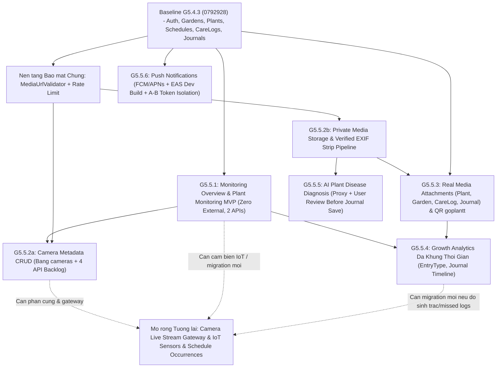

# GOPLANT G5.5 — ĐÁNH GIÁ MỨC ĐỘ SẴN SÀNG KỸ THUẬT & LỘ TRÌNH TRIỂN KHAI

- **Giai đoạn khảo sát & hiệu đính:** G5.5.0.2 (Final Monitoring Data Provenance Correction)
- **Repository:** `https://github.com/vuduc6002/GoPlant.git`
- **Nhánh mục tiêu:** `feature/integrate-frontend-report`
- **Baseline Code:** `0792928db9bf1a2ecbdaf89219d774a28af35911` (`feat(frontend): integrate care logs and growth journals`)
- **Tính chất tài liệu:** Khảo sát kiến trúc từ mã nguồn thực tế và hoạch định lộ trình G5.5 (documentation-only; chưa triển khai code nghiệp vụ G5.5).

---

## Lịch sử Phiên bản Tài liệu (Revision History)

| Phiên bản | Commit SHA | Mô tả thay đổi |
|---|---|---|
| **G5.5.0** | `7298acc2ff1ba11163cb167dac51e1c578b7db33` | Phiên bản khảo sát kỹ thuật và đề xuất lộ trình G5.5 ban đầu dựa trên baseline code `0792928db9bf1a2ecbdaf89219d774a28af35911`. |
| **G5.5.0.1** | `068508c10be63fb892a8eb99e80bdba171d43ebd` | Hiệu đính tài liệu theo codebase thực tế (A–L: scheme QR `goplantt`, tách G5.5.1 vs G5.5.4, biên giờ VN + `Clock`, Private Bucket `media_objects`, EXIF có kiểm chứng, query budget `O(1)`, xác nhận người dùng AI, trích dẫn Expo SDK 53+). *Re-audit G5.5.0.2 phát hiện còn sót 2 sai lệch provenance dữ liệu (`schedule_id IS NULL` suy ra manual và coi `HEALTHY` mặc định là xác nhận của người dùng).* |
| **G5.5.0.2** | `f962c486013f26ebaaa1fe1471898a29be0359c8` | Hiệu đính dứt điểm provenance dữ liệu Monitoring G5.5.1 (FIX A & FIX B): thay `manualCompletedLogs`/`scheduled*`/`CARE_LOG_MANUAL`/`CARE_LOG_SCHEDULED` bằng các trường/nhãn liên kết trung tính (`unlinkedCompletedLogs`, `unlinkedSkippedLogs`, `linkedScheduledCompletedLogs`, `linkedScheduledSkippedLogs`, `CARE_LOG_UNLINKED`, `CARE_LOG_LINKED`); ghi rõ `detachSchedule()` + `ON DELETE SET NULL` làm mất provenance lịch sử khi xóa lịch và hướng mở rộng `origin_type` bất biến (không backfill đoán mò); hiệu đính Source of Truth, UI labels và API contract cho `UserPlant.healthStatus` & `GrowthJournal.healthStatus` để ghi nhận rõ mặc định `HEALTHY` (không coi giá trị mặc định là xác nhận khỏe mạnh của người dùng). Baseline code giữ nguyên `0792928db9bf1a2ecbdaf89219d774a28af35911`. |
| **G5.5.1 & G5.5.2a** | `2d35097` (G5.5.1) -> *(G5.5.2a)* | **Đã hoàn thành triển khai G5.5.1** (`Monitoring Overview & Plant Monitoring MVP`, 2 endpoint thật, `Clock` múi giờ VN, truy vấn `O(1)`) và **G5.5.2a** (`Camera Metadata CRUD — Phase C1`: Entity/Repo/Service/Controller 4 API `/gardens/{gardenId}/cameras` & `/cameras/{cameraId}`, kiểm duyệt `connection_note` chống lưu credential, UI `CameraManagementSection` trên `GardenDetailScreen`, thẻ điều hướng tĩnh trên `MonitoringScreen`). Các hạng mục G5.5.2b (Media Storage), Phase C2 (Live Stream Video), G5.5.3 (QR), G5.5.4 (Growth Analytics), G5.5.5 (AI Diagnosis), G5.5.6 (Push Notifications) vẫn ở trạng thái đề xuất/backlog. |

---

## Quy ước Nhãn Trạng thái (Status Taxonomy)

Mọi hạng mục trong tài liệu này được gắn nhãn tường minh để tách bạch **hệ thống hiện hữu đã kiểm chứng** với **phần đề xuất cần xây mới hoặc cấu hình thêm**:

| Nhãn | Ý nghĩa |
|---|---|
| `Existing and verified` | Đã tồn tại trong mã nguồn / schema / CI và đã được xác minh trực tiếp trong repository |
| `Proposed but not implemented` | Đề xuất thiết kế kỹ thuật mới cho G5.5; hiện chưa có code triển khai |
| `Requires external service` | Phụ thuộc dịch vụ đám mây, nhà cung cấp AI, push gateway, lưu trữ đối tượng hoặc thiết bị phần cứng ngoài hệ thống |
| `Requires Backend/API changes` | Cần bổ sung Entity, Repository, Service, DTO, Controller, cấu hình bảo mật hoặc job bất đồng bộ trong `backend/` |
| `Requires database changes` | Cần bổ sung migration Flyway (`V2__...`, `V3__...`) trên PostgreSQL và đồng bộ với cấu hình Supabase |

---

## 1. Baseline Code, Branch & Trạng thái CI/CD Hiện tại

| Thuộc tính | Giá trị xác minh (`Existing and verified`) | Tham chiếu trong Repo |
|---|---|---|
| Branch hiện tại | `feature/integrate-frontend-report` | `git branch --show-current` |
| Baseline code (từ G5.4.3) | `0792928db9bf1a2ecbdaf89219d774a28af35911` | `feat(frontend): integrate care logs and growth journals` |
| 4 commit code liền trước | `32462ca` (G5.4.2.1.1), `5f236fb` (G5.4.2.1), `8a95452` (G5.4.2), `58f17da` (G5.4.1.1.2) | `git log` |
| Cấu hình Frontend CI | Node `22`, `npm ci`, `npm run typecheck`, `npm run lint`, `npm test` (**210 tests / 9 suites** Vitest `happy-dom` ghi nhận ở G5.4.3), `npx expo config --json`, `CI=1 npx expo install --check` | `.github/workflows/frontend.yml` |
| Cấu hình Backend Maven CI | Java `21` (Temurin), PostgreSQL `16-alpine` service, `SPRING_PROFILES_ACTIVE=postgres`, `./mvnw clean verify` (**96 tests / 18 classes** JUnit 5 ghi nhận ở G5.4.3) | `.github/workflows/maven.yml` |

> **Lưu ý:** Không thực thi lại Backend/Frontend code CI trong lượt hiệu đính tài liệu G5.5.0.1 vì không có thay đổi mã nguồn. Khi bắt đầu G5.5.1+, mọi thư viện Expo mới bắt buộc phải tương thích với **Expo SDK 57** (`"expo": "~57.0.32"`) để vượt qua bước `CI=1 npx expo install --check`.

---

## 2. Kiểm kê Kiến trúc Hiện tại (Current Architecture Inventory)

### 2.1. Kiến trúc Backend (`Existing and verified`)

- **Nền tảng:** Spring Boot `4.1.1`, Java `21`, Spring Data JPA + Hibernate, Spring Security (stateless JWT), Spring Validation, Flyway Core & PostgreSQL (`backend/pom.xml`).
- **Hồ sơ cấu hình (`application*.properties`):**
  - `default`: H2 in-memory (`jdbc:h2:mem:plantcaredb;MODE=PostgreSQL`), `ddl-auto=update`, `spring.flyway.enabled=false`.
  - `postgres`: PostgreSQL local/CI (`ddl-auto=validate`, `spring.flyway.enabled=true`).
  - `supabase`: PostgreSQL Supabase (`ddl-auto=validate`, **`spring.flyway.enabled=${SUPABASE_FLYWAY_ENABLED:false}`**, `CORS_ALLOWED_ORIGINS` mặc định rỗng).
- **Bảo mật & Auth (`SecurityConfig.java`, `JwtService.java`, `GlobalExceptionHandler.java`):**
  - Xác thực JWT HMAC-SHA256 qua thư viện Nimbus (`spring-boot-starter-oauth2-resource-server`), thời hạn `jwt.expiration-ms=86400000` (24 giờ). Hiện chưa có refresh token, token revocation (`jti`), hay cơ chế rate limit.
  - Chỉ `POST /api/v1/auth/register`, `POST /api/v1/auth/login`, `/h2-console/**`, `/error` là công khai; `/api/v1/admin/**` yêu cầu `ROLE_ADMIN`; toàn bộ endpoint còn lại yêu cầu JWT hợp lệ.
  - Chuẩn lỗi thống nhất qua `ApiResponse.failure(errorCode, message, field)`.
- **Phạm vi nghiệp vụ đã triển khai:** **10 Controller, 40 REST endpoints MVP** (Auth `2`, Users `3`, Species & Favorites `5`, Gardens `5`, Plants `8`, Schedules `6`, Care Logs `1`, Growth Journals `3`, Admin Species `4`, Admin Users `3`).
- **Điểm giới hạn quan trọng cho G5.5:**
  - `PlantCareBackendApplication.java` chưa kích hoạt `@EnableScheduling` hay `@EnableAsync`.
  - Chưa cấu hình `spring.servlet.multipart.*` hoặc HTTP client outbound cho Storage/AI/Push.
  - Các trường ảnh hiện có (`Garden.coverImageUrl`, `UserPlant.imageUrl`, `CareLog.imageUrls`, `GrowthJournal.imageUrls`, `User.avatarUrl`) hiện được service lưu chuỗi nguyên bản từ DTO mà chưa có lớp kiểm duyệt URL/allowlist/ownership tại Backend.
  - `ScheduleService` sử dụng `OffsetDateTime.now()` và `LocalDate.now(VN_ZONE)` trực tiếp (chưa tiêm `java.time.Clock`), và `getTodaySchedules()` dùng `todayVn.atTime(23, 59, 59, 999_999_999)` làm cận trên (`ScheduleService.java`). Các service mới của G5.5 phải dùng `Clock` tiêm được và cận trên `< startOfTomorrowVn`, không sửa `ScheduleService` trong lượt documentation-only này.

### 2.2. Kiến trúc Frontend (`Existing and verified`)

- **Nền tảng:** Expo `~57.0.32`, Expo Router `~57.0.30`, React Native `0.86.3`, React `19.2.3`, TypeScript `~6.0.3`, TanStack React Query `^5.107.1`, Axios `^1.21.0`, `expo-image`, `expo-secure-store`, `expo-constants`, `expo-device`, **`react-native-svg 15.15.4`** (`frontend/package.json`).
- **Cấu hình App (`frontend/app.json`):** URL scheme hiện tại là **`"scheme": "goplantt"`** (line 8). Chưa khai báo `android.package`, `ios.bundleIdentifier`, `extra.eas.projectId`, hay các permission plugin cho Camera / Media Library / Notifications.
- **Điều hướng (`frontend/src/app/`):** Nhóm auth (`/`, `/auth/login`, `/auth/register`), 5 màn hình chính (`/home`, `/gardens`, `/plants`, `/journal`, `/monitoring`), các luồng chi tiết & biểu mẫu (`/explore`, `/search`, `/filter`, `/garden-detail`, `/garden/create`, `/garden/add-plant`, `/plant-detail`, `/schedule`, `/schedule/create`, `/schedule/detail`, `/care-log/new`, `/journal/detail`, `/journal/new`, `/journal/edit`, `/monitoring/detail`).
- **Bảo mật HTTP & Chống lộ dữ liệu liên phiên (`apiClient.ts`, `tokenStorage.ts`, `AuthProvider.tsx`, `queryKeys.ts`, `queryClient.ts`):**
  - `apiClient.ts` kiểm tra `classifyApiUrl()` + `isTrustedBaseURL()`; mọi URL khác origin `API_BASE_URL` bị chặn ngay với lỗi `UNTRUSTED_API_URL`.
  - Cơ chế `expectedUserId` + `expectedSessionGeneration` kết hợp `queryKeys` theo `userId` và `clearQueryCache()` trong `AuthProvider.tsx` cô lập dữ liệu khi chuyển tài khoản **A → B** hoặc gặp 401.

### 2.3. Cơ sở Dữ liệu (`Existing and verified`)

- **Schema duy nhất:** `backend/src/main/resources/db/migration/V1__initial_schema.sql` gồm **11 bảng**: `roles`, `users`, `user_roles`, `plant_species`, `user_favorite_species`, `gardens`, `user_plants`, `care_schedules`, `care_logs`, `growth_journals`, `cameras`.
- **Cô lập sở hữu tầng DB:** Khóa duy nhất kép `UNIQUE (id, owner_id)` trên `gardens` và `user_plants` làm đích cho Composite Foreign Key ở `user_plants`, `care_schedules`, `care_logs`, `growth_journals`, `cameras`.
- **Thành phần ngủ trong V1 SQL (chưa có logic Java/Frontend):**
  - Bảng `cameras` (Backlog metadata: `id`, `garden_id`, `owner_id`, `name`, `location_desc`, `status`, `connection_note`, `created_at`, `updated_at`).
  - Cột `user_plants.plant_code VARCHAR(50) UNIQUE NULL` (hiện `PlantService.createPlant()` không sinh giá trị, luôn trả `null`).

---

## 3. Ma trận Sẵn sàng Frontend (Frontend Readiness Matrix)

| Phân hệ G5.5 | Thành phần đã có (`Existing and verified`) | Khoảng trống / Stub hiện tại | Thư viện & Cấu hình Native cần bổ sung (`Proposed`) |
|---|---|---|---|
| **A. Monitoring & Plant Health Analytics** | Route `/monitoring` (`MainScreens.tsx`) & `/monitoring/detail` (`MonitoringDetailScreen.tsx`, hiện nhận stub params `type`/`name`); `react-native-svg 15.15.4`; `getHealthStatusMeta` | `MonitoringScreen` render `0` / `—` và 3 `EmptyCard` tĩnh; `MonitoringDetailScreen` dùng số giả (`72%`, `5h`, `28°C`, `bars` mảng cứng); `HomeScreen` có thẻ thời tiết mẫu (`28°C • Độ ẩm 75%`, đã ghi `chưa kết nối API`) và nút thông báo `"Bản xem trước"` | Chưa cần native module mới cho biểu đồ vì `react-native-svg 15.15.4` đã cài; cần `monitoringApi.ts`, `monitoringHooks.ts`; cập nhật `MonitoringDetailScreen` nhận `plantId` (vườn điều hướng sang `/garden-detail`) (`Requires Backend/API changes`) |
| **B. Image Upload & Storage** | `expo-image` (`~57.0.5`); `sanitizeImageUrls()` chặn `file://` / `content://`; thông báo hoãn G5.5 tại `CreateCareLogScreen` & `NewJournalScreen`; ô nhập URL chữ tại `GardenScreens.tsx` | Chưa chọn/chụp/upload ảnh; `apiClient.ts` chặn host bên thứ ba; chưa có luồng xin signed URL upload & hiển thị signed read URL | `expo-image-picker`, `expo-image-manipulator`, `expo-file-system` (SDK 57), quyền `READ_MEDIA_IMAGES` / `NSPhotoLibraryUsageDescription` trong `app.json`; **`Requires Backend/API changes`**, **`Requires external service`** |
| **C. Camera Management** | Hợp đồng OpenAPI Backlog & mục `EmptyCard` trên màn theo dõi | Chưa có API client, query key, hooks, UI CRUD camera; chưa có player RTSP/HLS/WebRTC | Phase C1 (Metadata CRUD): UI + `cameraApi.ts`/`cameraHooks.ts` (`Requires Backend/API changes`); Phase C2 (Live stream): `expo-video`/WebRTC + media gateway (`Requires external service`) |
| **D. QR Plant Identification** | `"scheme": "goplantt"` trong `app.json`; `PlantDetailScreen.tsx` (dòng 586-588) đã render `<InfoRow label="Mã định danh cây" value={plant.plantCode} />` khi có dữ liệu | `plant.plantCode` luôn `null` nên hàng này luôn ẩn; chưa có màn quét QR, chưa có khung render mã QR SVG | `expo-camera` (`barcodeScannerSettings` hỗ trợ QR, SDK 57) + quyền Camera trong `app.json`; thư viện tạo QR matrix thuần JS + `react-native-svg`; **`Requires Backend/API changes`** |
| **E. AI Plant Disease Diagnosis** | Shortcut `'Sâu bệnh'` trên `HomeScreen.tsx` (đang trỏ tạm `/monitoring`) | Chưa có màn chẩn đoán ảnh lá, xem lại lịch sử, hay form xác nhận trước khi lưu `GrowthJournal` | Phụ thuộc **Phân hệ B (Upload ảnh)**; màn `/diagnosis` mới; **`Requires Backend/API changes`**, **`Requires external service`** |
| **F. Push Notifications** | Nút chuông trên `HomeScreen.tsx` & avatar trên `MainScreens.tsx` (đang báo `"Bản xem trước"`); `expo-device ~57.0.2` & `expo-constants ~57.0.23` đã cài | Chưa có đăng ký/hủy token, deep link handler, inbox; `app.json` thiếu `android.package`, `ios.bundleIdentifier`, `extra.eas.projectId`, plugin `expo-notifications` | `expo-notifications` (SDK 57); bắt buộc **EAS Development Build** (xem Mục 12); **`Requires Backend/API changes`**, **`Requires database changes`**, **`Requires external service`** |
| **G. Growth Analytics** | Dữ liệu `GrowthJournal` (5 `EntryType`, 3 `JournalHealthStatus`), `CareLog` (`COMPLETED` / `SKIPPED`), `UserPlant`; `react-native-svg 15.15.4` | `MonitoringDetailScreen` đang dùng mảng `bars` 12 tháng giả; DB thiếu `origin_type` bất biến (sau xóa lịch), cờ xác nhận `health_status`, chiều cao/số lá và bản ghi lượt bỏ lỡ từng kỳ lịch | G5.5.4: Biểu đồ đa khung thời gian (`30d`/`90d`/`12m`), phân bố `EntryType`, timeline `JournalHealthStatus` kèm ghi chú mặc định `HEALTHY` (`Requires Backend/API changes`); mở rộng provenance `origin_type` / sinh trắc / `schedule_occurrences` (`Requires database changes`) |

---

## 4. Ma trận Sẵn sàng Backend API (Backend API Readiness Matrix)

| Nhóm API | Trạng thái hiện tại | Chi tiết đối chiếu (`backend/src/main/java/...`) | Khoảng trống cần bổ sung cho G5.5 |
|---|---|---|---|
| **40 API MVP cốt lõi** | `Existing and verified` | 10 Controller: Auth (2), Users (3), Species (5), Gardens (5), Plants (8), Schedules (6), Care Logs (1), Growth Journals (3), Admin Species (4), Admin Users (3) | Chuẩn hóa tham chiếu media & `MediaUrlValidator`; sinh `plant_code` khi tạo cây ở G5.5.3 |
| **Monitoring MVP (G5.5.1)** | `Existing and verified` *(Đã hoàn thành G5.5.1)* | `MonitoringController`, `MonitoringService`, `TimeConfig`, projection queries `O(1)` (`GET /api/v1/monitoring/overview`, `GET /api/v1/monitoring/plants/{plantId}`) | Đã hoàn thành toàn bộ cho phạm vi G5.5.1 MVP (không N+1, chuẩn múi giờ VN nửa-mở) |
| **4 API Cameras (Phase C1 — G5.5.2a)** | `Existing and verified` *(Đã hoàn thành G5.5.2a)* | `Camera`, `CameraRepository`, `CameraConnectionNoteValidator`, `CameraService`, `CameraController` (`GET/POST /api/v1/gardens/{gardenId}/cameras`, `PUT/DELETE /api/v1/cameras/{cameraId}`) | Phase C1 Metadata CRUD đã hoàn thành (kiểm tra `owner_id -> 403` kể cả `ROLE_ADMIN`, cấm credential trong `connection_note`); **Phase C2 (Live Video Stream)** vẫn là Backlog (`Proposed but not implemented`) |
| **Image Upload & Storage (G5.5.2b)** | `Proposed but not implemented` | Không có controller upload, không có cấu hình multipart, lưu chuỗi ảnh trực tiếp | `POST /api/v1/media/upload-url`, `POST /api/v1/media/{mediaId}/confirm`, `GET /api/v1/media/{mediaId}/read-url` (hoặc `/content` proxy), `DELETE /api/v1/media/{mediaId}` + `MediaUrlValidator` (`Requires Backend/API changes`, `Requires database changes`, `Requires external service`) |
| **QR Plant Identification (G5.5.3)** | `Proposed but not implemented` | `UserPlant.plantCode` luôn `null`; `UserPlantRepository` chưa có `findByPlantCode`; `api-contract.md` mới ghi chú backlog `GET /plants/{id}/qr` | Sinh `plantCode` bất biến khi tạo cây + `GET /api/v1/plants/by-code/{plantCode}` (kiểm tra `owner_id -> 403`) + `POST /api/v1/plants/{plantId}/qr/regenerate` (`Requires Backend/API changes`) |
| **Growth Analytics Nâng cao (G5.5.4)** | `Proposed but not implemented` | Chỉ có endpoint phân trang thô `GET /plants/{plantId}/care-logs` & `/journals` | `GET /api/v1/plants/{plantId}/analytics?range=30d\|90d\|12m` trả phân bố `EntryType`, chuỗi trạng thái `GrowthJournal.healthStatus`, thống kê log còn tham chiếu lịch (`schedule_id IS NOT NULL`) (`Requires Backend/API changes`; thêm `Requires database changes` nếu cần `origin_type`/`schedule_occurrences`/cờ xác nhận) |
| **AI Plant Disease Diagnosis (G5.5.5)** | `Proposed but not implemented` | Chưa có AI proxy, rate limiter, hay persistence | `POST /api/v1/diagnoses`, `GET /api/v1/plants/{plantId}/diagnoses`, rate limiting (`Requires Backend/API changes`, `Requires database changes`, `Requires external service`) |
| **Push Notifications (G5.5.6)** | `Proposed but not implemented` | `PlantCareBackendApplication` chưa bật `@EnableScheduling`/`@EnableAsync`; chưa có quản lý device token | `POST/DELETE /api/v1/notifications/devices`, `GET/PUT /api/v1/notifications/preferences`, `GET/PATCH /api/v1/notifications` + Scheduler worker (`Requires Backend/API changes`, `Requires database changes`, `Requires external service`) |

---

## 5. Ma trận Sẵn sàng Cơ sở Dữ liệu (Database Readiness Matrix)

### 5.1. Kiểm toán Schema V1 (`V1__initial_schema.sql` — `Existing and verified`)

| Bảng hiện có | Mức độ đáp ứng cho G5.5 | Ràng buộc & Khoảng trống |
|---|---|---|
| `gardens`, `user_plants` | **Đủ cho G5.5.1 Monitoring MVP & G5.5.3 QR `plant_code`** | `user_plants.plant_code VARCHAR(50) UNIQUE NULL` đã có nhưng luôn `NULL`; `user_plants.health_status` (`HEALTHY`, `NEEDS_ATTENTION`, `CRITICAL`, `UNKNOWN`) là **trạng thái hiện được lưu trong hồ sơ cây** (DB mặc định `'UNKNOWN'`, nhưng `PlantService.createPlant()` gán mặc định `HealthStatus.HEALTHY` khi tạo cây và `CreateUserPlantRequest` không nhận trường này; `updatePlant()` cho phép đổi giá trị). **Schema V1 không có trường provenance phân biệt giá trị mặc định với xác nhận chủ động của người dùng** |
| `care_schedules` | **Đủ cho đếm sắp đến hạn / quá hạn & Push Scheduler** | Có `idx_care_schedules_active ON care_schedules(next_scheduled_at) WHERE status = 'ACTIVE'`, `reminder_time TIME`, `next_scheduled_at TIMESTAMPTZ`, `owner_id` |
| `care_logs` | **Đủ cho đếm log theo trạng thái liên kết hiện tại; Thiếu provenance gốc & bản ghi lượt bỏ lỡ** | Có `status IN ('COMPLETED', 'SKIPPED')`, `schedule_id UUID NULL REFERENCES care_schedules(id) ON DELETE SET NULL`, `performed_at TIMESTAMPTZ`, `image_urls TEXT[]`. Khi `ScheduleService.deleteSchedule()` gọi `careLogRepository.detachSchedule(scheduleId)`, `schedule_id` bị đặt về `NULL`, khiến log từng thuộc lịch trở nên **không phân biệt được với log tạo qua `CareLogService.createCareLog()`**. Khi lịch bị trễ nhiều kỳ và `advanceSchedule()` nhảy cóc tới tương lai, **không có dòng `CareLog` cho từng kỳ đã lỡ** |
| `growth_journals` | **Đủ cho dòng thời gian trạng thái nhật ký & `EntryType`; Thiếu provenance mặc định & số đo sinh trắc** | Có `entry_type`, `health_status` (`HEALTHY`, `NEEDS_ATTENTION`, `CRITICAL`), `note`, `image_urls TEXT[]`, `recorded_at`. `CreateGrowthJournalRequest` khởi tạo `healthStatus = HEALTHY` và `GrowthJournalService.createJournal()` mặc định `HEALTHY` nếu thiếu giá trị; **schema V1 không phân biệt trạng thái do người dùng chủ động chọn với giá trị mặc định**. Không có cột `height_cm`, `leaf_count`, `stem_diameter_mm`. Không tự cập nhật `user_plants.health_status` |
| `cameras` | **Đủ cho G5.5.2a Camera Metadata CRUD** | Có FK kép `(garden_id, owner_id) -> gardens(id, owner_id) ON DELETE CASCADE`, `name`, `location_desc`, `status IN ('ONLINE','OFFLINE','ERROR')`, `connection_note` |
| `plant_species` | **Đủ cho "Hướng dẫn chăm sóc tham khảo theo loài"** | `temperature_range`, `humidity_range`, `soil_ph`, `light_requirement`, `water_requirement`, `watering_frequency`,... là các chuỗi text nullable, chưa chuẩn hóa thành cặp min/max số |

### 5.2. Thành phần CSDL còn thiếu (`Requires database changes` — Flyway `V2__...`, `V3__...`)

| Hạng mục đề xuất | Thời điểm áp dụng | Thiết kế & Liên kết dữ liệu đề xuất |
|---|---|---|
| `media_objects` + bảng/cột liên kết (`users.avatar_media_id`, `gardens.cover_media_id`, `user_plants.cover_media_id`, `care_log_media`, `growth_journal_media`) | **G5.5.2b / G5.5.3** | `media_objects` lưu `id`, `owner_id` (FK `users`), `bucket`, `object_key` (UNIQUE), `mime_type`, `size_bytes`, `sha256`, `status IN ('PENDING','READY','ATTACHED','DELETED')`, `created_at`. Các bảng nghiệp vụ liên kết tới `media_objects(id)` qua FK nullable / bảng nối (hoặc lưu `media_id` / `object_key`), **không lưu Signed Read URL ngắn hạn** vào `cover_image_url` / `image_url` / `image_urls` |
| `plant_diagnoses` | **G5.5.5** | Lưu `id`, `owner_id`, `user_plant_id` (nullable), `media_id` (FK `media_objects`), `symptoms_text`, `provider`, `model_name`, `status` (`COMPLETED`/`FAILED`), `predicted_issue`, `confidence_label`, `severity`, `recommendations_json`, `disclaimer_version`, `created_at` |
| `device_tokens`, `notification_preferences`, `notifications`, `notification_deliveries` | **G5.5.6** | `device_tokens` lưu `expo_push_token` (gắn duy nhất `user_id` hiện hoạt trên thiết bị), `platform`, `is_active`; `notification_deliveries` giữ `UNIQUE (schedule_id, scheduled_for)` đảm bảo idempotency; `notifications` lưu hộp thư in-app |
| `care_logs.origin_type` bất biến (tùy chọn); `schedule_occurrences` (tùy chọn); cột/bảng `plant_measurements` hoặc cờ xác nhận `health_status` (tùy chọn) | **G5.5.4 / Mở rộng tương lai** | Tách biệt rõ 3 nhu cầu mở rộng: (1) thêm trường provenance bất biến `origin_type` (`MANUAL` / `SCHEDULED`) trên `care_logs` nếu cần giữ nguồn gốc log ngay cả sau khi xóa `CareSchedule` (**tuyệt đối không backfill bản ghi V1 cũ có `schedule_id IS NULL` bằng cách đoán mò**); (2) thêm `schedule_occurrences` để ghi nhận cả kỳ bị bỏ lỡ (`MISSED`) phục vụ True Schedule Adherence Rate; (3) thêm `plant_measurements` (`height_cm` / `leaf_count`) hoặc cờ phân biệt `HEALTHY` mặc định vs xác nhận của người dùng nếu nghiệp vụ yêu cầu |

### 5.3. Những điều KHÔNG thể tính hoặc khẳng định từ Schema V1 hiện tại

- **Phân biệt nguồn gốc thực sự (`manual` vs `scheduled-before-delete`) của `CareLog` có `schedule_id IS NULL`:** `CareLogService.createCareLog()` gán `schedule = null, status = COMPLETED`, nhưng `ScheduleService.deleteSchedule()` (`detachSchedule()`) kết hợp khóa ngoại `ON DELETE SET NULL` cũng đặt `schedule_id = NULL` cho các log từng tạo từ lịch (`COMPLETED` lẫn `SKIPPED`). Bảng `care_logs` không có cột provenance như `origin_type`, nên provenance lịch sử đã mất sau khi xóa lịch và **không thể phục hồi hay suy ra từ `schedule_id IS NULL`**.
- **Phân biệt giá trị `HEALTHY` mặc định lúc khởi tạo với đánh giá sức khỏe đã được người dùng xác nhận:** `PlantService.createPlant()` gán cứng `HealthStatus.HEALTHY` (`CreateUserPlantRequest` không có `healthStatus`), còn `CreateGrowthJournalRequest` / `GrowthJournalService.createJournal()` mặc định `JournalHealthStatus.HEALTHY`. Vì thiếu cột/cờ provenance trên cả `user_plants` và `growth_journals`, trạng thái `HEALTHY` lưu trong DB **không chứng minh người dùng đã kiểm tra hoặc xác nhận cây khỏe**.
- **Số đo môi trường thời gian thực:** độ ẩm đất (%), nhiệt độ (°C), độ ẩm không khí (%), cường độ ánh sáng (lux / giờ nắng thực).
- **Tỷ lệ tuân thủ lịch thực tế (True Schedule Adherence Rate):** không biết có bao nhiêu kỳ lặp đã trôi qua bị bỏ lỡ khi `advanceSchedule()` nhảy bước hoặc khi `CareSchedule` đã bị xóa (`schedule_id` thành `NULL` qua `ON DELETE SET NULL`).
- **Tốc độ tăng trưởng định lượng:** chiều cao thân (`cm`), số lá, kích thước tán qua thời gian.
- **Điểm số sức khỏe liên tục (Health Score 0–100):** dữ liệu sức khỏe hiện chỉ là nhãn trạng thái phân loại rời rạc lưu trong hồ sơ (`UserPlant.healthStatus` / `GrowthJournal.healthStatus`, có thể mang giá trị `HEALTHY` mặc định), không phải đo lường cảm biến hay xác nhận lâm sàng.
- **Luồng video / ảnh trực tiếp từ camera vật lý:** bảng `cameras` hiện chỉ chứa metadata mô tả.
- **Thời tiết địa phương theo khu vườn:** bảng `gardens` lưu `location` tự do, không có tọa độ `lat`/`lon` hay bảng thời tiết.

> **Cảnh báo Triển khai Flyway trên Cloud:** `application-supabase.properties` đặt `spring.jpa.hibernate.ddl-auto=validate` và `spring.flyway.enabled=${SUPABASE_FLYWAY_ENABLED:false}`. Mọi file migration từ `V2__...` phải tương thích PostgreSQL 14+ và được chạy trên database mục tiêu trước khi triển khai mã Java dùng entity mới. **G5.5.1 không thêm migration mới**, nên hoàn toàn an toàn với cả `postgres` và `supabase`.

---

## 6. Dịch vụ Bên ngoài & Phụ thuộc Hạ tầng (External Services & Dependencies)

| Dịch vụ / Phụ thuộc | Phục vụ phân hệ | Trạng thái (`Requires external service`) | Điều kiện vận hành & Tài liệu tham chiếu |
|---|---|---|---|
| **Object Storage (Private Bucket)** (Supabase Storage hoặc S3 / R2) | G5.5.2b (Upload), G5.5.3 (Ảnh đính kèm), G5.5.5 (AI) | Bắt buộc từ G5.5.2b | Dùng Private Bucket; credentials/Service Role Key chỉ nằm trên Backend; cấp Signed Upload PUT và Signed Read GET động (hoặc proxy Backend). |
| **Expo Push Service + FCM v1 (Google) + APNs (Apple)** | G5.5.6 (Push Notifications) | Bắt buộc cho G5.5.6 | GoPlant đang dùng **Expo SDK 57** (`~57.0.32`). Theo tài liệu chính thức của Expo (`https://docs.expo.dev/push-notifications/overview/` và `https://docs.expo.dev/versions/latest/sdk/notifications/`), từ **Expo SDK 53+**, Android Remote Push Notifications trong `expo-notifications` đã bị gỡ khỏi **Expo Go** (Expo Go chỉ còn hỗ trợ local notifications); do đó bắt buộc dùng **EAS Development Build** (`expo-dev-client`), khai báo `android.package`, `ios.bundleIdentifier`, `extra.eas.projectId`, FCM v1 & APNs `.p8`. |
| **Multimodal Vision AI API** (ví dụ Gemini Vision API) | G5.5.5 (AI Diagnosis) | Bắt buộc cho G5.5.5 | API Key giữ ở Backend; cấu hình quota, rate limit và timeout riêng. |
| **Weather API công khai** (tùy chọn) | Thẻ thời tiết `HomeScreen` | Tùy chọn ngoài G5.5.1 | `HomeScreen.tsx` đang ghi rõ thẻ thời tiết mẫu `(chưa kết nối API)`; quyết định giữ/bỏ hoặc nối API thuộc mục D5. |
| **Media Relay Gateway** (MediaMTX / Ant Media / WebRTC) + Camera IP | Phase C2 (Live Video) | Ngoài phạm vi phần mềm G5.5 MVP | Chỉ cần nếu triển khai phát video RTSP -> HLS/WebRTC; G5.5.2a chỉ làm Metadata CRUD không cần dịch vụ này. |
| **Cảm biến phần cứng IoT** | Đo ẩm đất / ánh sáng / nhiệt độ thật | Ngoài phạm vi phần mềm hiện tại | Khi chưa có phần cứng, UI chỉ hiển thị *"Chưa kết nối cảm biến IoT"*. |

---

## 7. Ánh xạ Nguồn Dữ liệu Monitoring & Ngữ nghĩa Dữ liệu (Monitoring Data Source Mapping & Data Semantics)

### 7.1. Bảng Ngữ nghĩa Dữ liệu & Source of Truth (`Existing and verified`)

| Thành phần Dữ liệu | Source of Truth (DB / Java) | Phân loại | Ràng buộc Ngữ nghĩa Bắt buộc |
|---|---|---|---|
| Trạng thái sức khỏe đang lưu trên hồ sơ cây | `user_plants.health_status` (`UserPlant.healthStatus`) | **Stored record status** (khởi tạo mặc định `HEALTHY`; có thể do hệ thống khởi tạo hoặc người dùng cập nhật) | `PlantService.createPlant()` gán mặc định `HealthStatus.HEALTHY` (`CreateUserPlantRequest` không truyền trường này); `PlantService.updatePlant()` cho phép cập nhật khi request có `healthStatus`. Schema V1 **không phân biệt giá trị mặc định lúc tạo với giá trị người dùng đã xác nhận**. Đây là trạng thái đang lưu trong hồ sơ, **không** phải đo lường cảm biến hay bằng chứng cây đã được xác nhận khỏe mạnh; **không** tự đồng bộ khi thêm `GrowthJournal`. |
| Trạng thái sức khỏe đang lưu trong nhật ký | `growth_journals.health_status` (`GrowthJournal.healthStatus`) | **Stored per-entry record status** (mặc định `HEALTHY` nếu không chọn khác) | Trạng thái được lưu tại từng bản ghi ở mốc `recordedAt`. `CreateGrowthJournalRequest` khởi tạo `healthStatus = HEALTHY` và `GrowthJournalService.createJournal()` gán `HEALTHY` nếu thiếu giá trị; schema V1 **không phân biệt trạng thái người dùng chủ động chọn với giá trị mặc định**. **Không** thay thế `UserPlant.healthStatus`; **không** coi là đo lường cảm biến hay xác nhận khỏe mạnh; **không** quy đổi ra điểm số trung bình. |
| Log chăm sóc theo liên kết lịch hiện tại | `care_logs` (`schedule_id`, `status`: `COMPLETED`/`SKIPPED`) | **User-triggered log (phân nhóm theo liên kết lịch hiện tại, không suy diễn nguồn gốc sau xóa lịch)** | `CareLogService.createCareLog()` tạo log với `schedule_id = NULL, status = COMPLETED`. `ScheduleService.completeSchedule()`/`skipSchedule()` tạo log với `schedule_id != NULL`. Khi xóa lịch (`deleteSchedule()`), `CareLogRepository.detachSchedule()` và FK `ON DELETE SET NULL` đặt `schedule_id = NULL` cho cả log `COMPLETED` lẫn `SKIPPED`. Vì DB V1 không có `origin_type`, **`schedule_id IS NULL` chỉ phản ánh log hiện không liên kết lịch (`unlinked`), KHÔNG đồng nghĩa là `manual`** và không thể phục hồi provenance cũ đã mất. |
| Số lịch sắp đến hạn & quá hạn | `care_schedules` (`status = 'ACTIVE'`, `next_scheduled_at`) | **Computed summary** theo múi giờ `Asia/Ho_Chi_Minh` | Xem quy ước nửa-mở `[now, startOfTomorrowVn)` và `(-inf, now)` ở Mục 7.3 để hai nhóm không chồng lấn. `advanceSchedule()` có thể nhảy qua nhiều kỳ trễ mà không ghi `CareLog` trung gian. |
| Thông tin chăm sóc theo loài | `plant_species` (`light_requirement`, `temperature_range`, `humidity_range`, `soil_ph`, `water_requirement`,...) | **Admin-curated catalog text (nullable)** | Chuỗi mô tả tự do, có thể `NULL`. Chỉ hiển thị tham khảo khi khác rỗng; **không** parse thành ngưỡng số, **không** so sánh với cảm biến, **không** sinh cảnh báo môi trường. |
| Chỉ số IoT (ẩm đất, lux, nhiệt độ, độ ẩm) | *Không tồn tại* | **Not available** | Không có trong schema/backend; UI không được hiển thị giá trị giả lập. |

### 7.2. Ánh xạ Widgets Monitoring (`/monitoring`, `/monitoring/detail`)

| Widget / Chỉ số UI | Nguồn dữ liệu & Cách tính | Phạm vi Giai đoạn | Xử lý UI bắt buộc |
|---|---|---|---|
| **Tổng quan vườn & cây:** số vườn, số cây, danh sách tóm tắt theo vườn | `gardens`, `user_plants` (query `COUNT`/`GROUP BY`, không N+1) | **G5.5.1** | Gọi qua `GET /api/v1/monitoring/overview`. Bấm vào thẻ vườn -> điều hướng tới `/garden-detail?gardenId=...` hiện có. |
| **Phân bổ trạng thái hiện lưu trên hồ sơ cây:** đếm `HEALTHY`, `NEEDS_ATTENTION`, `CRITICAL`, `UNKNOWN` | `user_plants.health_status` | **G5.5.1** | Hiển thị theo nhãn khuyến nghị **"Trạng thái được lưu trong hồ sơ cây"** kèm ghi chú ngắn: ***"Cây mới tạo mặc định có trạng thái Khỏe; hãy cập nhật nếu tình trạng thực tế khác."*** Không dùng các từ *"Đã được xác nhận khỏe mạnh"*, *"Đo lường sức khỏe"*, *"Đánh giá sức khỏe tự động"*. Danh sách `attentionPlants` (`CRITICAL` trước, `NEEDS_ATTENTION` sau) bấm vào mở `/monitoring/detail?plantId=...` hoặc `/plant-detail`. |
| **Tóm tắt lịch hôm nay & quá hạn:** `dueTodayCount`, `overdueCount` | `care_schedules` (`ACTIVE`) theo `Asia/Ho_Chi_Minh` | **G5.5.1** | Hiển thị tách biệt "Đến hạn còn lại hôm nay" và "Đang quá hạn". |
| **Số lượt chăm sóc đã ghi nhận (7d / 30d):** đếm riêng `unlinkedCompletedLogs`, `unlinkedSkippedLogs`, `linkedScheduledCompletedLogs`, `linkedScheduledSkippedLogs` | `care_logs` (`schedule_id IS NULL` vs `IS NOT NULL`, theo `status`) | **G5.5.1** | Sử dụng nhãn trung tính (**"Không/chưa gắn lịch"** cho nhóm `unlinked*` và **"Theo lịch hiện còn"** cho nhóm `linkedScheduled*`), kèm ghi chú nhóm không gắn lịch bao gồm cả log tạo thủ công lẫn log của lịch đã xóa. **Không** khẳng định tất cả `schedule_id IS NULL` là thủ công; **không** tính "Tỷ lệ tuân thủ lịch (%)". |
| **Chi tiết Monitoring một cây (`/monitoring/detail?plantId=...`):** tuổi cây (`plantedAt`), timeline hoạt động, nhật ký gần đây, tóm tắt lịch, hướng dẫn loài | `user_plants`, `care_schedules`, `care_logs`, `growth_journals`, `plant_species` | **G5.5.1** | Chỉ nhận `plantId` và gọi `GET /api/v1/monitoring/plants/{plantId}`. Timeline dùng `sourceType`: **`CARE_LOG_UNLINKED \| CARE_LOG_LINKED \| GROWTH_JOURNAL`** (ghi chú `CARE_LOG_UNLINKED` không đảm bảo là manual). Phần trạng thái cây dùng nhãn *"Trạng thái được lưu trong hồ sơ cây"* (+ ghi chú mặc định Khỏe); phần nhật ký dùng nhãn ***"Trạng thái được lưu trong nhật ký (có thể là giá trị mặc định khi tạo)."*** Mục loài dùng nhãn *"Hướng dẫn chăm sóc tham khảo theo loài"* (ẩn field `NULL`); thẻ môi trường hiển thị *"Chưa kết nối cảm biến IoT"*. |
| **Phân tích lịch sử đa khung thời gian (`30d` / `90d` / `12m`), phân bố `EntryType`, chuỗi trạng thái lưu trong `GrowthJournal.healthStatus`** | `growth_journals`, `care_logs` (và `origin_type` / `schedule_occurrences` / `plant_measurements` nếu mở rộng DB) | **G5.5.4** | Không nhồi vào G5.5.1; dùng biểu đồ phân loại/timeline kèm lưu ý `GrowthJournal.healthStatus` có thể mang giá trị `HEALTHY` mặc định khi tạo; không gán điểm trung bình giả cho `JournalHealthStatus`. |

### 7.3. Quy ước Múi giờ Việt Nam (`Asia/Ho_Chi_Minh`) cho G5.5.1

- Sử dụng `ZoneId VN_ZONE = ZoneId.of("Asia/Ho_Chi_Minh")` và **`java.time.Clock` tiêm qua Spring Bean** (hỗ trợ test biên giờ cố định như `2026-11-12T23:59:59+07:00` và `2026-11-13T00:00:00+07:00`).
- Tính tại thời điểm truy vấn `OffsetDateTime now = OffsetDateTime.now(clock)`:
  - `LocalDate todayVn = LocalDate.now(clock.withZone(VN_ZONE))`.
  - `OffsetDateTime startOfTomorrowVn = todayVn.plusDays(1).atStartOfDay(VN_ZONE).toOffsetDateTime()`.
  - **`overdueCount`:** số `CareSchedule` có `owner_id = currentUserId AND status = 'ACTIVE' AND next_scheduled_at < now`.
  - **`dueTodayCount`:** số `CareSchedule` có `owner_id = currentUserId AND status = 'ACTIVE' AND next_scheduled_at >= now AND next_scheduled_at < startOfTomorrowVn`.
- Hai tập hợp này **loại trừ nhau hoàn toàn** (`overdueCount + dueTodayCount` bằng đúng tổng lịch cần xử lý tới hết ngày hôm nay tại VN mà không gặp lỗi làm tròn `.999_999_999` nanosecond xuống PostgreSQL `TIMESTAMPTZ` vốn chỉ lưu độ phân giải microsecond).
- **Ranh giới code hiện hữu:** `ScheduleService.getTodaySchedules()` hiện dùng `todayVn.atTime(23, 59, 59, 999_999_999)` — **không sửa `ScheduleService.java`** trong G5.5.0.1 hay G5.5.1 nếu không nằm trong scope schedule bugfix riêng; các query mới trong `MonitoringService` tuân thủ chuẩn nửa-mở `[now, startOfTomorrowVn)`.

---

## 8. Đề xuất Kiến trúc Lưu trữ & Tải Ảnh (Storage and Upload Architecture Proposal)

> **Nhãn:** `Proposed but not implemented` · `Requires Backend/API changes` · `Requires database changes` · `Requires external service`

### 8.1. Mô hình Private Bucket, Khái niệm Định danh & Liên kết DB

Phân biệt rạch ròi **4 thành phần** trong suốt vòng đời ảnh:

| Thành phần | Bản chất & Thời hạn | Nơi lưu trữ | Ai tạo / sử dụng |
|---|---|---|---|
| **`mediaId`** | UUID bản ghi trong bảng `media_objects` (ổn định) | DB `media_objects.id` & bảng/cột liên kết | Backend tạo khi cấp quyền upload; Client gửi `mediaId` khi lưu Plant/Garden/CareLog/Journal/Diagnosis |
| **`objectKey`** | Đường dẫn khóa ổn định trong Private Bucket: `users/{userId}/{entityType}/{yyyy}/{MM}/{mediaId}.{ext}` (ổn định) | DB `media_objects.object_key` | Backend tự tạo (Client không được tự chọn đường dẫn); không lưu URL ký ngắn hạn vào DB |
| **`uploadUrl`** | Signed PUT URL tạm thời (TTL ngắn, ví dụ 5 phút) trỏ thẳng vào Object Storage | Chỉ trả 1 lần trong response `POST /api/v1/media/upload-url`; **không lưu DB** | Client dùng **`uploadClient` riêng** gửi binary (tuyệt đối không gửi GoPlant JWT hay cookie) |
| **`readUrl`** | Signed GET URL ngắn hạn (ví dụ TTL 15–60 phút) hoặc URL proxy `GET /api/v1/media/{mediaId}/content` có kiểm tra JWT & `owner_id` | **Tuyệt đối không lưu DB**; Backend sinh động trong DTO trả về khi đọc | Backend cấp khi trả `GardenDetail` / `UserPlantDetail` / `CareLog` / `GrowthJournal` / `Diagnosis` |

**Liên kết Dữ liệu giữa `media_objects` và các thực thể (`Requires database changes` ở G5.5.2b / G5.5.3):**
- **Không để `media_objects` đứng cô lập hay ghi đè URL ngắn hạn có `?token=` / `?X-Amz-Signature=` vào cột `TEXT` cũ (`cover_image_url`, `image_url`, `image_urls`).**
- **Thực thể đơn ảnh (`users`, `gardens`, `user_plants`):** Bổ sung cột `avatar_media_id UUID NULL`, `cover_media_id UUID NULL` tham chiếu `media_objects(id) ON DELETE SET NULL`. Các cột URL cũ chỉ giữ cho URL tĩnh công khai hợp lệ theo allowlist hoặc tương thích ngược; khi có `*_media_id`, Backend tự động sinh `readUrl` tươi mới và ánh xạ ra field ảnh trong Response DTO.
- **Thực thể đa ảnh (`care_logs`, `growth_journals`):** Bổ sung bảng liên kết `care_log_media(care_log_id, media_id, sort_order)` và `growth_journal_media(journal_id, media_id, sort_order)` (FK `ON DELETE CASCADE`, giới hạn nghiệp vụ `<= 4` ảnh/bản ghi). Khi đọc `CareLogResponse` / `GrowthJournalResponse`, Backend join/batch fetch `media_objects` (không N+1) để hydrate mảng `readUrl` + `mediaIds`.
- **Kiểm tra quyền sở hữu khi gắn (`Attachment Authorization`):** Trước khi gắn `mediaId` vào Garden/Plant/CareLog/Journal/Diagnosis, Backend phải xác minh trong cùng transaction: (1) `media.owner_id == currentUserId` (vi phạm -> `403 Forbidden`), (2) `media.status == 'READY'` hoặc đã confirm tồn tại trong bucket, và chuyển trạng thái `ATTACHED` (hoặc gỡ liên kết khi update/delete để cron job dọn ảnh mồ côi).

### 8.2. So sánh Phương án Upload & Chính sách Bảo mật

| Tiêu chí | Phương án A: Direct Signed PUT + Verification | Phương án B: Spring Boot Multipart Proxy (`<= 5MB`) |
|---|---|---|
| **Luồng chính** | `POST /media/upload-url` -> Client dùng `uploadClient` riêng (zero GoPlant JWT/cookie) `PUT` lên Private Bucket -> `POST /media/{id}/confirm` xác nhận file tồn tại & đạt MIME/size | Client `POST /media/upload` (multipart/form-data qua `apiClient` có JWT) -> Spring Boot kiểm tra magic bytes, nén/loại EXIF trên server -> SDK ghi vào Private Bucket -> trả `mediaId` |
| **Tải RAM Backend** | Thấp (không giữ luồng byte ảnh ở heap JVM) | Cao hơn nếu nhiều thiết bị gửi ảnh cùng lúc |
| **Độ tin cậy kiểm tra byte & EXIF** | Cần cấu hình constraint signed PUT và/hoặc worker hậu kiểm magic bytes + EXIF sau `confirm` | Kiểm soát ngay 100% tại Backend trước khi file chạm Private Bucket (`EXIF strip` đồng nhất không phụ thuộc HĐH máy khách) |

### 8.3. Kiểm soát EXIF GPS & Quyền riêng tư (Verifiable Pipeline)

- **Không tuyên bố** việc gọi `expo-image-manipulator` ở Frontend mặc nhiên xóa sạch EXIF GPS trên mọi phiên bản Android và iOS.
- **Pipeline có thể kiểm chứng:**
  1. Client resize (`max 1600px`) và re-encode JPEG/WebP (`quality: 0.8`) qua `expo-image-manipulator` để giảm dung lượng.
  2. Vì hành vi bảo toàn/loại bỏ thẻ EXIF khác nhau tùy codec gốc trên Android và iOS, hệ thống **bắt buộc phải kiểm chứng trên thiết bị thật Android & iOS** trong quá trình QA; nếu phát hiện giữ EXIF trên bất kỳ nền tảng nào (hoặc với luồng ảnh upload trực tiếp), **bắt buộc thực hiện re-encoding / stripping EXIF ở tầng Backend** (trước khi đánh dấu `READY` hoặc qua Multipart Proxy) sao cho file lưu cuối cùng trong Private Bucket không còn tag `GPSLatitude`, `GPSLongitude`, `Make`, `Model`.
  3. Bắt buộc thêm `MediaUrlValidator` trên Backend chặn `file://`, `content://`, `data:`, `javascript:`, IP nội bộ (chống SSRF) và host ngoài danh sách tin cậy khi dùng bất kỳ field URL legacy nào.

---

## 9. Đề xuất Quản lý Camera (Camera Management Proposal)

| Giai đoạn | Phạm vi | Nhãn kỹ thuật | Thiết kế & Ranh giới |
|---|---|---|---|
| **G5.5.2a (Phase C1): Camera Metadata CRUD** | Quản lý danh sách, vị trí mô tả, trạng thái (`ONLINE`/`OFFLINE`/`ERROR`), ghi chú kết nối cho camera trong từng khu vườn | `Existing and verified` *(Đã hoàn thành G5.5.2a — bảng `cameras` V1 + 4 API + Frontend `CameraManagementSection`)* | - Entity `Camera` ánh xạ bảng `cameras` V1 (không migration mới). - 4 API `GET/POST /api/v1/gardens/{gardenId}/cameras`, `PUT/DELETE /api/v1/cameras/{cameraId}` kiểm tra `owner_id == currentUserId -> 403 Forbidden` (không bypass admin). - UI quản lý camera trong `GardenDetailScreen` và thẻ điều hướng tĩnh `/gardens` trên `MonitoringScreen`. - Cấm lưu credential/userinfo URI trong `connection_note` ở cả BE & FE. |
| **Phase C2 (Backlog ngoài G5.5 MVP): Live Stream Video** | Xem luồng video/snapshot thời gian thực | `Proposed but not implemented`, `Requires external service`, `Requires database changes`, `Requires Backend/API changes` | Cần Media Gateway ngoài (MediaMTX / Ant Media) chuyển RTSP sang HLS/WebRTC có signed token và bảng cấu hình mã hóa riêng; chưa triển khai trong lộ trình G5.5 phần mềm hiện tại. |

---

## 10. Đề xuất Định danh & Quét QR Cây trồng (QR Identification Proposal)

> **Nhãn:** `Proposed but not implemented` · `Requires Backend/API changes` *(cột `user_plants.plant_code` đã tồn tại trong DB V1; `"scheme": "goplantt"` đã có trong `frontend/app.json`)*

1. **Định dạng Deep Link QR khớp cấu hình thực tế:**
   - Giá trị `"scheme"` đang khai báo trong `frontend/app.json` (dòng 8) là **`goplantt`**. Vì vậy payload chuẩn trong mã QR phải là **`goplantt://plant/{plantCode}`**.
   - Tuyệt đối không sửa `frontend/app.json` trong G5.5.0.1; nếu sau này muốn đổi sang scheme `goplant` hay HTTPS Universal/App Link (`https://...`), phải lập thành hạng mục cấu hình + kiểm thử deep link riêng trong **G5.5.3**.
2. **Sinh & Bảo vệ `plant_code`:**
   - Trong `PlantService.createPlant()` (G5.5.3), sinh mã ngẫu nhiên đủ entropy (`GP-` + 10 ký tự Base32 không gây nhầm `0/O`, `1/I`) đảm bảo UNIQUE constraint; bổ sung xử lý backfill hoặc lazy-generate cho cây cũ có `plant_code IS NULL`.
   - Không dùng UUID nội bộ hay số tuần tự làm mã QR.
3. **API Backend (G5.5.3):**
   - `GET /api/v1/plants/by-code/{plantCode}` (`Authenticated (owner)`): Kiểm tra `plant.owner.id == currentUserId`, vi phạm trả **`403 Forbidden`** (không trả chi tiết cây người khác); không tồn tại trả `404 Not Found`.
   - `POST /api/v1/plants/{plantId}/qr/regenerate` (`Authenticated (owner)`): Đổi `plantCode` mới khi tem cũ thất lạc/rách.
4. **Render & Quét trên Frontend (G5.5.3):**
   - Dùng `react-native-svg` (đã cài) + tạo QR matrix thuần JS để render mã QR trên `PlantDetailScreen` (không cần server sinh PNG).
   - Quét mã qua `expo-camera` (`barcodeScannerSettings` cho QR) kết hợp **nhập mã `plantCode` thủ công** khi từ chối quyền Camera hoặc chạy trên Expo Web.

---

## 11. Đề xuất Chẩn đoán Bệnh Cây bằng AI (AI Diagnosis Proposal)

> **Nhãn:** `Proposed but not implemented` · `Requires Backend/API changes` · `Requires database changes` · `Requires external service`

1. **Backend AI Proxy & Bảo vệ Secret:** Không đặt khóa API AI trong Frontend (`EXPO_PUBLIC_*`). Frontend gửi `mediaId` đã upload (thuộc chính user, ở trạng thái `READY`/`ATTACHED`) + `userPlantId` (tùy chọn) + mô tả triệu chứng tới `POST /api/v1/diagnoses`. Backend kết hợp ngữ cảnh loài/cây để gọi AI Provider qua HTTPS server-to-server.
2. **Giới hạn & Kiểm soát Chi phí:** Rate limit per-user (theo phút và quota ngày), timeout outbound riêng (15–20s), lưu kết quả vào `plant_diagnoses` (`GET /api/v1/plants/{plantId}/diagnoses`).
3. **Quyền riêng tư, Disclaimer & Luồng Chuyển thành Nhật ký (Xác nhận bắt buộc):**
   - Yêu cầu người dùng đồng ý rõ ràng trước khi gửi ảnh cây ra dịch vụ AI bên thứ ba.
   - Mọi kết quả AI phải mang nhãn **"Thông tin tham khảo từ AI — không thay thế chẩn đoán chuyên môn"**.
   - Nút **"Tạo nháp Nhật ký phát triển"** chỉ chuyển sang màn `/journal/new` với nội dung gợi ý tham khảo; **không tự động gọi `POST /api/v1/journals`** và **không tự ý áp đặt `healthStatus = NEEDS_ATTENTION`** như một kết luận chắc chắn — người dùng phải xem lại, chỉnh sửa và **tự chọn/xác nhận** `healthStatus` + ghi chú cuối cùng trước khi lưu.
   - Fallback khi AI lỗi/timeout: người dùng vẫn mở được `/journal/new` để ghi nhận thủ công.

---

## 12. Đề xuất Thông báo Đẩy (Push Notification Proposal)

> **Nhãn:** `Proposed but not implemented` · `Requires Backend/API changes` · `Requires database changes` · `Requires external service`

1. **Ràng buộc SDK & Build (`Requires external service`):**
   - Dự án sử dụng **Expo SDK 57** (`frontend/package.json`). Theo tài liệu chính thức của Expo (`https://docs.expo.dev/push-notifications/overview/`, `https://docs.expo.dev/versions/latest/sdk/notifications/`), từ **Expo SDK 53+**, Remote Push Notifications trên Android trong `expo-notifications` không còn hoạt động trên **Expo Go**. Do đó G5.5.6 bắt buộc dùng **EAS Development Build** (`expo-dev-client`), khai báo `android.package`, `ios.bundleIdentifier`, `extra.eas.projectId`, FCM v1 & APNs `.p8`.
2. **Lập lịch Idempotent tại Backend:**
   - Bật `@EnableScheduling` / `@EnableAsync`; cron worker truy vấn `care_schedules` (`ACTIVE`, `next_scheduled_at <= NOW()`, dựa trên `idx_care_schedules_active`) tôn trọng `quiet_hours` theo múi giờ `Asia/Ho_Chi_Minh`.
   - Khóa `UNIQUE (schedule_id, scheduled_for)` trên `notification_deliveries` bảo đảm mỗi kỳ đến hạn chỉ đẩy tối đa 1 lần; polling `/getReceipts` để tắt token trả lỗi `DeviceNotRegistered`.
3. **Cô lập Thiết bị Dùng chung (A → B Isolation):**
   - `POST /api/v1/notifications/devices` chuyển hẳn quyền sở hữu `expo_push_token` sang `currentUserId` mới nhất (gỡ khỏi account cũ nếu dùng chung máy).
   - `AuthProvider.performLogout()` hủy đăng ký token qua `DELETE /api/v1/notifications/devices` **trước** `clearSession()` (không chặn logout nếu offline/401).
   - Deep link từ thông báo đối chiếu `targetUserId === currentUser.id` trước khi điều hướng; nếu khác phiên đang đăng nhập thì chặn an toàn.

---

## 13. Đề xuất Phân tích Tăng trưởng (Growth Analytics Proposal — G5.5.4)

> **Nhãn:** `Proposed but not implemented` · `Requires Backend/API changes` *(Mở rộng provenance/sinh trắc/`schedule_occurrences` thêm `Requires database changes`)*

- **Tách bạch hoàn toàn khỏi G5.5.1:** Mục tiêu G5.5.4 là phân tích sâu theo đa khung thời gian (`30d`, `90d`, `12m`), không chồng chéo với bảng đếm & timeline đơn giản ở G5.5.1.
- **Thành phần G5.5.4 (không cần migration nếu chỉ phân tích lịch sử hiện hữu):**
  1. **Phân bố loại nhật ký (`EntryType` Distribution):** biểu đồ cột/tròn phân chia `GROWTH`, `WATERING`, `FERTILIZING`, `PEST`, `OTHER` từ `growth_journals`.
  2. **Diễn biến trạng thái được lưu trong Nhật ký (`GrowthJournal.healthStatus` Timeline):** biểu diễn rời rạc theo từng lần ghi nhận (`HEALTHY`, `NEEDS_ATTENTION`, `CRITICAL`) trên trục thời gian, **tách biệt hoàn toàn với `UserPlant.healthStatus`** và kèm ghi chú rõ **"Trạng thái được lưu trong nhật ký (có thể là giá trị mặc định khi tạo)"**. Nếu vẽ trục tung xếp tầng `CRITICAL` -> `NEEDS_ATTENTION` -> `HEALTHY`, giao diện và tài liệu phải ghi rõ **đây chỉ là thứ tự hiển thị danh mục (ordinal display ordering), tuyệt đối không tính điểm trung bình cộng, không coi là xác nhận khỏe mạnh hay đo đạc liên tục**.
  3. **Thống kê kết quả log còn liên kết lịch (`Linked Scheduled Log Outcomes`):** chỉ tính trên các log có `schedule_id IS NOT NULL` (`COMPLETED` vs `SKIPPED`) với định nghĩa mẫu số tường minh (*chỉ phản ánh các lần hoàn thành/bỏ qua trên các `CareSchedule` hiện vẫn còn tham chiếu; không bao gồm log có `schedule_id` bị gỡ về `NULL` sau khi xóa lịch, và không tính lượt trễ bị `advanceSchedule()` nhảy bước*).
- **Thành phần G5.5.4 / Mở rộng Tương lai (`Requires database changes` nếu nghiệp vụ yêu cầu):**
  1. **Giữ provenance `CareLog` sau khi xóa lịch:** Bổ sung trường bất biến như `origin_type` (`MANUAL` vs `SCHEDULED`) trên `care_logs` tại migration tương lai để phân biệt log tạo thủ công với log sinh từ lịch kể cả sau `ON DELETE SET NULL`. **Cấm backfill suy đoán các bản ghi V1 có `schedule_id IS NULL` vì provenance cũ đã mất.**
  2. **True Schedule Adherence Rate:** Bổ sung bảng `schedule_occurrences` ghi nhận từng kỳ đến hạn (kể cả `MISSED` khi lịch bị trễ bị `advanceSchedule()` nhảy qua) — đây là bài toán khác với `origin_type` của `CareLog` và không được đánh đồng hay suy diễn dữ liệu quá khứ từ V1.
  3. **Phân biệt giá trị `HEALTHY` mặc định vs user-confirmed & Đo sinh trắc số học:** Muốn biết trạng thái `HEALTHY` đã được người dùng chủ động xác nhận hay chưa, bắt buộc thêm cột/cờ provenance khi tạo/cập nhật ở schema & API tương lai (không suy diễn từ V1). Tương tự, biểu đồ tăng trưởng định lượng cần thêm `height_cm` / `leaf_count` / `canopy_cm` hoặc `plant_measurements`.

---

## 14. Rủi ro Bảo mật, Quyền riêng tư & Kiểm soát (Security and Privacy Risks)

| ID | Rủi ro cụ thể phát hiện trong kiến trúc / đề xuất | Mức độ | Biện pháp giảm thiểu bắt buộc |
|---|---|---|---|
| **SEC-01** | **Rò rỉ GoPlant Bearer JWT sang domain thứ 3 khi upload/AI/weather** | Cao | Giữ nguyên guard `UNTRUSTED_API_URL` trong `apiClient.ts`; bước `PUT` tới `uploadUrl` dùng `uploadClient` tách biệt **không gửi `Authorization` hay cookie**; AI proxy chạy server-to-server. |
| **SEC-02** | **Tiêm URL độc hại hoặc lạm dụng `mediaId` người khác** | Cao | Bổ sung `MediaUrlValidator` cho trường legacy (chỉ cho phép `https://`, chặn `file://`, `data:`, `javascript:`, RFC1918 SSRF); mọi thao tác gắn `mediaId` kiểm tra `media.owner_id == currentUserId -> 403`. |
| **SEC-03** | **Lưu Signed Read URL ngắn hạn xuống DB gây hết hạn link hoặc rò quyền bucket** | Cao | Dùng Private Bucket; **không lưu `readUrl` có token ký tạm thời xuống DB**; DB chỉ giữ `mediaId`/`objectKey` ổn định và Backend cấp lại `readUrl` hoặc proxy theo quyền tại thời điểm đọc. |
| **SEC-04** | **Rò rỉ tọa độ GPS nhà riêng qua EXIF khi chỉ dựa vào API client** | Cao | Không coi gọi `expo-image-manipulator` là đủ bảo chứng; phải test metadata thực tế trên Android & iOS và bổ sung re-encode/strip EXIF phía server (hoặc pipeline hậu kiểm trước `READY`). |
| **SEC-05** | **Rò rỉ thông báo đẩy liên tài khoản (User A → User B) trên cùng máy** | Cao | Chuyển quyền `expo_push_token` theo `userId` mới nhất trên server, gọi hủy token trước `clearSession()` khi logout, kiểm tra `targetUserId === currentUser.id` trước khi mở deep link. |
| **SEC-06** | **Đoán mã / IDOR khi quét QR (`plantCode`)** | Cao | Sinh `plantCode` ngẫu nhiên đủ entropy (`GP-XXXXXXXXXX`); `GET /api/v1/plants/by-code/{plantCode}` bắt buộc JWT + kiểm tra `owner_id == currentUserId -> 403`. |
| **SEC-07** | **Lộ thông tin đăng nhập Camera RTSP trong `cameras.connection_note`** | Cao | Cấm lưu URI có `username:password` hay IP nội bộ nhạy cảm vào `connection_note` ở G5.5.2a; kiểm tra từ chối chuỗi dạng `://user:pass@` ở Backend và Frontend. |
| **SEC-08** | **Lạm dụng tài nguyên Upload & AI gây phát sinh chi phí / DoS** | Cao | Rate limiter per-user trên `/media/*` và `/diagnoses`, giới hạn file `<= 5MB`, quota AI ngày, và timeout outbound ngắn. |
| **SEC-09** | **Rò rỉ khóa bí mật AI / Storage `service_role` / FCM trong Client** | Nghiêm trọng | Mọi secret chỉ nằm ở Backend / EAS Secrets; tuyệt đối không dùng tiền tố `EXPO_PUBLIC_` cho secret và không giữ Supabase `service_role` key trong Frontend. |
| **SEC-10** | **JWT 24h còn hiệu lực sau khi Admin `BANNED` user hoặc đổi mật khẩu** (`Existing limitation`) | Trung bình | Trước khi triển khai AI/Storage trả phí, cân nhắc kiểm tra `UserStatus == ACTIVE` ở filter/cache hoặc `token_version` trong JWT claims (`Requires Backend/API changes`). |

---

## 15. Đồ thị Phụ thuộc giữa các Phân hệ (Dependency Graph)

---

## 16. Cấu trúc Phân rã Công việc Chi tiết theo Giai đoạn (Detailed WBS per Phase)

| Giai đoạn | Mục tiêu & Phạm vi | Hạng mục công việc chi tiết (DB / Backend / Frontend / Infra) | Phụ thuộc |
|---|---|---|---|
| **G5.5.1 — Monitoring Overview & Plant Monitoring MVP** *(Giai đoạn đầu tiên)* | Thay dữ liệu giả trên `/monitoring` & `/monitoring/detail` bằng 2 endpoint tổng hợp thật từ V1 DB, không dùng dịch vụ ngoài | **DB:** Không migration. **BE:** `MonitoringController`, `MonitoringService`, inject `Clock`, định nghĩa nửa-mở `Asia/Ho_Chi_Minh` (`[now, startOfTomorrowVn)` và `< now`), `GET /api/v1/monitoring/overview` & `GET /api/v1/monitoring/plants/{plantId}` (query tổng hợp không N+1, đếm 4 bộ đếm liên kết trung tính `unlinkedCompletedLogs`, `unlinkedSkippedLogs`, `linkedScheduledCompletedLogs`, `linkedScheduledSkippedLogs`, phân loại timeline `CARE_LOG_UNLINKED` / `CARE_LOG_LINKED` / `GROWTH_JOURNAL`, giữ nguyên nhãn văn bản loài & không đồng bộ chéo `GrowthJournal.healthStatus`/`UserPlant.healthStatus`). **FE:** `monitoringApi.ts`, `monitoringHooks.ts`, `queryKeys.monitoring(userId)`, cập nhật `MonitoringScreen` (bấm vườn -> `/garden-detail`, bấm cây -> `/monitoring/detail?plantId=...`), cập nhật `MonitoringDetailScreen` nhận `plantId` (không nhận `gardenId`), SVG timeline/tổng hợp đơn giản bằng `react-native-svg`, nhãn *"Trạng thái được lưu trong hồ sơ cây"* (+ ghi chú mặc định Khỏe) và *"Trạng thái được lưu trong nhật ký (có thể là giá trị mặc định khi tạo)"*, thông báo *"Chưa kết nối cảm biến IoT"*, cô lập A → B. | Baseline G5.4.3 |
| **G5.5.2 — Camera Metadata CRUD (a) & Private Storage Pipeline (b)** | Mở khóa Camera CRUD theo OpenAPI (C1) và hạ tầng upload/read media an toàn (B) | **DB:** `V2__media_objects_and_links.sql` (`media_objects` + cột/bảng nối thực thể; `cameras` đã có ở V1). **BE:** (a) Entity/Repo/Service/Controller cho 4 API Cameras (cấm credential RTSP trong `connection_note`); (b) `MediaController/Service`, `MediaUrlValidator`, cấp `uploadUrl`/`readUrl` động, kiểm chứng ownership & EXIF stripping pipeline. **FE:** (a) CRUD Camera ở `GardenDetailScreen` & tóm tắt `/monitoring`; (b) `expo-image-picker`, `expo-image-manipulator`, `expo-file-system`, `uploadClient.ts` không gửi GoPlant JWT. | G5.5.1; Chốt Storage Private Bucket (D1) |
| **G5.5.3 — Media Attachments & QR Identification** | Đính kèm ảnh thật trong app và quét/tạo QR theo scheme `goplantt` | **DB:** Script/xử lý `plant_code` cho cây cũ còn `NULL` nếu cần (cột `user_plants.plant_code` đã có ở V1). **BE:** Sinh `plant_code` trong `PlantService.createPlant()`; `GET /api/v1/plants/by-code/{plantCode}` (`403` nếu khác owner); `POST /api/v1/plants/{plantId}/qr/regenerate`; hydrate `readUrl` động từ `media_objects`. **FE:** Đính kèm ảnh thật cho Garden, Plant, CareLog, GrowthJournal (xóa notice hoãn G5.5); cài `expo-camera`, màn `/scan-qr` + nhập mã thủ công, deep link **`goplantt://plant/{plantCode}`**, render QR SVG trên `PlantDetailScreen`. | G5.5.2 (`media_objects` & `uploadClient`) |
| **G5.5.4 — Growth Analytics Nâng cao** | Phân tích xu hướng đa khung thời gian (`30d` / `90d` / `12m`), phân bố `EntryType` và dòng thời gian trạng thái nhật ký | **DB:** Không migration nếu dùng log/journal hiện có; migration `V3` riêng nếu bật `care_logs.origin_type` (không backfill đoán mò), `schedule_occurrences` (missed logs), cờ xác nhận `health_status`, hoặc `plant_measurements` (chiều cao/số lá). **BE:** `GET /api/v1/plants/{plantId}/analytics?range=30d\|90d\|12m`. **FE:** Biểu đồ đa khung thời gian bằng `react-native-svg`, phân tách rõ `UserPlant.healthStatus` vs `GrowthJournal.healthStatus` (ghi chú giá trị mặc định `HEALTHY`, không tính điểm trung bình giả), định nghĩa rõ mẫu số log còn tham chiếu lịch (`schedule_id IS NOT NULL`). | G5.5.1 (và G5.5.3 nếu kèm filter theo ảnh) |
| **G5.5.5 — AI Plant Disease Diagnosis** | Chẩn đoán tham khảo từ ảnh lá qua Backend Proxy | **DB:** Migration tạo bảng `plant_diagnoses` liên kết `media_objects`. **BE:** `DiagnosisController/Service`, AI Vision HTTP proxy, rate limiter, `GET /api/v1/plants/{plantId}/diagnoses`. **FE:** Màn `/diagnosis` (nút `'Sâu bệnh'`), consent screen, disclaimer bắt buộc, nút chuyển nháp sang `/journal/new` để **người dùng tự xác nhận** `healthStatus` & nội dung trước khi lưu. | G5.5.2 (Media Storage); Chốt AI provider (D3) |
| **G5.5.6 — Push Notifications & Scheduler Reminder** | Nhắc lịch tự động qua FCM/APNs & hộp thư in-app | **DB:** Migration tạo `device_tokens`, `notification_preferences`, `notifications`, `notification_deliveries`. **BE:** `@EnableScheduling`/`@EnableAsync`, `NotificationDispatchJob` idempotent (`UNIQUE (schedule_id, scheduled_for)`), Expo Push client + receipt cleanup, endpoints thiết bị & inbox. **FE:** `expo-notifications` + EAS Dev Build config (`app.json`), permission Android 13+/iOS, kích hoạt nút chuông thông báo, chuyển/gỡ token an toàn khi A → B, kiểm tra `targetUserId` khi mở deep link. | Cấu hình FCM v1, APNs, EAS Project ID (D4) |

---

## 17. Tiêu chí Nghiệm thu theo Giai đoạn (Acceptance Criteria per Phase)

| Giai đoạn | Tiêu chí Chức năng, Dữ liệu & Hiệu năng | Tiêu chí Bảo mật, Cô lập Tài khoản & Kiểm thử |
|---|---|---|
| **G5.5.1 (Monitoring MVP)** | - `/monitoring` hiển thị đúng số vườn, số cây, phân bổ `healthDistribution` (`UserPlant.healthStatus`), `dueTodayCount`, `overdueCount`, 4 bộ đếm liên kết trung tính `unlinkedCompletedLogs` / `unlinkedSkippedLogs` / `linkedScheduledCompletedLogs` / `linkedScheduledSkippedLogs`, danh sách `attentionPlants` từ API thật; Empty State sạch khi 0 cây/0 vườn. - `/monitoring/detail?plantId=...` hiển thị dữ liệu thật của cây, timeline `CARE_LOG_UNLINKED` / `CARE_LOG_LINKED` / `GROWTH_JOURNAL`, nhãn *"Trạng thái được lưu trong hồ sơ cây"* kèm ghi chú *"Cây mới tạo mặc định có trạng thái Khỏe; hãy cập nhật nếu tình trạng thực tế khác."*, nhật ký dùng nhãn *"Trạng thái được lưu trong nhật ký (có thể là giá trị mặc định khi tạo)."*, thông báo *"Chưa kết nối cảm biến IoT"*, mục loài chỉ render field khác rỗng dưới nhãn *"Hướng dẫn chăm sóc tham khảo theo loài"* (**0 khẳng định `schedule_id IS NULL` là manual, 0 coi `HEALTHY` mặc định là xác nhận của user, 0 số cảm biến giả, 0 cảnh báo ngưỡng từ chuỗi loài**). - **Query budget (CI hard gate):** Số SQL queries trên request `overview` và `plants/{plantId}` bị chặn cố định `O(1)` (không N+1 khi tăng số vườn/cây). - **Latency target (Có điều kiện, không làm hard gate trên CI runner):** `p95 < 300ms` đo sau `5` lượt warm-up trên `30` lượt chạy liên tiếp với PostgreSQL 16 (bộ dữ liệu seed `1.000` `user_plants` / `20` `gardens` / `3.000` `care_logs` / `1.000` `growth_journals` / `500` `care_schedules` trên hạ tầng benchmark chuẩn). | - User B gọi `GET /api/v1/monitoring/plants/{plantId của A}` nhận **`403 Forbidden`**; `overview` của B tuyệt đối không đếm tài nguyên của A. - Test biên múi giờ `Asia/Ho_Chi_Minh` dùng `Clock` cố định xác nhận `overdueCount` và `dueTodayCount` không chồng lấn tại ranh giới `23:59:59+07:00` / `00:00:00+07:00`. - Test chuyển dịch provenance khi `deleteSchedule()` / `detachSchedule()` (`ON DELETE SET NULL`): log `COMPLETED` và `SKIPPED` sau khi xóa lịch chuyển sang `unlinked*` và `CARE_LOG_UNLINKED`. - Chuyển tài khoản A → B không giữ placeholder cache trên `/monitoring` hay `/monitoring/detail`. - Frontend CI (`typecheck`, `lint`, `vitest`, `expo config`, `expo install --check`) và Maven CI xanh 100%. |
| **G5.5.2 (Camera Metadata & Storage)** | - CRUD Camera trên `GardenDetailScreen` chạy đúng 4 API OpenAPI. - Pipeline upload hoàn chỉnh `upload-url -> PUT -> confirm -> readUrl` hoạt động với JPEG/PNG/WebP `<= 5MB`; báo lỗi rõ khi quá dung lượng hoặc sai định dạng. - **Không lưu Signed Read URL có tham số hết hạn xuống DB**; DB chỉ giữ `mediaId`/`objectKey` liên kết rõ với bảng nghiệp vụ. | - `MediaUrlValidator` chặn URI nội bộ/`file://`/`javascript:`; gắn `mediaId` của user A sang plant user B trả **`403`**.  - Request `PUT` tới `uploadUrl` không đính kèm `Authorization: Bearer` hay cookie GoPlant. - **EXIF Test bắt buộc:** Phân tích byte/header file ảnh sau lưu trên cả **Android và iOS thật** chứng minh không còn thẻ GPS/Make/Model (gọi `expo-image-manipulator` đơn thuần không đủ làm bằng chứng). - `connection_note` từ chối URI chứa `username:password`. |
| **G5.5.3 (Attachments & QR)** | - Đính kèm, xem (qua `readUrl` tươi/proxy) và xóa ảnh thật cho Garden, Plant, CareLog, GrowthJournal. - Cây mới tạo tự sinh `plant_code` duy nhất; QR payload khớp **`goplantt://plant/{plantCode}`**; quét camera hoặc nhập tay mở đúng `PlantDetailScreen`. | - User B quét QR cây của User A nhận **`403 Forbidden`**, không rò tên/ghi chú cây. - Hồi quy CareLog/GrowthJournal giữ nguyên múi giờ VN và badge `Quá hạn` chính xác. |
| **G5.5.4 (Growth Analytics)** | - Chuyển đổi khung thời gian `30d`/`90d`/`12m` cập nhật biểu đồ `EntryType`, timeline `GrowthJournal.healthStatus` (kèm ghi chú giá trị `HEALTHY` mặc định), và thống kê log còn tham chiếu lịch (`schedule_id IS NOT NULL`) với định nghĩa mẫu số minh bạch (**không gán điểm trung bình sức khỏe giả, không suy đoán provenance từ `schedule_id IS NULL`, không tạo dữ liệu `MISSED` giả khi chưa có bảng occurrences**). | - Query keys analytics theo `[analytics, userId, plantId, range]`; xóa cây/vườn hoặc đổi tài khoản xóa sạch cache liên quan. |
| **G5.5.5 (AI Diagnosis)** | - Tải ảnh qua `media_objects`, nhận phân tích cấu trúc, xem lại lịch sử theo cây, và tạo nháp để **người dùng tự chỉnh/xác nhận** `healthStatus` + ghi chú trước khi gọi `POST /journals`. - Fallback an toàn sang ghi nhật ký thủ công nếu AI lỗi/timeout. | - API Key AI không có mặt trong `frontend/` bundle. - Có consent trước gửi ảnh, có disclaimer ở mọi kết quả, rate limit trả `429`/`RATE_LIMITED`. |
| **G5.5.6 (Push Notifications)** | - Nhắc việc đúng giờ `Asia/Ho_Chi_Minh`, không gửi trùng nhờ `UNIQUE (schedule_id, scheduled_for)`. - Tap thông báo mở đúng màn `/schedule/detail` hoặc `/plant-detail`; inbox cập nhật trạng thái đã đọc. | - Kiểm thử trên **EAS Development Build** (không dùng Expo Go Android SDK 57 cho remote push). - Chuyển A → B trên cùng thiết bị: token chuyển sang B trước khi xóa session A; kiểm tra `targetUserId` chặn mở deep link sai tài khoản. |

---

## 18. Chiến lược Kiểm thử Hồi quy & E2E (Regression and E2E Test Strategy)

1. **Tầng Backend (`backend/` — Maven CI với PostgreSQL 16 + Flyway):**
   - **Migration Integrity (`DatabaseSchemaIntegrationTest`):** Xác nhận mọi migration `V1__` -> `Vn__` chạy sạch trên PostgreSQL 16 và vượt qua Hibernate `ddl-auto=validate` (G5.5.1 giữ nguyên V1 11 bảng).
   - **Deterministic Timezone, Provenance & Query Budget (`MockMvc` / Service tests):** Tiêm `Clock.fixed(...)` test ranh giới nửa đêm `Asia/Ho_Chi_Minh`; kiểm thử 4 bộ đếm `unlinkedCompletedLogs` / `unlinkedSkippedLogs` / `linkedScheduledCompletedLogs` / `linkedScheduledSkippedLogs` (bao gồm trường hợp xóa lịch khiến log `COMPLETED`/`SKIPPED` bị `detachSchedule()` chuyển về `schedule_id = NULL` và xuất hiện ở timeline dưới dạng `CARE_LOG_UNLINKED`); xác minh trạng thái mặc định `HEALTHY` trên `PlantService.createPlant()` / `CreateGrowthJournalRequest` không bị gán nhãn là xác nhận của người dùng và tách bạch `UserPlant.healthStatus` vs `GrowthJournal.healthStatus`; đếm SQL statements qua Hibernate Statistics/datasource proxy để khẳng định **0 N+1**.
   - **Security & Ownership (`MockMvc`):** Kiểm tra `403 Forbidden` cho mọi cross-user access (monitoring plant, camera, media object, QR `plantCode`, AI diagnosis history, device token) và `MediaUrlValidator` SSRF/scheme fuzzing.
   - **External Gateway Mocking:** Dùng `MockRestServiceServer` / WireMock cho Storage, AI Vision và Expo Push API để CI không gọi mạng ngoài.
2. **Tầng Frontend (`frontend/` — Vitest `happy-dom` + Axios Adapter Mock):**
   - **Mock Native Modules có kiểm soát:** Bổ sung mock cho `expo-image-picker`, `expo-image-manipulator`, `expo-camera`, `expo-notifications`, `expo-file-system` theo từng phase tương ứng; luôn chạy `CI=1 npx expo install --check` kiểm tra tương thích SDK 57.
   - **Suite Cô lập A → B bắt buộc:** Kiểm thử chuyển tài khoản `User A -> Logout/401 -> Login User B` cho Monitoring (`useMonitoringOverview`, `usePlantMonitoringDetail`), Camera, QR scan, Diagnosis, Push.
   - **Kiểm thử Không Rò rỉ JWT:** Xác nhận `uploadClient` không gửi header `Authorization` sang URL ngoài và `apiClient` vẫn ném `UNTRUSTED_API_URL` khi trỏ ngoài `API_BASE_URL`.
3. **Kiểm thử Thiết bị Thật / EAS Development Build (Manual & E2E Checklist):**
   - **G5.5.2b/G5.5.3:** Kiểm tra file ảnh lưu thực tế trên Private Bucket từ thiết bị Android & iOS (dùng parser EXIF xác nhận đã sạch GPS/Model); kiểm tra quét QR `goplantt://plant/{plantCode}` từ camera thật & deep link hệ điều hành.
   - **G5.5.6:** Kiểm tra remote push ở trạng thái app background/killed và chuyển đổi tài khoản A → B trên cùng một điện thoại chạy EAS Dev Build.

---

## 19. Rủi ro, Điểm nghẽn & Quyết định Nghiệp vụ/Kỹ thuật Cần Chốt

| # | Vấn đề cần quyết định (trước G5.5.2+) | Các lựa chọn | Tác động nếu chậm quyết định |
|---|---|---|---|
| **D1** | **Object Storage Provider & Proxy vs Direct Signed URL** | (A) Supabase Storage Private Bucket + Signed PUT/GET + xác minh/xóa EXIF phía server (hoặc Multipart proxy `<= 5MB`)  (B) S3 / Cloudflare R2 | Chặn toàn bộ G5.5.2b (Upload ảnh) và G5.5.5 (AI) |
| **D2** | **Phạm vi Camera trong G5.5** | (A) Chỉ Metadata CRUD (G5.5.2a, dùng bảng `cameras` hiện có)  (B) Cần thêm Live Video Stream (đòi Media Gateway + phần cứng RTSP) | Kéo dài tiến độ & phát sinh hạ tầng gateway ngoài nếu chọn (B) |
| **D3** | **AI Provider, Ngân sách & Quota** | (A) Gemini Vision qua Backend Proxy với quota/ngày  (B) Trì hoãn AI sang sau G5.5 | Chặn G5.5.5 |
| **D4** | **Tài khoản Developer & Chứng chỉ Push** | Chuẩn bị Firebase FCM v1, Apple Developer APNs `.p8`, EAS Project ID | Chặn kiểm thử & phát hành G5.5.6 |
| **D5** | **Thẻ Thời tiết mẫu trên `HomeScreen.tsx`** | (A) Giữ nguyên ghi chú `Mẫu UI (chưa kết nối API)` ở G5.5.1 và gỡ/ẩn sau  (B) Gắn Open-Meteo API hoặc ẩn hẳn khỏi `HomeScreen` | Cần thống nhất UX Trang chủ trước khi sửa `HomeScreen` |
| **D6** | **Nhu cầu `origin_type`, `schedule_occurrences`, cờ xác nhận `health_status` & Đo sinh trắc ở G5.5.4+** | (A) Dùng dữ liệu V1 hiện có (chỉ thống kê `linked`/`unlinked`, không tính missed rate hay phục hồi provenance cũ, không phân biệt `HEALTHY` mặc định với user-confirmed)  (B) Thêm migration V3 lưu `care_logs.origin_type` bất biến (không backfill đoán mò), `schedule_occurrences` (`MISSED`), cờ xác nhận `health_status` và `height_cm`/`leaf_count` | Quyết định có mở migration V3 cho G5.5.4+ hay không |

---

## 20. Đề xuất Giai đoạn Triển khai Đầu tiên Nhỏ nhất & Khả thi Ngay — **G5.5.1**

### Tên giai đoạn đề xuất: **G5.5.1 — Monitoring Overview & Plant Monitoring MVP (Zero External Dependencies)**

#### 20.1. Vì sao G5.5.1 là bước khởi động nhỏ nhất và an toàn nhất?

1. **Không phụ thuộc bất kỳ dịch vụ bên ngoài hay cấu hình native mới:** Không cần Storage bucket, không AI key, không FCM/APNs, không thêm package mới vào `frontend/package.json` hay quyền vào `frontend/app.json`.
2. **Không sửa Schema SQL (`V1__initial_schema.sql`):** Chạy thẳng trên 11 bảng hiện tại -> 0 rủi ro với `ddl-auto=validate` hay `SUPABASE_FLYWAY_ENABLED=false`.
3. **Thay thế trung thực dữ liệu giả trên UI:** Tab `/monitoring` và `/monitoring/detail` chuyển sang dữ liệu thật từ Backend, gỡ bỏ số cảm biến giả (`72% Độ ẩm đất`, `28°C`, `bars` mảng cứng), phân nhóm trung thực log theo trạng thái liên kết lịch hiện tại (`linked` vs `unlinked`) thay vì suy đoán nguồn gốc sau khi xóa lịch, tách biệt trạng thái đang lưu trên hồ sơ cây (khởi tạo mặc định `HEALTHY` khi tạo) với nhật ký (cũng mặc định `HEALTHY` nếu không chọn khác), và giữ hướng dẫn loài dưới dạng văn bản tham khảo.

#### 20.2. Phạm vi G5.5.1 Khép kín (Scope Guard)

- **Trong phạm vi G5.5.1 (`Requires Backend/API changes` + Frontend UI/Hooks):**
  - Backend thêm `MonitoringController`, `MonitoringService`, DTOs, query tổng hợp (không N+1), tiêm `Clock` với múi giờ `Asia/Ho_Chi_Minh`, đếm 4 bộ đếm `unlinked*` / `linkedScheduled*` và phân loại timeline `CARE_LOG_UNLINKED` / `CARE_LOG_LINKED` / `GROWTH_JOURNAL`.
  - Frontend thêm `monitoringApi.ts`, `monitoringHooks.ts`, `queryKeys.monitoring`, cập nhật `MonitoringScreen` (chọn vườn mở `/garden-detail`; chọn cây mở `/monitoring/detail?plantId=...`) và `MonitoringDetailScreen` (chỉ nhận `plantId`), vẽ thẻ tổng hợp / hoạt động đơn giản bằng `react-native-svg` đã có, dùng nhãn *"Trạng thái được lưu trong hồ sơ cây"* (+ ghi chú mặc định Khỏe) và *"Trạng thái được lưu trong nhật ký (có thể là giá trị mặc định khi tạo)."*
- **Ngoài phạm vi G5.5.1 (tuyệt đối không chạm ở lượt G5.5.1):**
  - Endpoint chi tiết khu vườn riêng (`GET /api/v1/monitoring/gardens/{gardenId}`) — chưa tạo, dùng `/garden-detail` hiện có.
  - Sửa đổi `ScheduleService.java`, thêm cột `origin_type` trên `care_logs`, cờ xác nhận `health_status`, `schedule_occurrences`, upload ảnh, Image Picker, Camera CRUD, QR (`plant_code`/`goplantt`), AI Diagnosis, Push Notifications, Growth Analytics đa khung thời gian (G5.5.4), hay thay đổi `V1__initial_schema.sql`.

#### 20.3. Bảng Đặc tả Hợp đồng API Tối thiểu cho G5.5.1 (`Proposed API Contract`)

| Thuộc tính | Endpoint 1: `GET /api/v1/monitoring/overview` | Endpoint 2: `GET /api/v1/monitoring/plants/{plantId}` |
|---|---|---|
| **Quyền & Ownership** | `Authenticated` (Bearer JWT). Chỉ tổng hợp tài nguyên có `owner_id = currentUserId` trích từ JWT. | `Authenticated (owner)`. Kiểm tra cây tồn tại -> `404`; nếu `plant.owner.id != currentUserId` -> bắt buộc **`403 Forbidden`**. |
| **Input / Params** | Không tham số đầu vào (phase MVP giữ đơn giản). | Path param `plantId: UUID` (UUID sai định dạng -> `400 VALIDATION_ERROR`). |
| **Response `data` Fields** | - `gardensCount`: `int` - `plantsCount`: `int` - `healthDistribution`: `{ healthyCount, needsAttentionCount, criticalCount, unknownCount }` *(đếm theo `UserPlant.healthStatus` hiện lưu trong hồ sơ cây; **lưu ý:** `PlantService.createPlant()` khởi tạo mặc định `HEALTHY`, schema V1 không phân biệt mặc định với đánh giá người dùng đã xác nhận)* - `schedulesSummary`: `{ activeCount, dueTodayCount, overdueCount }` *(nửa-mở VN)* - `careLogsSummary7d` & `careLogsSummary30d`: `{ unlinkedCompletedLogs, unlinkedSkippedLogs, linkedScheduledCompletedLogs, linkedScheduledSkippedLogs }` *(nhóm theo `schedule_id IS NULL` vs `IS NOT NULL` & `status`; `unlinked*` gồm cả manual logs và logs từng thuộc lịch nhưng lịch đã bị xóa qua `detachSchedule()` / `ON DELETE SET NULL` — không suy diễn là manual, không có `% adherence` giả; nếu muốn gom nhóm hiển thị có thể kèm cấu trúc tham khảo `linkedScheduledLogs` đại diện các log hiện còn tham chiếu schedule)* - `attentionPlants[]`: tối đa 10 cây có `healthStatus` là `CRITICAL` hoặc `NEEDS_ATTENTION` (`plantId`, `displayName`, `gardenId`, `gardenName`, `speciesName`, `healthStatus`) - `gardensSummary[]`: danh sách vườn kèm `gardenId`, `name`, `plantCount`, `attentionCount` - `sensorConnected`: `false` *(cố định khi chưa có IoT)* - `generatedAt`: ISO UTC (`...Z`) | - `plantId`, `displayName`, `garden`: `{ id, name }`, `species`: `{ id, commonName, scientificName, category }` - `currentHealthStatus`: `HEALTHY \| NEEDS_ATTENTION \| CRITICAL \| UNKNOWN` *(giá trị `UserPlant.healthStatus` hiện lưu trong hồ sơ; cây mới tạo mặc định `HEALTHY`, không phải đo lường hay xác nhận khỏe mạnh)* - `plantedAt`: `YYYY-MM-DD \| null`, `ageDays`: `Integer \| null` *(tính theo `todayVn` nếu `plantedAt != null`)* - `schedulesSummary`: `{ activeCount, dueTodayCount, overdueCount }` - `careLogsSummary30d`: `{ unlinkedCompletedLogs, unlinkedSkippedLogs, linkedScheduledCompletedLogs, linkedScheduledSkippedLogs }` *(cùng định nghĩa với `overview`; không coi `schedule_id IS NULL` là manual)* - `recentActivityTimeline[]`: danh sách hoạt động gần nhất theo mục từ `CareLog` & `GrowthJournal` (`sourceType`: **`CARE_LOG_UNLINKED \| CARE_LOG_LINKED \| GROWTH_JOURNAL`**, ISO UTC `occurredAt`). **Ghi chú bắt buộc:** `CARE_LOG_UNLINKED` = log hiện không còn tham chiếu lịch (`schedule_id IS NULL`, có thể là manual hoặc lịch đã xóa — **không đảm bảo là manual**); `CARE_LOG_LINKED` = log hiện còn tham chiếu tới `CareSchedule` - `recentJournalObservations[]`: tối đa N bản ghi `GrowthJournal` gần nhất (`journalId`, `recordedAt`, `entryType`, `healthStatus`, `notePreview`) — **tách biệt khỏi `currentHealthStatus`; `healthStatus` là trạng thái được lưu trong nhật ký (có thể là giá trị `HEALTHY` mặc định khi tạo qua `CreateGrowthJournalRequest`)** - `speciesCareGuide`: `{ lightRequirement, waterRequirement, wateringFrequency, temperatureRange, humidityRange, soilPh, usageAndCaution }` *(các chuỗi nullable thô từ `PlantSpecies`, không parse số)* - `sensorConnected`: `false` - `generatedAt`: ISO UTC (`...Z`) |
| **Timezone Semantics** | `Asia/Ho_Chi_Minh` qua injected `Clock`: `overdueCount` (`ACTIVE` & `nextScheduledAt < now`), `dueTodayCount` (`ACTIVE` & `nextScheduledAt >= now && < startOfTomorrowVn`). Toàn bộ timestamp response trả UTC `...Z`. | Giống `overview` cho `schedulesSummary`, tính `ageDays` theo `todayVn = LocalDate.now(clock.withZone(VN_ZONE))`, cửa sổ `30d` tính lùi từ `now` (`now.minusDays(30)`). |
| **Empty State Semantics** | User mới chưa có vườn/cây trả **`200 OK`** với toàn bộ bộ đếm `0`, `attentionPlants: []`, `gardensSummary: []`, `sensorConnected: false` (không trả `404`). | Cây thuộc owner hợp lệ nhưng chưa có lịch/log/nhật ký trả **`200 OK`** với bộ đếm `0`, mảng rỗng `[]`, `speciesCareGuide` giữ nguyên hoặc các field `null`. |
| **Error Semantics** | `401 UNAUTHORIZED` (thiếu/hết hạn JWT), `500 INTERNAL_ERROR` (qua `GlobalExceptionHandler`). | `400 VALIDATION_ERROR` (UUID lỗi), `401 UNAUTHORIZED`, **`403 FORBIDDEN`** (không phải chủ cây), `404 NOT_FOUND` (cây không tồn tại). |

---

*Kết thúc tài liệu hiệu đính kỹ thuật và lộ trình G5.5.0.2.*
